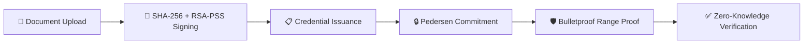
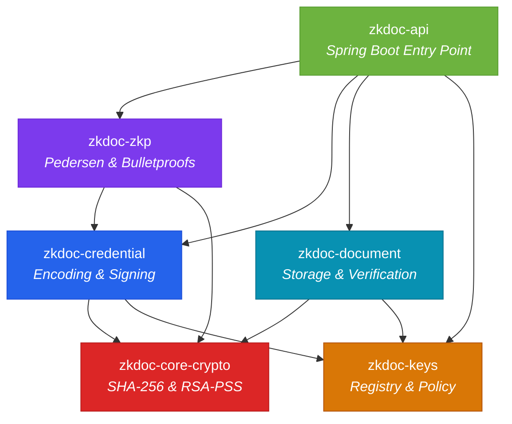
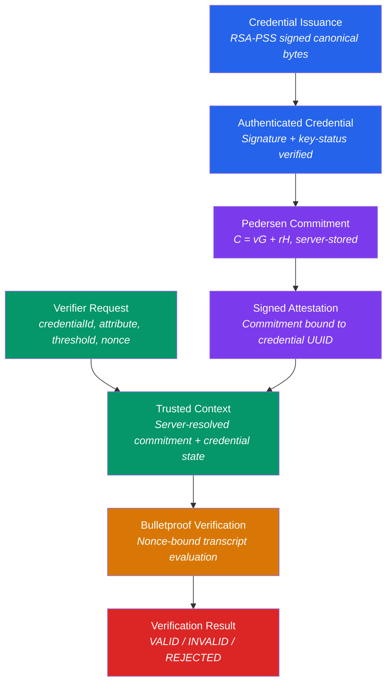

<div align="center">

# 🔐 Zero Knowledge Document Verification

**Privacy-preserving document and credential verification using real zero-knowledge cryptography**

[](https://openjdk.org/projects/jdk/21/)
[](https://spring.io/projects/spring-boot)
[](https://react.dev/)
[](https://www.sqlite.org/)
[](.)

<br/>

A multi-module Java platform implementing **Pedersen commitments**, **Bulletproof range proofs**, **RSASSA-PSS digital signatures**, and **minimal-disclosure verification capabilities** for enterprise-grade zero-knowledge document verification.

[Getting Started](#-getting-started) · [Architecture](#-architecture) · [API Reference](#-api-reference) · [Security](#-security-model)

</div>

---

## 📑 Table of Contents

- [Overview](#-overview)
- [Features](#-features)
- [Architecture](#-architecture)
- [Tech Stack](#-tech-stack)
- [Project Structure](#-project-structure)
- [Getting Started](#-getting-started)
- [Build & Test](#-build--test)
- [API Reference](#-api-reference)
- [Frontend](#-frontend)
- [Security Model](#-security-model)
- [Configuration](#-configuration)
- [Documentation](#-documentation)

---

## 🌐 Overview

`zkdoc-platform` is a **Java 21 / Spring Boot** multi-module foundation for zero-knowledge document and credential verification. It combines cryptographic document signing with a real predicate-proof layer, enabling a holder to prove properties about credential attributes (e.g., *"age ≥ 18"*) without revealing the underlying value.



> [!IMPORTANT]
> The implemented ZKP capability is specifically **`attribute >= threshold`** predicate proofs using real Bulletproof/range-proof construction. This project does not claim arbitrary ZKP support, universal selective disclosure, or properties that are not actually implemented and validated.

---

## ✨ Features

| Category | Feature | Description |
|:---------|:--------|:------------|
| 🔐 **Cryptography** | SHA-256 Document Hashing | Streaming, constant-memory document digest computation |
| | RSASSA-PSS Signatures | Document and credential signing with PSS padding |
| | Pedersen Commitments | `C = vG + rH` with fresh `SecureRandom` blinding per commitment |
| | Bulletproof Range Proofs | Real Weavechain Bulletproofs over Ristretto curve |
| 📄 **Documents** | Secure Upload & Storage | Content validation, magic-byte inspection, MIME spoofing defense |
| | Integrity Verification | SHA-256 digest comparison for upload-time and stored-copy checks |
| | Public Verification | Rate-limited opaque-token verification via QR codes |
| 📋 **Credentials** | Canonical Encoding | Versioned binary encoder: UTF-8 length-prefixed, sorted attributes, fixed-width timestamps |
| | Issuer Signing | RSA-PSS signature over canonical credential bytes |
| | Holder Credentials | Holder-to-credential binding with lifecycle management |
| 🛡️ **ZKP Predicates** | Statement Binding | Server-resolved trusted verification context (no caller-supplied commitments) |
| | Predicate Verification | `attribute >= threshold` proofs with nonce-bound Bulletproof transcripts |
| | Adversarial Hardening | 73+ tests covering replay, substitution, revocation, and boundary attacks |
| 📱 **QR Verification** | Capability Tokens | 256-bit opaque tokens — no secrets embedded in QR codes |
| | Camera Scanning | Browser-native QR scanning with explicit user consent |
| | Rate Limiting | 30 requests/minute per IP via Bucket4j in-memory limiter |
| 🔑 **Key Management** | Key Registry | Flyway-managed registry with ACTIVE / RETIRED / REVOKED lifecycle |
| | Key Purpose Policy | Separate purposes for DOCUMENT, CREDENTIAL, JWT, and COMMITMENT keys |
| | Trust Resolution | Active and retired keys verify; revoked keys fail verification |

---

## 🏗️ Architecture

### Module Dependency Graph



### Modules

| Module | Package | Responsibility |
|:-------|:--------|:---------------|
| **`zkdoc-core-crypto`** | `com.zkdoc.core.crypto` | Shared SHA-256 and RSA-PSS primitives |
| **`zkdoc-document`** | `com.zkdoc.document` | Document signing, artifact storage, content validation, and verification |
| **`zkdoc-credential`** | `com.zkdoc.credential` | Canonical credential encoding, signing, and holder credential lifecycle |
| **`zkdoc-zkp`** | `com.zkdoc.zkp` | Pedersen commitments, Bulletproof predicate engine, holder proof generation, and statement binding |
| **`zkdoc-keys`** | `com.zkdoc.keys` | Signing-key registry, status policy, trust resolution, and key lifecycle |
| **`zkdoc-api`** | `com.zkdoc.api` | Spring Boot entry point, HTTP API, SQLite/PostgreSQL config, Flyway migrations, security filters |

### Cryptographic Trust Chain



---

## 🛠️ Tech Stack

### Backend

| Technology | Version | Purpose |
|:-----------|:--------|:--------|
| Java | 21 | Language runtime and compiler target |
| Spring Boot | 3.4.3 | Application framework and dependency management |
| Spring Security | *(managed)* | JWT-based role authorization |
| SQLite JDBC | 3.47.2.0 | Default embedded database |
| PostgreSQL | 42.7.5 | Production database driver |
| Flyway | *(managed)* | Schema migration management |
| Weavechain Bulletproofs | 1.0.11 | Ristretto Pedersen commitments and range proofs |
| ZXing | 3.5.3 | QR code generation (server-side) |
| Bucket4j | 8.10.1 | In-memory rate limiting |
| ArchUnit | 1.3.0 | Architecture rule enforcement (test) |
| Testcontainers | 1.20.5 | Integration testing infrastructure |

### Frontend

| Technology | Purpose |
|:-----------|:--------|
| React 18 | UI framework |
| TypeScript | Type-safe development |
| Vite | Build tooling and dev server |
| TailwindCSS | Utility-first styling |
| ZXing Browser | Client-side QR code scanning |
| Lucide Icons | Icon library |

---

## 📁 Project Structure

```
Zero Knowledge Document Verification/
├── 📄 pom.xml                          # Parent POM (reactor build)
├── 📄 README.md
├── 📄 SECURITY.md
├── 📄 Dockerfile
├── 📄 docker-compose.yml
│
├── 🔴 zkdoc-core-crypto/              # Shared cryptographic primitives
│   └── src/main/java/com/zkdoc/core/crypto/
│
├── 🔵 zkdoc-document/                 # Document lifecycle & storage
│   └── src/main/java/com/zkdoc/document/
│       ├── storage/                    # Content validation & artifact storage
│       ├── DocumentUploadService.java
│       ├── Sha256Hasher.java
│       └── RsaPssSigner.java
│
├── 🟡 zkdoc-keys/                     # Key registry & trust policy
│   └── src/main/java/com/zkdoc/keys/
│       ├── KeyRegistryService.java
│       ├── KeyTrustResolver.java
│       └── RegisteredKey.java
│
├── 🔵 zkdoc-credential/               # Credential encoding & signing
│   └── src/main/java/com/zkdoc/credential/
│       ├── CredentialService.java
│       ├── CanonicalCredentialEncoder.java
│       └── HolderCredentialService.java
│
├── 🟣 zkdoc-zkp/                      # Zero-knowledge proof layer
│   └── src/main/java/com/zkdoc/zkp/
│       ├── engine/                     # Bulletproof predicate engine
│       ├── binding/                    # Trusted statement verification
│       ├── holder/                     # Holder proof generation
│       ├── PedersenCommitmentService.java
│       └── CredentialPredicateVerifier.java
│
├── 🟢 zkdoc-api/                      # Spring Boot application
│   └── src/main/
│       ├── java/com/zkdoc/api/
│       │   ├── document/              # Document upload controller
│       │   ├── credential/            # Credential issuance controller
│       │   ├── zkp/                   # Predicate verification controller
│       │   ├── holder/                # Holder operations controller
│       │   ├── qr/                    # QR generation controller
│       │   ├── publicverify/          # Public verification controller
│       │   ├── security/              # Security config & rate limiting
│       │   └── audit/                 # Verification audit logging
│       └── resources/
│           └── db/migration/
│               ├── sqlite/            # V1–V10 SQLite migrations
│               └── postgresql/        # V1–V5 PostgreSQL migrations
│
├── 🌐 frontend/                       # React / TypeScript SPA
│   └── src/
│       ├── app/                       # App shell, routing, providers
│       ├── components/                # UI component library
│       ├── features/                  # Feature modules
│       │   ├── verification/          # QR scanning & public verification
│       │   ├── dashboard/             # Overview & health status
│       │   └── administration/        # Platform operations page
│       └── lib/                       # API client & utilities
│
└── 📚 docs/                           # Architecture & security docs
    ├── architecture/                  # 22 architecture documents
    ├── decisions/                     # Architecture decision records
    ├── development/                   # Development guides
    └── security/                      # Threat models & security analysis
```

---

## 🚀 Getting Started

### Prerequisites

| Requirement | Details |
|:------------|:--------|
| **Java 21** | JDK 21 or later. The project and compiler release are pinned to 21 |
| **Maven** | Bundled via Maven Wrapper (`mvnw` / `mvnw.cmd`) — no separate installation needed |
| **Node.js** | Automatically installed by `frontend-maven-plugin` during build |

### Setup in IntelliJ IDEA

1. **Import Project** — Open the root `pom.xml` as a Maven project and allow Maven synchronization to finish

2. **Configure SDK** — In **File → Project Structure → Project**, select an OpenJDK 21 SDK (or download/add one). Set the language level to **21**

3. **Maven Settings** — In **Settings → Build Tools → Maven**, use IntelliJ IDEA's bundled Maven. No separate Maven installation is necessary

4. **Build Frontend** — Run Maven `generate-resources` or `package` once after frontend changes. The `zkdoc-api` build installs its pinned Node/npm toolchain, runs `npm ci`, and writes the production React bundle into the API's static resources

5. **Run Application** — Open `zkdoc-api/src/main/java/com/zkdoc/api/Application.java` and run that class. It is the only class with a `main()` method and the only supported application entry point

6. **Open Browser** — Navigate to `http://localhost:8080` for the integrated application

> [!NOTE]
> The application starts with SQLite at `./data/zkdoc.db`. Flyway creates or upgrades that file at startup. The checked-in application configuration does not read a `.env` file and does not use PostgreSQL credentials.

### Verify the Running API

```powershell
Invoke-RestMethod http://localhost:8080/api/health
```

**Expected response:**

```json
{"status":"ok"}
```

---

## 🧪 Build & Test

### Command Reference

| Action | Command | Description |
|:-------|:--------|:------------|
| **Run all tests** | `mvnw.cmd test` | Executes the full test suite across all 6 modules |
| **Package** | `mvnw.cmd package` | Builds the complete multi-module package including frontend |
| **IntelliJ: Test** | Maven tool window → **Lifecycle → test** | Same as terminal, from the IDE |
| **IntelliJ: Package** | Maven tool window → **Lifecycle → package** | Same as terminal, from the IDE |

### Test Suite

The project includes **73+ tests** across 7 reactor modules with **0 failures, 0 errors**:

| Module | Test Focus |
|:-------|:-----------|
| `zkdoc-core-crypto` | SHA-256 hashing correctness, RSA-PSS signature round-trips |
| `zkdoc-document` | Document upload, verification, content validation, artifact storage security |
| `zkdoc-keys` | Key lifecycle (ACTIVE → RETIRED → REVOKED), fingerprinting, trust resolution |
| `zkdoc-credential` | Canonical encoding/decoding, credential issuance security, holder credential binding |
| `zkdoc-zkp` | Pedersen commitment properties, Bulletproof engine, holder proof generation, adversarial invariants |
| `zkdoc-api` | Security authorization, predicate verification boundary, QR capability, rate limiting |

The predicate integration suite logs each security case as `CASE <name>: PASS` or `CASE <name>: FAIL (...)`. It covers both accepted predicates (equal-to and above threshold) and rejected proofs, including wrong credentials, altered proofs or thresholds, replay with a different nonce, revoked/expired credentials, invalid signatures, and commitment substitution.

---

## 📡 API Reference

### Authentication

All non-public routes require a **Bearer JWT** with one of these roles:

| Role | Permissions |
|:-----|:------------|
| `ISSUER` | Document upload, credential issuance, QR generation |
| `HOLDER` | Holder credential operations, capability management |
| `VERIFIER` | Predicate proof verification |
| `ADMIN` | Key management, administrative operations |

### Endpoints

<details>
<summary><strong>📄 Document Operations</strong></summary>

| Method | Endpoint | Auth | Description |
|:-------|:---------|:-----|:------------|
| `POST` | `/api/documents` | `ISSUER` | Upload a document (multipart `file`). Stores file bytes, SHA-256 digest, RSA-PSS signature, and UUID |
| `GET` | `/api/documents/{id}/verify` | Authenticated | Verify the stored document copy |
| `POST` | `/api/documents/{id}/verify-upload` | Authenticated | Independently hash a newly uploaded `file` against the stored digest |

</details>

<details>
<summary><strong>📋 Credential Operations</strong></summary>

| Method | Endpoint | Auth | Description |
|:-------|:---------|:-----|:------------|
| `POST` | `/api/credentials` | `ISSUER` | Create an issuer-signed credential with versioned canonical encoding |
| `GET` | `/api/credentials/{id}/verify` | Authenticated | Verify a credential's RSA-PSS signature and key status |

</details>

<details>
<summary><strong>🛡️ Zero-Knowledge Predicate Verification</strong></summary>

| Method | Endpoint | Auth | Description |
|:-------|:---------|:-----|:------------|
| `POST` | `/api/v2/zkp/credential-predicates/verify` | `VERIFIER` | Verify a predicate proof. Accepts only proof version, credential ID, attribute name, threshold, verifier nonce, and proof bytes. Server resolves the commitment internally |

> [!IMPORTANT]
> The verifier API never accepts the hidden value, blinding factor, or a caller-supplied commitment. The server obtains the issuer-signed commitment itself, binds the nonce into the Bulletproof transcript, and evaluates the proof against its own trusted verification context.

</details>

<details>
<summary><strong>📱 QR & Public Verification</strong></summary>

| Method | Endpoint | Auth | Description |
|:-------|:---------|:-----|:------------|
| `GET` | `/api/documents/{id}/qr` | `ISSUER` | Generate a PNG QR code encoding a public verification URL |
| `GET` | `/api/public/verify/{token}` | Public | Verify a document via opaque 256-bit token. Returns only `signatureValid` and `documentActive` |
| `POST` | `/api/capabilities` | `ISSUER` / `HOLDER` | Create a verification capability token |
| `GET` | `/api/capabilities/{token}` | Public | Resolve a capability for public verification |

> [!NOTE]
> The QR token is a separate 256-bit opaque value, not a document UUID. Public verification is rate-limited to **30 requests/minute per IP**. Set `ZKDOC_PUBLIC_VERIFICATION_BASE_URL` to give QR codes a deployed external base URL.

</details>

<details>
<summary><strong>👤 Holder Operations</strong></summary>

| Method | Endpoint | Auth | Description |
|:-------|:---------|:-----|:------------|
| `POST` | `/api/holder/credentials` | `HOLDER` / `ADMIN` | Bind a credential to a holder |
| `POST` | `/api/holder/proofs/generate` | `HOLDER` / `ADMIN` | Generate a predicate proof from holder-controlled proving material |

</details>

<details>
<summary><strong>🔑 Administration</strong></summary>

| Method | Endpoint | Auth | Description |
|:-------|:---------|:-----|:------------|
| `*` | `/api/admin/keys` | `ADMIN` | Key registration and status mutation |
| `GET` | `/api/health` | Public | Health check endpoint |

</details>

---

## 🌐 Frontend

The [`frontend/`](frontend/) application provides a responsive React shell, design system, typed API client, health indicator, and the public verification page.

### Pages

| Route | Feature |
|:------|:--------|
| `/` | Dashboard with backend health status |
| `/verify` | Public verification — accepts opaque token or scans QR code |
| `/credentials` | Credential management *(placeholder)* |
| `/verification` | Verification operations *(placeholder)* |
| `/predicate-verification` | Predicate verification *(placeholder)* |
| `/audit-logs` | Audit log viewer *(placeholder)* |
| `/administration` | Platform operations — documents real operational boundaries |

### Development Server

With the backend running on port 8080:

```powershell
Set-Location frontend
npm ci
Copy-Item .env.example .env.local
npm run dev
```

Open `http://localhost:5173`. Vite proxies same-origin `/api` requests to the backend because the current Spring configuration does not enable cross-origin browser access.

> [!TIP]
> This is an **optional development workflow**. Normal use starts from `Application.java` and opens `http://localhost:8080` — the production React bundle is built into and served by `zkdoc-api` automatically.

### Frontend Limitations

The public verification page accepts the opaque token or the exact verification URL emitted by a document QR code. Camera scanning starts only after explicit user action, decodes locally, and releases the stream after a scan, user stop, or navigation.

Authenticated document/credential verification is not exposed because the repository has no frontend authentication provider or configured external JWT issuer. Predicate verification remains restricted to the backend's `VERIFIER` role, and verification history is absent because there is no history-read API. See [`frontend/README.md`](frontend/README.md) for QR requirements, exact result semantics, tests, build integration, and deferred features.

---

## 🔒 Security Model

### Authorization Matrix

| Route Pattern | Required Role | Notes |
|:--------------|:-------------|:------|
| `/api/public/**` | None | Rate-limited public verification |
| `/api/documents` (POST) | `ISSUER` | Document upload |
| `/api/credentials` (POST) | `ISSUER` | Credential issuance |
| `/api/capabilities/**` | `ISSUER` / `HOLDER` / `ADMIN` | Verification capability management |
| `/api/v2/zkp/credential-predicates/**` | `VERIFIER` | Predicate proof verification |
| `/api/holder/**` | `HOLDER` / `ADMIN` | Holder operations |
| `/api/admin/**` | `ADMIN` | Administrative operations |

### Cryptographic Commitments

For integer attributes, `zkdoc-zkp` creates a Weavechain Bulletproofs Ristretto Pedersen commitment `C = vG + rH`:

- `r` is a **new `SecureRandom` value** for every commitment, never derived from `v`
- The SHA-256 fingerprint of `r` is checked against prior values before storage
- The **raw blinding factor is never persisted** — only the commitment bytes
- The issuer signs a canonical attestation binding the commitment bytes to the credential UUID and attribute name

### Security Boundaries

> [!CAUTION]
> See [SECURITY.md](SECURITY.md) for the precise security boundary, including the fact that private keys are environment-injected files rather than HSM-backed, and that local SQLite is not a production multi-node datastore.

**Key security properties:**

- Verification attempts are audited without recording sensitive payloads
- Audit events are write-only application metadata, not a tamper-proof ledger
- The backend has no profile, password, user, role, session, audit-read/export, or summary endpoints
- Key registration and status mutation are backend-only (`/api/admin/keys`)

---

## ⚙️ Configuration

### Runtime Defaults

| Property | Default | Description |
|:---------|:--------|:------------|
| Database | SQLite at `./data/zkdoc.db` | Flyway auto-creates/upgrades on startup |
| Server Port | `8080` | Spring Boot default |
| Public Verification URL | `http://localhost:8080` | Override with `ZKDOC_PUBLIC_VERIFICATION_BASE_URL` |
| Rate Limit | 30 req/min per IP | Public verification endpoint |

### Environment Variables

| Variable | Required | Description |
|:---------|:---------|:------------|
| `ZKDOC_PUBLIC_VERIFICATION_BASE_URL` | No | External base URL for QR code generation |

### Database Profiles

| Database | Migrations | Notes |
|:---------|:-----------|:------|
| **SQLite** *(default)* | `V1`–`V10` in `db/migration/sqlite/` | Embedded, zero-config for development |
| **PostgreSQL** | `V1`–`V5` in `db/migration/postgresql/` | Production-grade, requires connection config |

---

## 📚 Documentation

Comprehensive architecture and security documentation is available in the [`docs/`](docs/) directory:

<details>
<summary><strong>📐 Architecture Documents (22 files)</strong></summary>

| Document | Topic |
|:---------|:------|
| `system-architecture.md` | System-level architecture overview |
| `module-boundaries.md` | Module separation and dependency rules |
| `cryptographic-architecture.md` | Cryptographic primitive selection and usage |
| `zkp-architecture.md` | Zero-knowledge proof layer design |
| `zkp-proving-boundary.md` | Holder proving boundary specification |
| `predicate-verification-boundary.md` | Verifier boundary hardening |
| `attribute-commitments.md` | Pedersen commitment construction |
| `credential-model.md` | Credential domain model |
| `credential-issuance.md` | Issuance workflow |
| `credential-signing.md` | Signing architecture |
| `canonicalization-spec.md` | Canonical encoding specification |
| `holder-credentials.md` | Holder credential binding |
| `domain-model.md` | Core domain entities |
| `persistence-model.md` | Data persistence strategy |
| `storage-architecture.md` | Storage layer design |
| `document-security-and-storage.md` | Document lifecycle security |
| `verification-architecture.md` | Verification flow design |
| `qr-and-public-verification-architecture.md` | QR capability architecture |
| `key-management-architecture.md` | Key management design |
| `trust-model.md` | Trust chain model |
| `trust-registry.md` | Trust registry design |
| `deployment-architecture.md` | Deployment topology |

</details>

<details>
<summary><strong>🔐 Security Documents (14 files)</strong></summary>

| Document | Topic |
|:---------|:------|
| `threat-model.md` | Comprehensive threat model |
| `abuse-model.md` | Abuse scenario analysis |
| `security-requirements.md` | Security requirements specification |
| `security-claims.md` | Explicit security claims and limitations |
| `privacy-requirements.md` | Privacy design requirements |
| `attribute-privacy-model.md` | Attribute-level privacy analysis |
| `credential-security.md` | Credential security boundaries |
| `credential-authenticity.md` | Credential authenticity guarantees |
| `credential-issuance-threats.md` | Issuance threat analysis |
| `credential-verification.md` | Verification security model |
| `holder-security-model.md` | Holder security boundary |
| `key-security.md` | Key material security |
| `key-compromise-response.md` | Key compromise response procedures |
| `secure-development-baseline.md` | Secure development practices |

</details>

<details>
<summary><strong>🧑‍💻 Development Guides (4 files)</strong></summary>

| Document | Topic |
|:---------|:------|
| `local-development.md` | Local environment setup |
| `configuration.md` | Configuration reference |
| `database-development.md` | Database schema and migration guide |
| `testing.md` | Testing strategy and conventions |

</details>

<details>
<summary><strong>📝 Architecture Decision Records</strong></summary>

| Document | Topic |
|:---------|:------|
| `architecture-decision-records.md` | Key architecture decisions and rationale |

</details>

---

## ⚠️ Known Limitations

| Area | Limitation |
|:-----|:-----------|
| **ZKP Scope** | Only `attribute >= threshold` predicates are supported. No arbitrary circuit ZKP, selective disclosure, or unlinkability |
| **Key Storage** | Private keys are environment-injected files, not HSM-backed |
| **Database** | SQLite is the default — not suitable for production multi-node deployments |
| **Frontend Auth** | No frontend authentication provider or external JWT issuer configured |
| **Audit Log** | Write-only application metadata, not a tamper-proof ledger |
| **Dependencies** | The Weavechain Bulletproofs dependency requires JitPack. Its incompatible unused Caffeine transitive declaration is excluded |

---

<div align="center">

**Built with ❤️ using Java 21, Spring Boot, and real zero-knowledge cryptography**

[⬆ Back to Top](#-zero-knowledge-document-verification)

</div>
