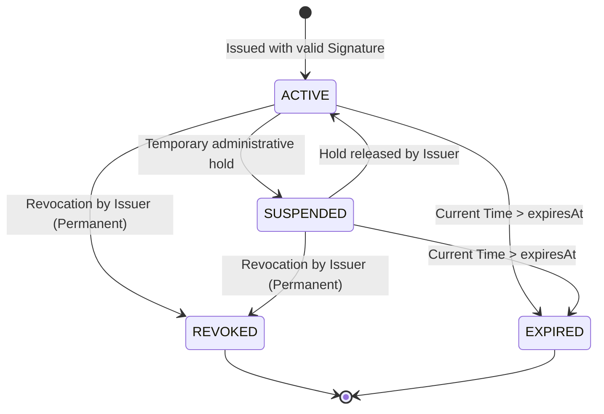

# Zero-Knowledge Document Verification Platform
## Credential Model & Entity Domain Boundaries

**Document Version:** 1.0.0  
**Status:** Approved Architectural Baseline  
**Phase:** Phase 0 — Architecture & Security Baseline  

---

### 1. Distinct Domain Entity Boundaries

To maintain strict conceptual integrity and prevent security boundary confusion, the platform defines distinct entities across separate database tables and Java domain types. **Collapsing these entities into a single generic record is strictly prohibited.**

```
+-------------------------------------------------------------+
|                          Document                           |
|  (File Metadata, Storage URI, MimeType, Size, Public Token) |
+-------------------------------------------------------------+
                               |
                               v
+-------------------------------------------------------------+
|                      Document Artifact                      |
|           (Raw File Bytes, SHA-256 Digest, RSA-PSS Sig)     |
+-------------------------------------------------------------+

---------------------------------------------------------------

+-------------------------------------------------------------+
|                         Credential                          |
|    (ID, IssuerID, KeyID, Version, Dates, Status, SchemaID)  |
+-------------------------------------------------------------+
                               |
            +------------------+------------------+
            | 1..*                                | 1..1
            v                                     v
+-----------------------+              +----------------------+
|  CredentialAttribute  |              |   SignedCredential   |
| (Name, Type, RawVal)  |              | (CanonicalBytes,     |
+-----------------------+              |  SHA-256 Digest,     |
            |                          |  RSA-PSS Signature)  |
            | 1..1                     +----------------------+
            v
+-------------------------------------------------------------+
|                     AttributeCommitment                     |
|            (Commitment Point C, Version, Salt Hash)         |
+-------------------------------------------------------------+
                               |
                               v
+-------------------------------------------------------------+
|                    CommitmentAttestation                    |
|       (Issuer Signature over CredID + AttrName + C)         |
+-------------------------------------------------------------+

---------------------------------------------------------------

+-------------------------------------------------------------+
|                     VerificationSession                     |
|           (Session ID, Verifier Nonce, ExpiresAt)           |
+-------------------------------------------------------------+
                               |
                               v
+-------------------------------------------------------------+
|                   PredicateProofSubmission                  |
|    (Proof Bytes, Shifted Commitment C', Verification Result)|
+-------------------------------------------------------------+
```

---

### 2. Credential Schema & Fields

A production Verifiable Credential consists of the following immutable fields:

| Field | Type | Description |
| :--- | :--- | :--- |
| `id` | `UUID` (128-bit) | Globally unique identifier of the credential. |
| `schemaId` | `String` (URI/URN) | Strict schema definition identifier (e.g., `urn:zkdoc:schema:employment-credential:v1`). |
| `issuerId` | `String` (URI/URN) | Authoritative identifier of the issuing authority. |
| `issuerKeyId` | `UUID` / `String` | Identifier of the registered public key used to sign the credential. |
| `version` | `Integer` | Internal credential structure version (Baseline: `1`). |
| `issuedAt` | `Instant` (UTC) | Exact ISO-8601 UTC timestamp of issuance. |
| `expiresAt` | `Instant` (UTC) | Expiration timestamp after which the credential is invalid. |
| `status` | `CredentialStatus` | Lifecycle state: `ACTIVE`, `SUSPENDED`, `REVOKED`, `EXPIRED`. |
| `attributes` | `List<CredentialAttribute>`| Ordered list of named attributes. |
| `canonicalDigest` | `byte[32]` | SHA-256 hash of the canonical binary encoding. |
| `signature` | `byte[]` | RSASSA-PSS digital signature over `canonicalDigest`. |

---

### 3. Credential Attribute Schema

Each attribute within a credential is typed explicitly:

```java
public record CredentialAttribute(
    String name,           // ASCII identifier (e.g., "annualIncome")
    AttributeType type,    // INTEGER, STRING, BOOLEAN, DATE
    String rawValue        // String representation normalized per type rules
) {}
```

#### Supported Types for Commitments:
* Only `INTEGER` attributes (64-bit unsigned integers, $v \in [0, 2^{64}-1]$) are eligible for Pedersen commitments and Bulletproof range proofs in Phase 0/Phase 1.
* Any request to commit a `STRING` or `BOOLEAN` is rejected during validation.

---

### 4. Credential Lifecycle State Machine

The lifecycle of a credential is governed by a strict transition matrix:



* **Verification Rule:** Verification succeeds **only** when `status == ACTIVE` AND `now() < expiresAt`.
* Revocation is irreversible. A revoked credential can never re-enter the `ACTIVE` state.
