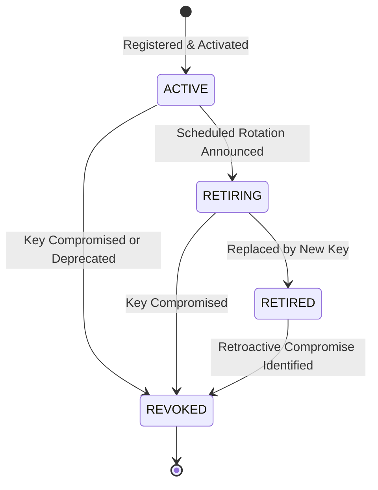

# Zero-Knowledge Document Verification Platform
## Cryptographic Key Management & Lifecycle Architecture

**Document Version:** 1.0.0  
**Status:** Approved Architectural Baseline  
**Phase:** Phase 0 — Architecture & Security Baseline  

---

### 1. Key Purpose Segregation

To uphold the principle of least privilege and prevent cross-protocol key confusion attacks, cryptographic keys are strictly partitioned by dedicated **Key Purpose**:

```
+--------------------------------------------------------------------------+
|                        Key Purpose Architecture                          |
+--------------------------------------------------------------------------+
|  1. JWT_SIGNING                    | Signs API authentication bearer JWTs|
|  2. DOCUMENT_SIGNING               | Signs SHA-256 document digests      |
|  3. CREDENTIAL_SIGNING             | Signs canonical credential digests  |
|  4. COMMITMENT_ATTESTATION_SIGNING | Signs Pedersen commitment bindings  |
+--------------------------------------------------------------------------+
```

* **Security Invariant:** A public key registered for `DOCUMENT_SIGNING` cannot be accepted to verify a credential signature. A key registered for `JWT_SIGNING` cannot be used to verify documents.

---

### 2. Key Lifecycle State Machine

Keys progress through four distinct lifecycle states:



| Key Status | Can Sign New Records? | Can Verify Historical Signatures? | Typical Duration |
| :--- | :--- | :--- | :--- |
| **`ACTIVE`** | **YES** | **YES** | 90 to 365 days |
| **`RETIRING`** | Transitional (Grace Period) | **YES** | 14 to 30 days |
| **`RETIRED`** | **NO (Forbidden)** | **YES (Valid for past records)** | Permanent (Archival) |
| **`REVOKED`** | **NO (Forbidden)** | **NO (Fails all verifications)** | Permanent (Blacklisted) |

#### 2.1. Historical Verification Policy
* Documents and credentials signed by a key during its `ACTIVE` period remain cryptographically valid after the key transitions to `RETIRED`.
* When a key transitions to `REVOKED` (e.g., due to private key compromise), **all** verification attempts against signatures made by that key immediately fail-closed.

---

### 3. Key Registry Schema & Metadata

The public key registry is maintained in the `key_registry` table in PostgreSQL:

| Field | Type | Description |
| :--- | :--- | :--- |
| `id` | `UUID` | Unique identifier for the key record. |
| `key_id` | `VARCHAR(64)` | Human/system key identifier (e.g., `iss-doc-2026-q1`, or JWT `kid`). |
| `owner_id` | `VARCHAR(128)` | Identity of key owner (e.g., `urn:zkdoc:issuer:government-auth`). |
| `purpose` | `VARCHAR(32)` | Enum: `JWT_SIGNING`, `DOCUMENT_SIGNING`, `CREDENTIAL_SIGNING`, `COMMITMENT_ATTESTATION_SIGNING`. |
| `algorithm` | `VARCHAR(32)` | Enum: `RSA_PSS_SHA256`, `ED25519`. |
| `public_key_pem` | `TEXT` | PEM-encoded X.509 SubjectPublicKeyInfo public key. |
| `status` | `VARCHAR(16)` | Enum: `ACTIVE`, `RETIRING`, `RETIRED`, `REVOKED`. |
| `created_at` | `TIMESTAMP WITH TIME ZONE` | Creation timestamp (UTC). |
| `activated_at` | `TIMESTAMP WITH TIME ZONE` | Activation timestamp (UTC). |
| `retired_at` | `TIMESTAMP WITH TIME ZONE` | Optional retirement timestamp (UTC). |
| `revoked_at` | `TIMESTAMP WITH TIME ZONE` | Optional revocation timestamp (UTC). |
| `revocation_reason` | `TEXT` | Audit reason if revoked. |
| `replacement_key_id` | `VARCHAR(64)` | Identifier of successor key upon retirement. |

---

### 4. Private Key Custody & Production Hardware Separation

* **No Private Keys in Database:** The PostgreSQL database **never** contains private keys, secret seeds, or key generation seeds.
* **Environment Separation:**
  * **Local Development / CI:** Private keys are injected as external file paths or environment variables (`ZKDOC_SIGNING_KEY_FILE`).
  * **Production:** Private keys are managed via AWS KMS / CloudHSM / HashiCorp Vault. Signature generation delegates to the KMS/HSM boundary, and only public keys are exported to the platform registry.
* **Prohibited Behavior:** In-memory ephemeral key generation at server startup (which breaks persistence across restarts) is explicitly prohibited in production configurations.
