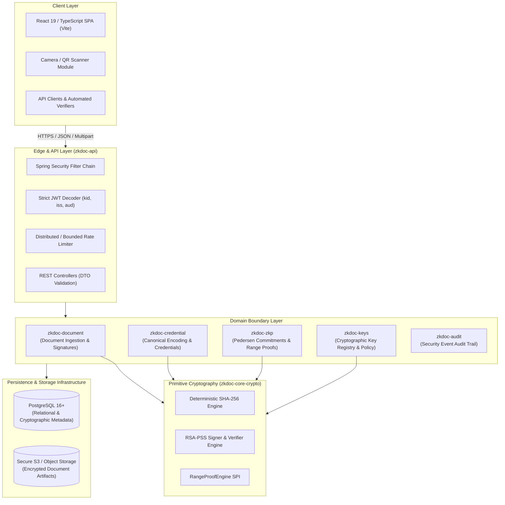

# Zero-Knowledge Document Verification Platform
## System Architecture Specification

**Document Version:** 1.0.0  
**Status:** Approved Architectural Baseline  
**Phase:** Phase 0 — Architecture & Security Baseline  

---

### 1. Executive Summary & Purpose

The **Zero-Knowledge Document Verification Platform** (`zkdoc-platform`) is an enterprise-grade, privacy-preserving verification platform engineered to guarantee document integrity, document authenticity, credential authenticity, and cryptographic attribute verification.

The platform provides a dual-engine verification capability:
1. **Public Document Verification:** Deterministic SHA-256 content digesting combined with RSA-PSS digital signatures, accessible via QR capability tokens without leaking underlying document contents.
2. **Privacy-Preserving Credential Verification:** Zero-Knowledge Proof (ZKP) verification enabling credential holders to prove numeric threshold predicates (specifically: $\text{attribute} \ge \text{threshold}$) using Ristretto255 Pedersen commitments and Bulletproof range proofs without revealing raw attribute values, blinding factors, or witnesses to the verifier or platform.

---

### 2. Architectural Style: Modular Monolith

To avoid premature distributed systems complexity while enforcing strict domain decoupling, the system is architected as a **strictly partitioned Modular Monolith** with unidirectional dependency flows and explicit interface boundaries.

---

### 3. Module Boundaries & Responsibilities

| Module Name | Responsibilities | Forbidden Operations |
| :--- | :--- | :--- |
| `zkdoc-core-crypto` | Pure cryptographic primitives: SHA-256 byte hashing, RSA-PSS signature creation and verification, `RangeProofEngine` SPI interface, SecureRandom management. | No Spring framework dependencies, no database access, no network access, no domain model awareness. |
| `zkdoc-document` | Document metadata handling, upload stream digesting, document signing, artifact verification flows, public QR token generation. | Direct database table creation (handled by Flyway in API), no exposure of document plaintext in public endpoints. |
| `zkdoc-credential` | Credential schema enforcement, deterministic binary canonical encoding, issuer signing, credential digest generation, lifecycle management. | No reflection-based serialization, no reliance on JSON stringification for signature digests. |
| `zkdoc-zkp` | Pedersen commitment generation ($C = vG + rH$), commitment attestation creation, Bulletproof range proof verification wrapper, transcript challenge binding. | Never persist raw blinding factors, never store witnesses in database, never accept caller-supplied unauthenticated commitments. |
| `zkdoc-keys` | Cryptographic key registry, key purpose segregation, key lifecycle state machine (`ACTIVE`, `RETIRING`, `RETIRED`, `REVOKED`), historical signature validation policies. | In-memory ephemeral key generation in production; never expose private key bytes via APIs. |
| `zkdoc-api` | HTTP REST endpoints, request DTO validation, Spring Security JWT authentication and RBAC, Flyway migrations, rate limiting, exception mapping, SPA serving. | Direct cryptographic mathematics; all crypto must delegate to dedicated domain modules. |

---

### 4. Component Interaction & Data Flow

#### 4.1. Public Document Verification Flow
1. Verifier scans QR code containing an opaque capability token: `GET /api/public/verify/{token}`.
2. `zkdoc-api` validates token format and applies client rate limits.
3. `zkdoc-document` resolves the document record matching the token from PostgreSQL.
4. `zkdoc-keys` retrieves the registered public key for `DOCUMENT_SIGNING` active or retired at issuance time.
5. `zkdoc-core-crypto` verifies the RSA-PSS signature against the recorded SHA-256 digest.
6. Return minimal status: `{"signatureValid": true, "documentActive": true}`. Raw document bytes, hashes, and issuer internal identities are **not** disclosed.

#### 4.2. ZKP Predicate Verification Flow ($\text{attribute} \ge \text{threshold}$)
1. Verifier initiates verification session or supplies nonce challenge.
2. Holder submits proof payload: `{ credentialId, attributeName, threshold, nonce, proofBytes }`.
3. `zkdoc-credential` confirms credential validity and lifecycle state (`ACTIVE`).
4. `zkdoc-zkp` resolves the **authenticated commitment** and issuer attestation directly from database (refusing any caller-supplied commitment point).
5. `zkdoc-keys` verifies issuer's attestation signature over the commitment.
6. `zkdoc-zkp` calculates the shifted commitment $C' = C - \text{threshold} \cdot G$.
7. `RangeProofEngine` verifies that $C'$ commits to a value in $[0, 2^{64}-1]$ with the verifier nonce bound into the Fiat-Shamir transcript.
8. `zkdoc-api` logs audit event and returns structured result.

---

### 5. Deployment Architecture & Infrastructure

- **Container Runtime:** Docker OCI-compliant container running OpenJDK 21 LTS headless distroless / alpine base.
- **Relational Store:** PostgreSQL 16+ with SSL enforced, connection pooling via HikariCP, Flyway migration versioning.
- **Object Storage:** AWS S3 or MinIO S3-compatible bucket with Server-Side Encryption (KMS/SSE-S3), private access control, and SHA-256 checksum verification on read.
- **Network Boundaries:** TLS 1.3 termination at Reverse Proxy / Ingress; strict CORS policy; internal database and object storage isolated on private VPC subnet.
