# Zero-Knowledge Document Verification Platform
## Trust Model & Security Boundaries

**Document Version:** 1.0.0  
**Status:** Approved Architectural Baseline  
**Phase:** Phase 0 — Architecture & Security Baseline  

---

### 1. Actor Definitions & Trust Roles

The platform defines four primary actors with strict segregation of cryptographic custody and authorization privileges.

```mermaid
flowchart LR
    subgraph ISSUER_ACTOR ["Issuer (Trusted Authority)"]
        IssuerKey["Private Signing Keys"]
        Issuance["Signs Credentials & Attestations"]
    end

    subgraph HOLDER_ACTOR ["Holder (Credential Owner)"]
        HolderWallet["Private Proving Material (r, witness)"]
        ProofGen["Generates Bulletproof Range Proofs"]
    end

    subgraph PLATFORM_ACTOR ["Platform (Untrusted Host / State Verifier)"]
        Registry["Key & Credential Registry (PostgreSQL)"]
        Storage["Encrypted Artifact Storage (S3)"]
        Audit["Audit Logger"]
    end

    subgraph VERIFIER_ACTOR ["Verifier (Relying Party)"]
        ChallengeGen["Generates Nonce / Predicate Request"]
        VerificationReq["Submits Proof & Verifies Results"]
    end

    ISSUER_ACTOR -->|Submits Signed Metadata| PLATFORM_ACTOR
    ISSUER_ACTOR -->|Delivers Credential + Secrets| HOLDER_ACTOR
    HOLDER_ACTOR -->|Presents Zero-Knowledge Proof| VERIFIER_ACTOR
    VERIFIER_ACTOR -->|Queries Public Verification| PLATFORM_ACTOR
```

#### 1.1. Issuer (Trusted Authority)
* **Role:** Originator of authoritative documents and verifiable credentials.
* **Responsibilities:** Creates credentials, defines attributes, commits to numeric values ($C = vG + rH$), signs credentials with RSA-PSS, signs commitment attestations, manages issuer private keys.
* **Trust Level:** Authoritative for issued statements. Assumed not to create fraudulent claims about attributes under its remit.

#### 1.2. Holder (Subject / Credential Owner)
* **Role:** Individual or entity to whom a credential or document pertains.
* **Responsibilities:** Receives credential metadata and private proving material (secret blinding factor $r$ and attribute value $v$). Controls proof generation.
* **Trust Level:** **Untrusted.** May attempt to forge proofs, manipulate thresholds, swap commitments, or prove predicates for values below threshold.

#### 1.3. Verifier (Relying Party)
* **Role:** Party requiring cryptographic assurance of a claim (e.g., verifying a document's validity or asserting $\text{attribute} \ge \text{threshold}$).
* **Responsibilities:** Defines the predicate and threshold, issues verification challenges (nonces), validates proof outcomes.
* **Trust Level:** **Semi-trusted.** Verifier is untrusted with private data; must receive only minimum disclosure and zero knowledge of raw attributes.

#### 1.4. Platform (Application & Infrastructure Operator)
* **Role:** The service hosting the API, database, and public verification routing.
* **Responsibilities:** Stores public metadata, resolves keys, checks signatures, computes shifted commitments, runs proof verification algorithms, logs audit events.
* **Critical Rule:** **The Platform is NOT the Holder.** The platform never holds custody of secret blinding factors or witnesses. An application login account does not substitute for cryptographic proof of ownership.

---

### 2. Formal Trust Boundaries & Non-Trust Guarantees

| Trust Boundary | What IS Trusted | What is NOT Trusted / Explicit Limitation |
| :--- | :--- | :--- |
| **Issuer ↔ Platform** | Issuer's public key (when validated against key registry). Cryptographic signatures produced by issuer. | Platform does not trust unsigned issuer requests. Platform does not custody issuer private keys in production database. |
| **Issuer ↔ Holder** | Holder trusts issuer's digital signature on the credential. Issuer trusts the initial attribute source. | Issuer cannot compel holder to disclose raw attribute once issued; Holder cannot tamper with signed attribute or commitment. |
| **Holder ↔ Platform** | Platform trusts mathematical proofs submitted by holder only after full cryptographic verification. | Platform **never** trusts holder claims without proofs. Platform never receives or stores holder's secret blinding factors ($r$) in persistent database. |
| **Holder ↔ Verifier** | Verifier trusts the mathematical validity of the zero-knowledge range proof. | Verifier **never** trusts holder's word; Verifier never learns $v$, $r$, or witness. |
| **Verifier ↔ Platform** | Verifier trusts platform to faithfully look up authenticated public commitments and run verification algorithms. | Verifier does not allow platform to alter verification rules; Verifier may independently run verification algorithm using public parameters. |
| **User Authentication ↔ Cryptographic Identity** | Spring Security JWT validates who is logged into the HTTP session (`ISSUER`, `ADMIN`, etc.). | JWT **never** substitutes for cryptographic signatures. An `ISSUER` session cannot issue a credential without valid RSA-PSS signature bytes. |
| **Application Authorization ↔ Issuer Trust** | RBAC controls access to endpoints. | RBAC permissions do not confer cryptographic trust. Only valid signatures tied to registered keys establish trust. |
| **Database ↔ Cryptographic Trust** | Database provides storage and indexing of metadata. | Database is **untrusted** for cryptographic integrity. If a database record is tampered with, signature and hash verification fail-closed. |
| **Object Storage ↔ Document Authenticity** | S3 stores raw bytes. | Object storage is treated as untrusted blob storage. Every retrieval must match the SHA-256 digest recorded in the cryptographic registry. |
| **Key Registry ↔ Private-Key Custody** | Registry stores public keys, algorithms, valid lifetimes, and statuses. | Registry **never** stores private keys. Private keys reside in secure hardware, KMS, or protected environment injection. |
| **Public Verification ↔ Private Credential Data** | Public endpoint validates token capability and returns boolean status. | Public endpoint **never** accepts or reveals raw documents, credential attributes, holder names, or hashes. |

---

### 3. Fail-Closed Principles

1. **Missing or Corrupted Metadata:** If a key, credential, or commitment is not found in registered state, verification terminates immediately with `FAIL`.
2. **Revocation Precedence:** A revoked key fails verification immediately, regardless of mathematical signature validity.
3. **Zero Knowledge Enforcement:** If a verifier request includes a raw attribute or blinding factor, the request is rejected as a protocol violation.
