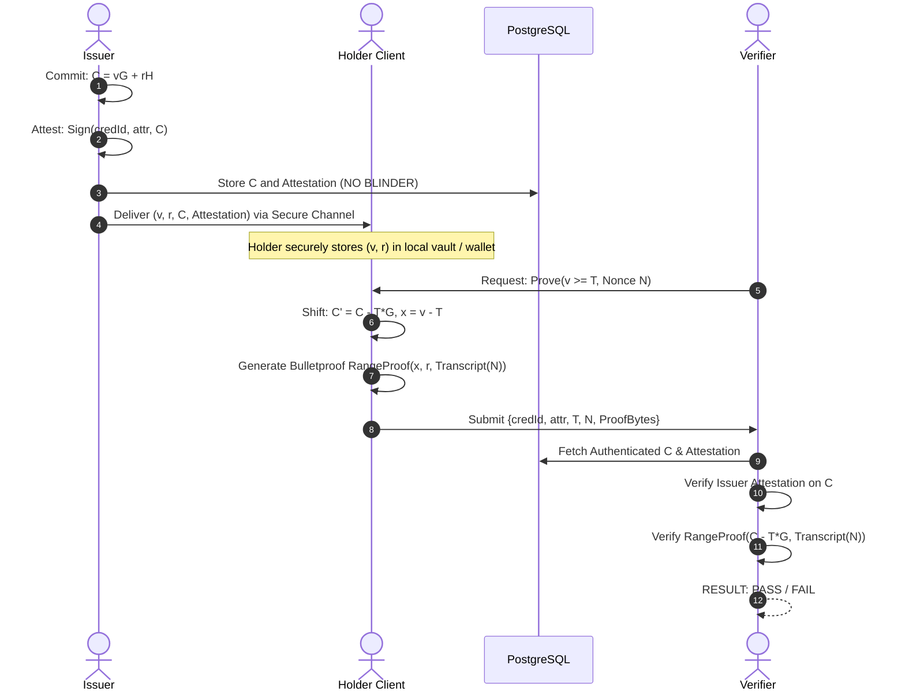

# Zero-Knowledge Document Verification Platform
## Zero-Knowledge Proof (ZKP) Architecture & Predicate Specification

**Document Version:** 1.0.0  
**Status:** Approved Architectural Baseline  
**Phase:** Phase 0 — Architecture & Security Baseline  

---

### 1. Mathematical Foundation: Ristretto255 Pedersen Commitments

To enable zero-knowledge range verification, integer attributes are represented using Pedersen commitments over the **Ristretto255** prime-order group ($\ell \approx 2^{252}$).

#### 1.1. Commitment Equation
$$C = v \cdot G + r \cdot H$$

* $v \in [0, 2^{64}-1]$: The private integer attribute value.
* $r \in \mathbb{Z}_q$: A cryptographically strong, uniformly random blinding factor generated via `SecureRandom`.
* $G, H \in \mathcal{G}$: Fixed, orthogonal base points (generators) on Ristretto255 with unknown discrete logarithm relationship $\log_G(H)$.
* $C$: A 32-byte compressed Ristretto point.

#### 1.2. Cryptographic Properties
1. **Information-Theoretic Hiding:** Given commitment $C$, any value $v'$ is equally plausible under some blinding factor $r'$. An adversary with infinite computational power cannot extract $v$.
2. **Computational Binding:** Finding $v' \ne v$ and $r' \ne r$ such that $v'G + r'H = vG + rH$ requires solving the discrete logarithm problem on Ristretto255 ($> 128$ bits of security).

---

### 2. Supported Predicate: Greater-Than-or-Equal ($\text{attribute} \ge \text{threshold}$)

The primary zero-knowledge statement supported in this baseline is:

$$\text{Predicate Statement: } \text{attribute } v \ge \text{threshold } T$$

#### 2.1. Reduction to a Non-Negative Range Proof
By elementary arithmetic:
$$v \ge T \iff (v - T) \ge 0$$

Assuming standard 64-bit integer domains, proving $v \ge T$ is mathematically equivalent to proving that the difference $x = (v - T)$ lies in the interval $[0, 2^{64}-1]$.

#### 2.2. Homomorphic Commitment Shifting
The verifier (or platform) takes the public authenticated commitment $C = vG + rH$ and the public threshold $T$, and computes the **shifted commitment** $C'$:

$$C' = C - T \cdot G = (v \cdot G + r \cdot H) - (T \cdot G) = (v - T) \cdot G + r \cdot H$$

Notice that:
* $C'$ is a valid Pedersen commitment to the hidden value $x = (v - T)$ with the exact same blinding factor $r$.
* The prover knows the witness $(x, r)$.
* The prover proves in zero knowledge that $C'$ commits to a value in $[0, 2^{64}-1]$ using a Bulletproof range proof.
* **Crucial Security Property:** If $v < T$, then $(v - T) < 0$, which in modular field arithmetic wraps to a value $\ge 2^{64}$ (specifically $q - (T - v)$). The Bulletproof range check over $[0, 2^{64}-1]$ **cryptographically fails**. The verifier independently rejects the proof!

---

### 3. Fiat-Shamir Transcript & Context Binding

To prevent **replay attacks, proof substitution, and context manipulation**, the Fiat-Shamir challenge generator (transcript) must absorb all public context before generating verification challenges:

```
Transcript Initialization:
  1. Append Domain Separator: "zkdoc-bulletproof-range-proof-v1"
  2. Append Credential ID: UUID (16 bytes)
  3. Append Credential Digest: SHA-256 (32 bytes)
  4. Append Attribute Name: UTF-8 string
  5. Append Threshold Value: uint64 big-endian (8 bytes)
  6. Append Original Commitment C: Ristretto255 compressed point (32 bytes)
  7. Append Shifted Commitment C': Ristretto255 compressed point (32 bytes)
  8. Append Verifier Challenge / Nonce: 32 bytes (fresh per session)
```

**Attack Mitigations:**
* **Threshold Tampering:** If an attacker changes $T$ after the proof is generated, $C'$ changes and the challenge hash diverges, failing verification.
* **Cross-Credential Replay:** A proof for User A's credential cannot be presented for User B's credential because `credentialId` is bound into the transcript.
* **Session Replay:** A captured proof cannot be replayed in a new verification session because the verifier's fresh `nonce` changes the transcript.

---

### 4. Holder Private Material & Custody Isolation



* **No Blinder in Database:** The platform database **never** stores the raw blinding factor $r$. Storing $r$ on the server would destroy the privacy model.
* **Zero Knowledge to Verifier:** The verifier receives only the proof bytes and public parameters. The verifier never receives $v$, $r$, or intermediate witnesses.

---

### 5. Third-Party Proof Library Governance

The platform uses the **Weavechain Bulletproofs Java** library (wrapping Dalek Ristretto255 curves). To prevent tight coupling and mitigate dependency risks, all ZKP logic is shielded behind a project-owned Service Provider Interface (SPI):

```java
package com.zkdoc.core.crypto.zkp;

public interface RangeProofEngine {
    byte[] generateCommitment(long value, byte[] blindingFactor);
    byte[] shiftCommitment(byte[] originalCommitment, long threshold);
    byte[] proveRange(long value, byte[] blindingFactor, byte[] transcriptBinding);
    boolean verifyRange(byte[] shiftedCommitment, byte[] proofBytes, byte[] transcriptBinding);
}
```

* **Audit & Isolation:** All native calls, memory allocations, and MessagePack parsing occur strictly within the implementation adapter (`WeavechainRangeProofEngine`). If an alternative proving engine (e.g., Rust FFI / Arkworks) is required in the future, it can be swapped without touching domain logic.
