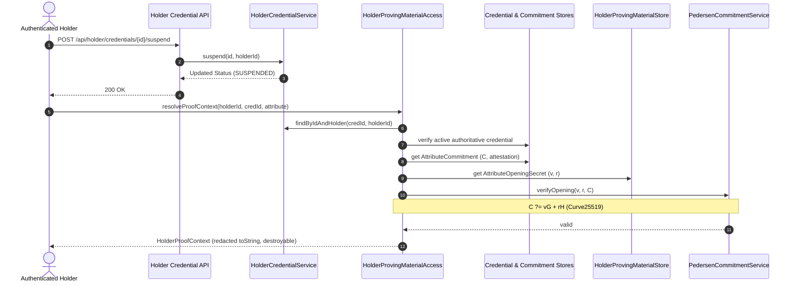

# Architecture Specification: ZKP Proving Boundary & Holder Lifecycle

## 1. Executive Summary

Phase 6B completes the holder credential lifecycle and establishes the cryptographic proving boundary between the holder's witness store and zero-knowledge proof generation. This architecture strictly isolates private witness parameters ($v$, $r$) from the backend and verifiers, ensuring zero-custody and BOLA/IDOR protection.

## 2. Threat Modeling & Security Invariants

| Vector | Threat | Mitigation / Control |
| :--- | :--- | :--- |
| **BOLA / IDOR** | Holder A requests witness material belonging to Holder B. | `HolderCredentialService.findByIdAndHolder` enforces strict subject ownership matching against authenticated caller (`Authentication.getName()`). |
| **Information Disclosure** | Blinding factors or plaintext values logged or leaked in error dumps. | `HolderProofContext.toString()` explicitly redacts `blindingFactor` and `attributeValue` as `[REDACTED]`. The context record is never returned via public APIs or REST endpoints. |
| **Lifecycle Inconsistency** | Prover generates a proof using a revoked or suspended credential. | `DefaultHolderProvingMaterialAccess` verifies both the holder status (`ACTIVE`) and the issuer-side authoritative credential status (`ACTIVE`). Fails closed on non-active states. |
| **Witness Tampering** | Adversary injects invalid opening tuple $(v', r')$. | Cryptographic continuity verification computes $C = vG + rH$ using `PedersenCommitmentService.verifyOpening` prior to returning the proof context. Mismatches abort immediately. |
| **Memory Retention** | Witness parameters persist indefinitely in memory. | `HolderProofContext` implements `javax.security.auth.Destroyable` enabling deterministic zeroization of sensitive arrays. |

## 3. Proving Boundary Flow

## 4. Phase Boundary Compliance

- No Bulletproof range proofs, constraint gadgets, or nonces are generated or exposed in this phase.
- Only proving context provisioning and holder lifecycle state transitions are implemented.
