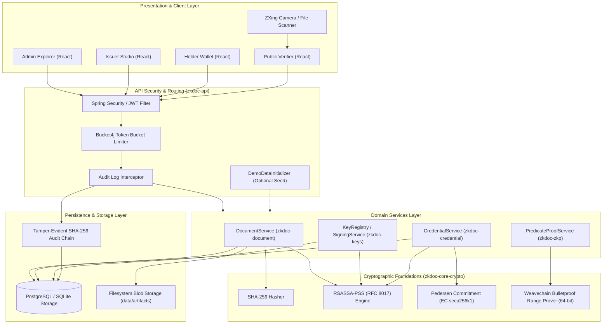
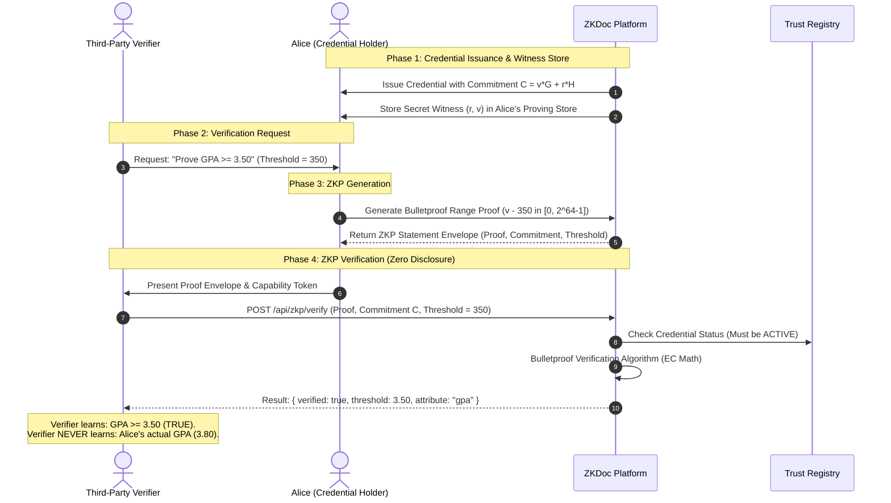

# 🏛️ ZKDoc Platform — Demonstration Architecture & Trust Boundaries

This document details the multi-tiered architecture, cryptographic foundations, data flows, and trust boundaries implemented in the **Zero-Knowledge Document Verification Platform**.

---

## 1. System Architecture Overview

ZKDoc is implemented as a modular Java 21 / Spring Boot 3.4.3 enterprise platform coupled with an SPA frontend. It enforces separation of concerns across cryptographic primitives, document management, key infrastructure, credential issuance, zero-knowledge proofs, and API exposure.

---

## 2. Multi-Module Architecture

The repository enforces modular architecture using Maven multi-module isolation:

| Module | Purpose | Key Classes & Interfaces |
| :--- | :--- | :--- |
| [`zkdoc-core-crypto`](file:///c:/Sabareesh/Easwari%20College/Semester%203/OOPs%20with%20Java/Project/Start%20over/Zero%20Knowledge%20Document%20Verification/zkdoc-core-crypto) | Pure cryptographic algorithms, byte conversions, and zero-knowledge primitives. | `Sha256Hasher`, `RsaPssSignatureEngine`, `PedersenCommitmentEngine`, `BulletproofProver` |
| [`zkdoc-document`](file:///c:/Sabareesh/Easwari%20College/Semester%203/OOPs%20with%20Java/Project/Start%20over/Zero%20Knowledge%20Document%20Verification/zkdoc-document) | Document ingest, SHA-256 integrity calculation, and digital signature attachment. | `DocumentService`, `DocumentRecord`, `DocumentStorageService` |
| [`zkdoc-keys`](file:///c:/Sabareesh/Easwari%20College/Semester%203/OOPs%20with%20Java/Project/Start%20over/Zero%20Knowledge%20Document%20Verification/zkdoc-keys) | Key registry, lifecycle states (`ACTIVE`, `REVOKED`), and public key export. | `KeyRegistryService`, `SigningKeyProvider`, `RegisteredKey` |
| [`zkdoc-credential`](file:///c:/Sabareesh/Easwari%20College/Semester%203/OOPs%20with%20Java/Project/Start%20over/Zero%20Knowledge%20Document%20Verification/zkdoc-credential) | Verifiable credential issuance, lifecycle suspension/revocation, and capability tokens. | `CredentialService`, `CredentialLifecycleService`, `VerificationCapability` |
| [`zkdoc-zkp`](file:///c:/Sabareesh/Easwari%20College/Semester%203/OOPs%20with%20Java/Project/Start%20over/Zero%20Knowledge%20Document%20Verification/zkdoc-zkp) | Real Bulletproof range proofs over 64-bit integers and statement verification. | `DefaultZkpStatementVerificationService`, `DefaultPredicateProofGenerationService`, `PedersenCommitmentService` |
| [`zkdoc-api`](file:///c:/Sabareesh/Easwari%20College/Semester%203/OOPs%20with%20Java/Project/Start%20over/Zero%20Knowledge%20Document%20Verification/zkdoc-api) | REST API endpoints, JWT token validator, CORS/security headers, demo initializers. | `DocumentController`, `VerifierController`, `DemoTokensController`, `SecurityConfiguration` |
| [`frontend`](file:///c:/Sabareesh/Easwari%20College/Semester%203/OOPs%20with%20Java/Project/Start%20over/Zero%20Knowledge%20Document%20Verification/frontend) | Single Page Application built with React 19, TypeScript, Tailwind CSS, and ZXing. | `LoginPage.tsx`, `PublicVerificationPage.tsx`, `HolderCredentialsPage.tsx`, `AdminDashboardPage.tsx` |

---

## 3. Cryptographic Primitives & Invariants

### A. Document Integrity (SHA-256)
All physical or digital artifacts uploaded to the platform are immediately passed through a streaming SHA-256 digest engine. The resulting 32-byte hash (64 hex characters) is immutable. Any single-bit change in the document completely alters this hash, guaranteeing tamper evidence.

### B. Digital Signatures (RSASSA-PSS, RFC 8017)
Unlike older, vulnerable PKCS#1 v1.5 padding schemes, ZKDoc mandates **RSASSA-PSS** with:
- Hash Algorithm: `SHA-256`
- Mask Generation Function: `MGF1` with `SHA-256`
- Salt Length: 32 bytes (matching SHA-256 output)
- Key Size: RSA-2048 or RSA-4096

### C. Pedersen Commitments
To facilitate zero-knowledge predicate proofs over numeric credential attributes (e.g., GPA or Age), the platform binds attributes using Pedersen commitments on elliptic curve points $G$ and $H$:
$$C = v \cdot G + r \cdot H$$
- **Hiding Property:** Given commitment $C$, an adversary has zero information about value $v$ because random scalar $r$ perfectly masks it.
- **Binding Property:** It is computationally infeasible for the holder to find alternative $v' \neq v$ and $r'$ such that $v' \cdot G + r' \cdot H = C$.

### D. Zero-Knowledge Range Proofs (Bulletproofs)
ZKDoc implements zero-knowledge range proofs based on the **Bulletproofs protocol** (Bunz et al., IEEE S&P 2018).
- When a verifier asks: *"Is Alice's GPA $\ge 3.50$?"*, Alice constructs a proof showing that:
  $$(v - 350) \in [0, 2^{64}-1]$$
- The verifier validates this proof against the public commitment $C$ without Alice ever disclosing $v$.
- **No Trusted Setup:** Unlike SNARKs, Bulletproofs require no toxic-waste ceremony or trusted setup.

### E. Tamper-Evident Audit Hash Chain
Every administrative and verification event is appended to an immutable database log. Each row computes:
$$\text{EntryHash}_n = \text{SHA-256}(\text{EntryHash}_{n-1} \parallel \text{Timestamp} \parallel \text{Actor} \parallel \text{Action} \parallel \text{Details})$$
Administrators can run full-chain integrity reconciliation from the UI or API, immediately revealing any out-of-band database tampering.

---

## 4. Verification Workflow Modes

The verifier subsystem supports two distinct operational modes:

### Mode A: Presented Artifact Verification
1. Verifier obtains the physical/digital document file.
2. The file is uploaded to the verifier interface.
3. The platform computes the document's SHA-256 digest on the fly.
4. The digest is matched against the registered document registry and checked against the issuer's RSASSA-PSS signature.
5. If someone modified a single character in the document (such as altering a grade or date), the hash mismatch flags an immediate **Integrity Violation**.

### Mode B: Registry Capability (Zero-Document Disclosure)
1. The credential holder generates a time-bound, use-capped **Verification Capability Token** (or exports it as a QR code).
2. The verifier scans the QR code or enters the capability token into the verifier portal.
3. The platform validates capability expiry and remaining use count.
4. The verifier confirms the issuer's signature and active credential status without ever transferring or storing the underlying document binary.

---

## 5. Minimal-Disclosure Trust Boundary

### Information Boundaries:
- **What the Verifier SEES:**
  - `verified: true/false`
  - Predicate evaluated: `gpa >= 3.50`
  - Issuer identity: `urn:zkdoc:issuer:acme-university`
  - Credential status: `ACTIVE`
  - Audit reference ID
- **What the Verifier NEVER SEES:**
  - Alice's true GPA (`3.80`)
  - Blinding secret ($r$)
  - Raw diploma document or private student notes
  - Other undisclosed credential attributes
