# Phase F1: Frontend Rebuild Implementation Roadmap (Phases F1–F12)

**Project:** Zero-Knowledge Document Verification Platform  
**Document ID:** ZKDOC-FE-F1-005  
**Status:** Approved Master Roadmap  
**Target Execution:** Phases F2 through F12  

---

## 1. Executive Roadmap Overview

This roadmap defines the complete, phased engineering lifecycle for decommissioning the legacy frontend and delivering a production-grade, zero-knowledge document verification frontend.

Each phase is designed with explicit boundaries, preconditions, deliverables, automated verification commands, and exit criteria. No phase begins until the preceding phase meets its exit criteria.

```mermaid
flowchart LR
    F1[F1: Audit & Plan] --> F2[F2: Scaffolding]
    F2 --> F3[F3: Design System]
    F3 --> F4[F4: API & Auth]
    F4 --> F5[F5: Landing & Docs]
    F5 --> F6[F6: Verifier Workflows]
    F6 --> F7[F7: Issuer Lifecycle]
    F7 --> F8[F8: Holder & ZKP]
    F8 --> F9[F9: Admin & Audit]
    F9 --> F10[F10: A11y & UX]
    F10 --> F11[F11: E2E & Hardening]
    F11 --> F12[F12: Production Readiness]
```



---

## 2. Phase-by-Phase Execution Plans

---

### Phase F1: Existing Frontend Audit, Backend Compatibility Assessment, and Safe Replacement Plan (CURRENT)
- **Objective:** Perform a rigorous, non-destructive audit of the existing codebase, document backend API and security contracts, formulate replacement architecture, and establish the safe transition strategy.
- **Preconditions:** Git repository accessible on `feat/readiness` branch.
- **Primary Deliverables:**
  1. `docs/frontend-rebuild/f1-frontend-audit.md`
  2. `docs/frontend-rebuild/f1-backend-integration-contract.md`
  3. `docs/frontend-rebuild/f1-safe-replacement-map.md`
  4. `docs/frontend-rebuild/f1-technology-recommendation.md`
  5. `docs/frontend-rebuild/f1-implementation-roadmap.md`
- **Verification Strategy:**
  - `git status` (must be clean of application code modifications).
  - Validation of documented API endpoints against Java controllers.
- **Exit Criteria:** All 5 documentation artifacts completed and reviewed; zero application source files modified.

---

### Phase F2: Safe Decommissioning, Build Scaffolding, and Tooling Foundation
- **Objective:** Quarantine legacy frontend source files into `frontend/legacy-reference/`, scaffold modern React 19 + TypeScript 5.7+ + Vite 6+ toolchain, configure Tailwind CSS v4, ESLint, Prettier, and Vitest, and verify Maven build compatibility.
- **Preconditions:** Phase F1 approved and signed off.
- **Primary Tasks & Deliverables:**
  - Quarantine `frontend/src` to `frontend/legacy-reference/src/`.
  - Replace `package.json`, `package-lock.json`, `vite.config.ts`, `tsconfig*.json`, `eslint.config.js`, `.prettierrc`.
  - Create minimal `index.html`, `src/main.tsx`, and `src/App.tsx`.
  - Configure build outDir to `../zkdoc-api/src/main/resources/static`.
  - Validate that `frontend-maven-plugin` executes `install-node-and-npm`, `npm ci`, and `npm run build` cleanly.
- **Verification Commands:**
  ```powershell
  npm --prefix frontend run typecheck
  npm --prefix frontend run lint
  npm --prefix frontend run format:check
  npm --prefix frontend run build
  .\mvnw.cmd test -pl zkdoc-api -Dtest=FrontendIntegrationTest
  ```
- **Exit Criteria:** Clean build produces static bundle; `FrontendIntegrationTest` passes; 0 lint errors, 0 type errors.

---

### Phase F3: Design System, Layout Shell, and Accessible Component Architecture
- **Objective:** Implement the core design tokens, layout shell, navigation, and reusable WCAG 2.2 Level AA compliant component library using Radix UI headless primitives and Tailwind CSS v4.
- **Preconditions:** Phase F2 completed.
- **Primary Tasks & Deliverables:**
  - Set up CSS tokens in `src/index.css` (accessible palette, dark mode support, focus ring tokens).
  - Build layout components: `AppLayout`, `Navbar`, `Sidebar`, `Footer`, `Breadcrumbs`, `SkipToContent`.
  - Build UI primitives: `Button`, `Badge`, `Card`, `Dialog/Modal`, `DropdownMenu`, `Tabs`, `Alert`, `Tooltip`, `Skeleton`.
  - Implement 404 `NotFoundPage` and error boundary components.
  - Component unit tests with React Testing Library.
- **Verification Commands:**
  ```powershell
  npm --prefix frontend run test:run -- components
  npm --prefix frontend run lint
  ```
- **Exit Criteria:** All primitive components render with accessible ARIA landmarks, keyboard focus management, and 100% unit test pass rate.

---

### Phase F4: State Management, Type-Safe API Client, and Authentication Integration
- **Objective:** Implement the type-safe fetch client with correlation ID propagation, `ApiErrorResponse` mapping, TanStack Query provider, and the OAuth2 JWT session store.
- **Preconditions:** Phase F3 completed.
- **Primary Tasks & Deliverables:**
  - Implement `src/api/client.ts` with `X-Correlation-Id` header generation, error normalization, and 401 interception.
  - Implement typed DTOs in `src/api/types.ts` mirroring Java models.
  - Implement Zustand `authStore` for JWT storage in `sessionStorage` or memory.
  - Implement Developer JWT Connect modal for testing without in-band login.
  - Implement route guard wrappers (`RequireAuth`, `RequireRole`).
- **Verification Commands:**
  ```powershell
  npm --prefix frontend run test:run -- api auth
  npm --prefix frontend run typecheck
  ```
- **Exit Criteria:** Unit tests prove correct error response parsing, correlation ID propagation, and route protection for unauthenticated users.

---

### Phase F5: Landing Page, Public Documentation, and Platform Onboarding
- **Objective:** Create the public-facing platform landing page, architecture overview, role selector, and verification primer.
- **Preconditions:** Phase F4 completed.
- **Primary Tasks & Deliverables:**
  - Build `LandingPage` with zero-knowledge platform visual explanation and workflow diagrams.
  - Provide role entry points (Verifier, Issuer, Holder, Administrator).
  - Add documentation modal explaining Bulletproofs vs Groth16, commitments, and selective disclosure.
  - Integration with React Router navigation.
- **Verification Commands:**
  ```powershell
  npm --prefix frontend run test:run -- pages/LandingPage
  npm --prefix frontend run build
  ```
- **Exit Criteria:** Landing page renders responsively on mobile and desktop; all links and role buttons route correctly.

---

### Phase F6: Public Credential and Predicate Verification Workflows
- **Objective:** Implement full public and authenticated verification flows, QR code scanning/parsing, and mathematical predicate verification.
- **Preconditions:** Phase F5 completed.
- **Primary Tasks & Deliverables:**
  - Build `PublicVerificationPage` supporting verification by ID or canonical QR format (`{"v":"QR_V1","m":...}`).
  - Integrate `html5-qrcode` scanner with camera selection and file upload fallback.
  - Build `PredicateVerificationPage` targeting `POST /api/v2/zkp/credential-predicates/verify` with strict 6-field payload.
  - **Critical Fix:** Prevent false-positive badges! Verification status badges must strictly reflect `verified: true`.
  - Accessible result summary card with ARIA live announcements.
- **Verification Commands:**
  ```powershell
  npm --prefix frontend run test:run -- pages/Verification
  npm --prefix frontend run typecheck
  ```
- **Exit Criteria:** Tests prove correct QR string parsing; tests assert zero green badges render when backend returns `verified: false`.

---

### Phase F7: Issuer Dashboard and Credential Issuance Lifecycle
- **Objective:** Implement the issuer dashboard, document upload, and cryptographic credential issuance interface.
- **Preconditions:** Phase F6 completed.
- **Primary Tasks & Deliverables:**
  - Build `IssuerDashboardPage` with credential issuance overview and active credentials table.
  - Implement multi-attribute credential issuance form using React Hook Form + Zod.
  - Integrate with `POST /api/issuer/credentials/issue` and `POST /api/issuer/documents/upload`.
  - Implement credential revocation modal calling `POST /api/issuer/credentials/{id}/revoke`.
  - Add QR code display modal (`qrcode.react`) with downloadable PNG capability.
- **Verification Commands:**
  ```powershell
  npm --prefix frontend run test:run -- pages/Issuer
  npm --prefix frontend run lint
  ```
- **Exit Criteria:** Full issuance flow validated via mock API tests; form handles validation errors matching backend `ApiErrorResponse.validationErrors`.

---

### Phase F8: Holder Dashboard, Credential Wallet, and ZK Proof Generation
- **Objective:** Implement holder credential wallet, attribute inspection, and Zero-Knowledge Proof generation with secure blinding factor isolation.
- **Preconditions:** Phase F7 completed.
- **Primary Tasks & Deliverables:**
  - Build `HolderDashboardPage` listing holder credentials and status badges.
  - Implement Proof Generation modal calling `POST /api/holder/credentials/proofs/generate`.
  - **Critical Fix:** Ensure `nonceHex` is generated and transmitted in compliance with backend regex `^[0-9a-fA-F]{2,128}$`.
  - Implement proof export / copy feature for verifier submission.
  - Enforce zeroization of sensitive proof buffers upon dialog close.
- **Verification Commands:**
  ```powershell
  npm --prefix frontend run test:run -- pages/Holder
  npm --prefix frontend run typecheck
  ```
- **Exit Criteria:** Tests verify successful proof generation payload formation including valid hex nonces; sensitive fields zeroed.

---

### Phase F9: System Administration, Key Management, and Audit Logging
- **Objective:** Implement administrative views for cryptographic key lifecycle, system recovery reconciliation, and immutable audit log exploration.
- **Preconditions:** Phase F8 completed.
- **Primary Tasks & Deliverables:**
  - Build `AdministrationPage` with key registry status (`GET /api/keys/status`) and key rotation modal (`POST /api/admin/keys/rotate`).
  - Implement Recovery Admin section targeting `POST /api/admin/recovery/reconcile` and `GET /api/admin/recovery/status`.
  - Build `AuditLogPage` with paginated event view, actor filtering, and correlation ID search.
- **Verification Commands:**
  ```powershell
  npm --prefix frontend run test:run -- pages/Admin pages/Audit
  npm --prefix frontend run lint
  ```
- **Exit Criteria:** Admin operations handle errors cleanly; audit viewer supports sorting, pagination, and correlation lookup.

---

### Phase F10: Comprehensive Accessibility, Responsive Design, and UX Polish
- **Objective:** Perform end-to-end accessibility audits, mobile responsive refactoring, keyboard navigation testing, and screen reader verification.
- **Preconditions:** Phase F9 completed.
- **Primary Tasks & Deliverables:**
  - Run automated Axe accessibility testing suite (`@axe-core/playwright`).
  - Ensure all tables collapse into accessible cards on viewport width `< 768px`.
  - Verify WCAG 2.2 AA contrast ratios, focus rings, and ARIA attributes across all pages.
  - Implement toast notifications for async API actions.
- **Verification Commands:**
  ```powershell
  npm --prefix frontend run test:a11y
  npm --prefix frontend run lint
  ```
- **Exit Criteria:** Zero Axe core accessibility violations; full keyboard navigation without mouse across every route.

---

### Phase F11: End-to-End Testing, Security Hardening, and Build Integration
- **Objective:** Implement comprehensive Playwright E2E tests, audit Content Security Policy compliance, and verify Maven full reactor build integration.
- **Preconditions:** Phase F10 completed.
- **Primary Tasks & Deliverables:**
  - Write Playwright E2E test suite covering:
    - Verifier QR scanning and predicate verification.
    - Issuer credential creation and revocation.
    - Holder proof generation and presentation.
    - Admin key rotation and audit inspection.
  - Verify bundle security: no source map leakage in production, zero `eval()`, CSP compliance.
  - Run full Maven build verifying `frontend-maven-plugin` embeds assets into JAR.
- **Verification Commands:**
  ```powershell
  npm --prefix frontend run test:e2e
  .\mvnw.cmd clean verify
  ```
- **Exit Criteria:** Full `mvnw clean verify` passes with 0 failures; Playwright E2E suite passes 100%.

---

### Phase F12: Final Review, Legacy Cleanup, Documentation, and Production Readiness
- **Objective:** Permanently remove quarantined legacy files (`frontend/legacy-reference/`), perform final code review, update all platform documentation, and certify production readiness.
- **Preconditions:** Phase F11 completed.
- **Primary Tasks & Deliverables:**
  - Permanently delete `frontend/legacy-reference/`.
  - Generate comprehensive `docs/frontend-rebuild/frontend-operations-guide.md`.
  - Run final repository security and dependency scan.
  - Verify Docker container packaging and startup.
- **Verification Commands:**
  ```powershell
  npm --prefix frontend run typecheck
  npm --prefix frontend run lint
  npm --prefix frontend run test:run
  .\mvnw.cmd test -pl zkdoc-api -Dtest=FrontendIntegrationTest
  ```
- **Exit Criteria:** Legacy files deleted; repository clean; backend passes all tests; production deployment certified.

---

## 3. Cross-Cutting Risk Management & Mitigation Matrix

| Risk Identified | Severity | Impact | Mitigation Strategy |
| :--- | :---: | :--- | :--- |
| **Breaking `FrontendIntegrationTest` during scaffolding** | High | Fails backend CI on deep-link verification | Keep `zkdoc-api/src/main/resources/static/index.html` intact until F2 produces a verified replacement bundle. |
| **API Contract Drift** | High | 400 Bad Request on proof or verification submission | Zod schemas and TypeScript types strictly generated from Java DTO source code. All DTO tests validate exact field names. |
| **Cryptographic Trust Falsification** | Critical | Users misled into trusting invalid proofs | Enforce strict boolean equality (`verified === true`). Disallow truthy checks on undefined properties. |
| **OAuth2 Token Incompatibility** | High | 401 Unauthorized across all authenticated routes | Replace mock JWTs with standard RS256 developer key utility or interactive JWT session connect modal matching `ManagedJwtDecoderProvider`. |
| **Sandbox Network Isolation in CI/Dev** | Medium | `npm audit` or external fetches fail | Commit lockfile cleanly; bundle all icons and fonts locally without external CDN dependencies. |
| **Accessibility Non-Compliance** | Medium | Platform fails enterprise accessibility audit | Radix UI primitives enforce WAI-ARIA standards by default; automated Axe Playwright tests gate Phase F10. |

---

## 4. Overall Rebuild Acceptance Criteria

The frontend rebuild will be formally certified as complete upon meeting all of the following conditions:

1. **Compilation & Packaging:** `.\mvnw.cmd clean verify` completes successfully with code `0`, bundling the production SPA into the standalone Spring Boot JAR.
2. **Backend Regression:** All existing backend tests (`zkdoc-crypto`, `zkdoc-zkp`, `zkdoc-keys`, `zkdoc-core`, `zkdoc-api`) pass with zero regressions.
3. **Route Integrity:** `FrontendIntegrationTest` passes across `/`, `/verify`, `/credentials`, `/verification`, and deep routes.
4. **Static Analysis:** `npm run typecheck`, `npm run lint`, and `npm run format:check` execute with zero errors or warnings.
5. **Cryptographic Accuracy:** Proof generation transmits valid `nonceHex`, and verification displays positive badges *only* upon mathematical proof verification.
6. **Authentication Realism:** Authentication strictly adheres to OAuth2 Resource Server Bearer standards without mock token leakage.
7. **Accessibility:** WCAG 2.2 Level AA compliance verified via automated Axe Playwright tests and manual keyboard review.
8. **Code Cleanliness:** All legacy code in `frontend/legacy-reference/` completely removed; zero legacy technical debt carried forward.
