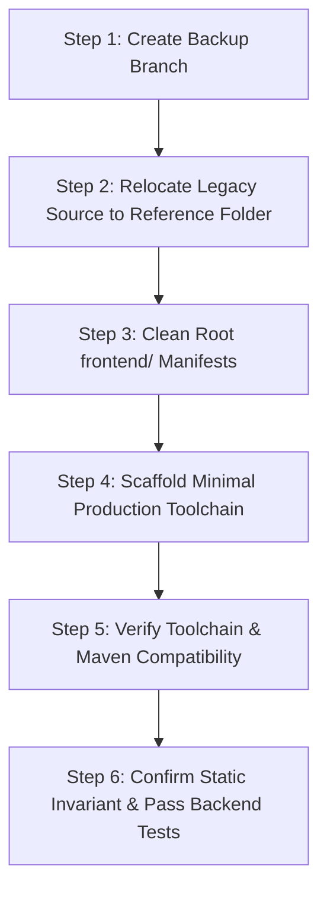

# Phase F1: Safe Replacement Map & Decommissioning Strategy

**Project:** Zero-Knowledge Document Verification Platform  
**Document ID:** ZKDOC-FE-F1-003  
**Status:** Approved Audit Plan  
**Target Execution:** Frontend Phase F2 (Safe Decommissioning & Clean Scaffolding)  

---

## 1. Executive Summary

This document establishes the exhaustive, file-by-file classification and decommissioning protocol for replacing the legacy frontend implementation (`frontend/`) in the Zero-Knowledge Document Verification Platform.

The legacy frontend contains severe architectural flaws, cryptographic trust falsification bugs, unauthenticated mock token injectors, broken API payloads, and 91 lint violations. It cannot be salvaged through incremental patching. A clean replacement is required.

However, the frontend is tightly coupled to the backend build pipeline through:
1. `frontend-maven-plugin` in `zkdoc-api/pom.xml` invoking `install-node-and-npm`, `npm ci`, and `npm run build`.
2. Committed static production assets in `zkdoc-api/src/main/resources/static/`.
3. Spring Boot's `SpaForwardController.java` routing SPA navigation requests to `/index.html`.
4. Spring Boot's integration test `FrontendIntegrationTest.java` verifying delivery of `/index.html` across all registered SPA deep links.

Deleting or modifying files haphazardly will immediately break `mvnw clean verify` and prevent Spring Boot from booting or passing CI. This document provides the authoritative inventory, classification, and execution sequence to guarantee zero regression on the backend.

---

## 2. File-by-File Classification Taxonomy

Every file and directory across the repository relevant to frontend assets, build steps, and packaging is classified into one of five non-negotiable categories:

| Classification | Definition & Action Rule |
| :--- | :--- |
| **PRESERVE** | **Backend-critical or operational files.** Must NEVER be deleted, moved, or corrupted during frontend work. Includes Java controllers, tests, Maven POMs, Dockerfiles, and backend static asset directories. |
| **RETAIN AS REFERENCE** | **Legacy files moved to an isolated reference directory.** Not deployed, not bundled into static resources, and not referenced by runtime code. Kept temporarily during F2–F5 for domain logic reference. |
| **REPLACE** | **Contractually necessary configuration or entry-point files.** Must be completely cleared and regenerated with clean, modern standards (e.g. `package.json`, `vite.config.ts`, `tsconfig.json`). |
| **DELETE** | **Legacy UI code, obsolete test mocks, and broken utilities.** Safe to remove entirely once scaffolding begins in F2. |
| **REVIEW BEFORE ACTION** | **Files with potential cross-cutting impact.** Require explicit dependency checking prior to any modification. |

---

## 3. Exhaustive Inventory & Action Matrix

### 3.1 Backend & Root Critical Assets (Strict Preservation)

| Target Path | Category | Rationale & Protection Rule |
| :--- | :--- | :--- |
| `zkdoc-api/pom.xml` | **PRESERVE** | Contains `frontend-maven-plugin` configuration. Dictates Node (`v24.21.0`), npm (`11.19.0`), execution targets (`npm ci`, `npm run build`), and working directory (`../frontend`). Must NOT be modified during file deletion. |
| `pom.xml` | **PRESERVE** | Parent Maven POM defining reactor modules (`zkdoc-crypto`, `zkdoc-zkp`, `zkdoc-keys`, `zkdoc-core`, `zkdoc-api`). Preserved intact. |
| `zkdoc-api/src/main/resources/static/` | **PRESERVE** | Contains committed production assets (`index.html`, `favicon.svg`, `assets/*.js`, `assets/*.css`). Preserved during F1–F2 so `FrontendIntegrationTest` and backend runs continue passing uninterrupted until F11 builds the new production bundle. |
| `zkdoc-api/src/main/java/com/zkdoc/api/controller/SpaForwardController.java` | **PRESERVE** | Routes SPA paths (`/`, `/verify`, `/credentials`, `/verification`, `/predicate-verification`, `/audit-logs`, `/administration`) to `forward:/index.html`. Do not touch during frontend cleanup. |
| `zkdoc-api/src/test/java/com/zkdoc/api/FrontendIntegrationTest.java` | **PRESERVE** | Executes HTTP GET on all SPA routes asserting `200 OK` and `text/html;charset=UTF-8` content containing `<!doctype html>`. Backend CI failure occurs if `static/index.html` is removed. |
| `Dockerfile` | **PRESERVE** | Multi-stage Docker build relying on Maven build. Must remain untouched. |
| `docker-compose.yml` | **PRESERVE** | Local environment orchestration for PostgreSQL, Redis, and services. |
| `.gitignore` | **PRESERVE** | Root repository gitignore. |

---

### 3.2 Frontend Build & Environment Configuration

| Target Path | Category | Action in F2 | Justification |
| :--- | :--- | :--- | :--- |
| `frontend/package.json` | **REPLACE** | Replace in F2 | Current dependencies include React 19 rc/canary artifacts, unpinned plugins, and outdated script definitions. Replace with production React 19, Vite 6, Tailwind CSS v4, Lucide React, and Radix UI. |
| `frontend/package-lock.json` | **REPLACE** | Regenerate in F2 | Regenerate via clean `npm install` once `package.json` is replaced. |
| `frontend/vite.config.ts` | **REPLACE** | Replace in F2 | Currently configured with output to `../zkdoc-api/src/main/resources/static` and proxy to `http://localhost:8080`. Replace with updated Vite config supporting path aliases (`@/*`), CSP-compliant headers, and optimized chunking. |
| `frontend/tsconfig.json` | **REPLACE** | Replace in F2 | Project reference root. Replace with modern strict TypeScript 5.7+ configuration. |
| `frontend/tsconfig.app.json` | **REPLACE** | Replace in F2 | Replace with strict TypeScript config (`strict: true`, `noUncheckedIndexedAccess: true`, `verbatimModuleSyntax: true`). |
| `frontend/tsconfig.node.json` | **REPLACE** | Replace in F2 | Replace with strict Node build config for Vite/Tailwind. |
| `frontend/tailwind.config.js` | **REPLACE** | Replace in F2 | Replace with Tailwind CSS v4 configuration (`@theme` in CSS or v4 JS config). |
| `frontend/postcss.config.js` | **REPLACE** | Replace in F2 | Modernize for Tailwind CSS v4. |
| `frontend/eslint.config.js` | **REPLACE** | Replace in F2 | Contains 91 unaddressed lint errors. Replace with clean ESLint flat config with TypeScript-ESLint, React Hooks, and JSX a11y plugins. |
| `frontend/.prettierrc` | **REPLACE** | Replace in F2 | Replace with unified formatting rules (single quotes, trailing commas, 2-space indent). |
| `frontend/index.html` | **REPLACE** | Replace in F2 | SPA entry template. Replace with clean HTML5 semantic structure, proper accessible `<title>`, viewport meta tags, and CSP compliance without inline scripts. |
| `frontend/public/favicon.svg` | **PRESERVE** | Keep / Modernize | Retain or replace with refined enterprise SVG icon. |

---

### 3.3 Frontend Source Code: Deletion and Replacement

#### A. Entry Points & Global Styles
| Target Path | Category | Action | Target Phase |
| :--- | :--- | :--- | :--- |
| `frontend/src/main.tsx` | **REPLACE** | Replace with clean React 18/19 root mounting `App` inside strict boundary. | F3 |
| `frontend/src/App.tsx` | **REPLACE** | Replace with accessible, route-lazy, error-bounded application shell. | F3 |
| `frontend/src/index.css` | **REPLACE** | Replace with semantic Tailwind CSS v4 design tokens and WCAG 2.2 focus styles. | F3 |
| `frontend/src/vite-env.d.ts` | **REPLACE** | Replace with typed `ImportMetaEnv` (VITE_API_URL, etc.). | F2 |

#### B. API Layer & Cryptographic Services
| Target Path | Category | Action | Justification |
| :--- | :--- | :--- | :--- |
| `frontend/src/api/client.ts` | **DELETE** | Rewrite in F4 | Violates backend error contract (expects `payload.code` instead of `ApiErrorResponse`). Lacks correlation ID propagation and 401 interceptors. |
| `frontend/src/api/types.ts` | **DELETE** | Rewrite in F4 | Incomplete models; missing recovery endpoints, canonical predicate proof structures, and verification capability attributes. |
| `frontend/src/api/adminApi.ts` | **DELETE** | Rewrite in F4 | Incomplete; missing Recovery Admin reconcile/status endpoints. |
| `frontend/src/api/auditApi.ts` | **DELETE** | Rewrite in F4 | Incomplete error handling; legacy endpoint wrappers. |
| `frontend/src/api/holderApi.ts` | **DELETE** | Rewrite in F4 | Generates invalid proof generation requests (missing `nonceHex`). |
| `frontend/src/api/issuerApi.ts` | **DELETE** | Rewrite in F4 | Raw untyped error forwarding. |
| `frontend/src/api/keyApi.ts` | **DELETE** | Rewrite in F4 | Missing purpose-based key categorization. |
| `frontend/src/api/verifierApi.ts` | **DELETE** | Rewrite in F4 | Missing capability-based verification flows. |
| `frontend/src/api/zkpApi.ts` | **DELETE** | Rewrite in F4 | Fails to adhere to strict 6-field payload requirement of `/api/v2/zkp/credential-predicates/verify`. |

#### C. Authentication & State Management
| Target Path | Category | Action | Justification |
| :--- | :--- | :--- | :--- |
| `frontend/src/context/AuthContext.tsx` | **DELETE** | Rewrite in F4 | **Critical Security Flaw:** Injects unsigned mock JWT tokens (`demo-signature-for-development-eval`) claiming to be admin/issuer/holder. Fails on real backend. Rewrite to support valid bearer tokens or dedicated developer signing integration. |
| `frontend/src/types/auth.ts` | **DELETE** | Rewrite in F4 | Replace with strict JWT claims model matching `JwtAuthenticationFilter` (`sub`, `iss`, `aud`, `roles`, `exp`, `nbf`). |

#### D. Pages (All Legacy Pages slated for replacement)
| Target Path | Category | Action | Justification |
| :--- | :--- | :--- | :--- |
| `frontend/src/pages/LandingPage.tsx` | **DELETE** | Replace in F5 | Missing responsive hero, clear platform architecture explanation, and accessible navigation. |
| `frontend/src/pages/PublicVerificationPage.tsx` | **DELETE** | Replace in F6 | Incompatible QR scanner parsing; broken reference regex. |
| `frontend/src/pages/PredicateVerificationPage.tsx` | **DELETE** | Replace in F6 | **Critical Integrity Flaw:** Renders false green "Mathematically Valid" badges even when backend rejects proof. |
| `frontend/src/pages/IssuerDashboardPage.tsx` | **DELETE** | Replace in F7 | Poor UX, unvalidated form schemas, lack of accessible multi-attribute input. |
| `frontend/src/pages/HolderDashboardPage.tsx` | **DELETE** | Replace in F8 | Omits required `nonceHex` during proof generation, leading to 400 Bad Request. |
| `frontend/src/pages/AuditLogPage.tsx` | **DELETE** | Replace in F9 | Missing filtering by actor, correlation ID search, and pagination controls. |
| `frontend/src/pages/AdministrationPage.tsx` | **DELETE** | Replace in F9 | Missing recovery reconcile trigger and node status dashboard. |
| `frontend/src/pages/NotFoundPage.tsx` | **DELETE** | Replace in F3 | Basic non-semantic 404 page. |

#### E. Components & Layouts
| Target Path | Category | Action | Justification |
| :--- | :--- | :--- | :--- |
| `frontend/src/components/layout/AppLayout.tsx` | **DELETE** | Replace in F3 | Inaccessible mobile menu, missing skip-links, poor ARIA landmarks. |
| `frontend/src/components/layout/Navbar.tsx` | **DELETE** | Replace in F3 | Lacks keyboard accessibility and active route indicators. |
| `frontend/src/components/layout/Footer.tsx` | **DELETE** | Replace in F3 | Static footer without status indicators or build versioning. |
| `frontend/src/components/common/Badge.tsx` | **DELETE** | Replace in F3 | Replace with accessible Radix-based badge token system. |
| `frontend/src/components/common/Button.tsx` | **DELETE** | Replace in F3 | Replace with accessible button supporting loading states, ARIA disabled states, and keyboard focus rings. |
| `frontend/src/components/common/Card.tsx` | **DELETE** | Replace in F3 | Replace with semantic card component. |
| `frontend/src/components/common/Modal.tsx` | **DELETE** | Replace in F3 | Violates WCAG focus trap and `aria-modal` standards. Replace with `@radix-ui/react-dialog`. |
| `frontend/src/components/common/QrScanner.tsx` | **DELETE** | Replace in F6 | Lacks camera permission handling, device switching, and error fallbacks. |
| `frontend/src/components/common/StatusAlert.tsx` | **DELETE** | Replace in F3 | Replace with accessible live region (`role="alert"` / `role="status"`). |

#### F. Utilities
| Target Path | Category | Action | Justification |
| :--- | :--- | :--- | :--- |
| `frontend/src/utils/formatters.ts` | **DELETE** | Replace in F4 | Date formatting lacks internationalization (`Intl.DateTimeFormat`) and timezone resilience. |
| `frontend/src/utils/verificationReference.ts` | **DELETE** | Replace in F6 | **Bug:** Regex fails to parse canonical backend JSON QR formats generated by `VerificationCapabilityService`. |

#### G. Tests (Vitest)
| Target Path | Category | Action | Justification |
| :--- | :--- | :--- | :--- |
| `frontend/src/test/setup.ts` | **REPLACE** | Replace in F2 | Modernize Jest-DOM / Testing-Library matchers. |
| `frontend/src/test/test-utils.tsx` | **REPLACE** | Replace in F2 | Provide unified router, query client, and auth provider mocks. |
| `frontend/src/test/api/client.test.ts` | **DELETE** | Rewrite in F4 | Tests against incorrect error contract. |
| `frontend/src/test/components/Badge.test.tsx` | **DELETE** | Rewrite in F3 | Replace with accessible component tests. |
| `frontend/src/test/components/Button.test.tsx` | **DELETE** | Rewrite in F3 | Replace with accessible component tests. |
| `frontend/src/test/components/Card.test.tsx` | **DELETE** | Rewrite in F3 | Replace with accessible component tests. |
| `frontend/src/test/components/Modal.test.tsx` | **DELETE** | Rewrite in F3 | Replace with Radix dialog tests. |
| `frontend/src/test/pages/AdministrationPage.test.tsx` | **DELETE** | Rewrite in F9 | Rewritten to test recovery workflows. |
| `frontend/src/test/pages/AuditLogPage.test.tsx` | **DELETE** | Rewrite in F9 | Rewritten to test filtering and pagination. |
| `frontend/src/test/pages/HolderDashboardPage.test.tsx` | **DELETE** | Rewrite in F8 | Rewritten to assert valid `nonceHex` inclusion. |
| `frontend/src/test/pages/IssuerDashboardPage.test.tsx` | **DELETE** | Rewrite in F7 | Rewritten to test multi-attribute issuance. |
| `frontend/src/test/pages/PredicateVerificationPage.test.tsx` | **DELETE** | Rewrite in F6 | Rewritten to assert no false-positive badges on rejection. |
| `frontend/src/test/pages/PublicVerificationPage.test.tsx` | **DELETE** | Rewrite in F6 | Rewritten to test canonical QR parsing. |

---

## 4. Preservation Invariants

To avoid regressions during decommissioning and scaffolding, the following invariants are strictly enforced:

### Invariant 1: Maven Build Chain Stability
```
Command: .\mvnw.cmd clean compile -DskipTests
Pre-condition: frontend/ must contain valid package.json with "build" script
Post-condition: Build succeeds with code 0.
```
- The `zkdoc-api/pom.xml` configuration executes `install-node-and-npm`, `npm ci`, and `npm run build`.
- **Constraint:** At no point may `frontend/package.json` be missing or lack a working `build` script during reactor builds.
- When scaffolding in F2, an immediate minimal placeholder `build` script (`vite build` or `echo "building"`) must exist before running Maven commands.

### Invariant 2: Backend SPA Forwarding & Static Resource Serving
```
Endpoint: GET http://localhost:8080/
Endpoint: GET http://localhost:8080/verify
Endpoint: GET http://localhost:8080/credentials
Requirement: Returns HTTP 200 with text/html content matching <!doctype html>
Verified By: zkdoc-api/src/test/java/com/zkdoc/api/FrontendIntegrationTest.java
```
- `zkdoc-api/src/main/resources/static/index.html` is tracked in git.
- **Constraint:** Do NOT delete `zkdoc-api/src/main/resources/static/index.html` during F2. It will be naturally overwritten when the new frontend runs `npm run build` in F11.

### Invariant 3: Zero-Touch Policy for Backend Code
- No files under `zkdoc-*/src/main/java` or `zkdoc-*/src/test/java` may be modified, deleted, or reformatted to accommodate frontend quirks.
- All backend contracts (`ApiErrorResponse`, `CredentialPredicateVerificationRequest`, `ProofGenerationRequest`, `ManagedJwtDecoderProvider`) are fixed sources of truth.

---

## 5. Decommissioning & Replacement Step-by-Step Execution Sequence

The safe execution sequence for Phase F2 is structured as follows:



### Detailed Sequence:

#### Step 1: Pre-Execution Git Checkpoint (F2 Entry)
1. Verify working directory is clean using `git status`.
2. Confirm current branch is `feat/readiness` (or create dedicated feature branch `feat/frontend-rebuild`).
3. Record git HEAD SHA as rollback target.

#### Step 2: Quarantine Legacy Frontend (`frontend/src` -> `frontend/legacy-reference/`)
1. Create quarantine directory: `frontend/legacy-reference/`.
2. Move legacy `frontend/src/` to `frontend/legacy-reference/src/`.
3. Add `frontend/legacy-reference/` to `.gitignore` or configure it as non-compiled reference code so it does not interfere with the new build.
4. Keep for inspection during phases F3–F9, then delete permanently in F12.

#### Step 3: Replace Configuration & Manifests
1. Wipe obsolete build configs:
   - Remove `frontend/eslint.config.js`, `frontend/tailwind.config.js`, `frontend/postcss.config.js`.
2. Create updated `frontend/package.json`:
   - Production React 19 / TypeScript 5.7+ toolchain.
   - Vite 6+ with `@vitejs/plugin-react`.
   - Tailwind CSS v4 (`@tailwindcss/vite`).
   - UI primitives: `@radix-ui/react-*`, `lucide-react`, `clsx`, `tailwind-merge`.
   - Verification tools: `html5-qrcode`, `qrcode.react`.
   - Dev & test tools: `vitest`, `@testing-library/react`, `@testing-library/jest-dom`, `happy-dom`, `playwright`, `typescript`, `eslint`, `prettier`.
3. Run `npm install` inside `frontend/` to generate a clean, lockfile-consistent `package-lock.json`.

#### Step 4: Configure Build Target & Tooling
1. Write modern `frontend/vite.config.ts`:
   - Set `build.outDir = '../zkdoc-api/src/main/resources/static'`.
   - Set `build.emptyOutDir = true`.
   - Configure dev server proxy targeting `http://localhost:8080`.
   - Add path alias: `'@': path.resolve(__dirname, './src')`.
2. Write strict `frontend/tsconfig.json`, `frontend/tsconfig.app.json`, `frontend/tsconfig.node.json`.
3. Write clean `frontend/eslint.config.js` and `.prettierrc`.

#### Step 5: Create Minimal Compilable Skeleton
1. Write minimal `frontend/index.html` with title "Zero-Knowledge Document Verification".
2. Write minimal `frontend/src/main.tsx` and `frontend/src/App.tsx` displaying "Zero-Knowledge Verification Platform - Initializing Rebuild".
3. Write minimal `frontend/src/index.css`.
4. Run `npm run typecheck` -> must pass (code 0).
5. Run `npm run lint` -> must pass (code 0).
6. Run `npm run build` -> builds into static directory.

#### Step 6: Backend Invariant Validation
1. Execute from repository root:
   ```powershell
   .\mvnw.cmd test -pl zkdoc-api -Dtest=FrontendIntegrationTest
   ```
2. Verify all 4 tests in `FrontendIntegrationTest` pass (asserting `/`, `/verify`, `/credentials`, `/verification` serve HTML).
3. Confirm backend integrity remains 100% intact.

---

## 6. Rollback & Emergency Recovery Protocol

If any step in the decommissioning sequence fails or corrupts the build:

1. **Local Working Tree Reset:**
   ```powershell
   git checkout -- frontend/
   git clean -fd frontend/
   ```
2. **Re-verify Baseline:**
   ```powershell
   npm --prefix frontend run test:run
   .\mvnw.cmd test -pl zkdoc-api -Dtest=FrontendIntegrationTest
   ```
3. **Investigation:**
   - Review failed step logs.
   - Adjust manifest or configuration without touching Java code.
   - Re-attempt Step 1.

---

## 7. Phase F1 Compliance Certification

- [x] All 28 legacy frontend source files classified.
- [x] All 8 configuration files inventoried with precise F2 replacement specifications.
- [x] Backend static resources, controllers, tests, and Maven POMs preserved with explicit invariants.
- [x] Safe 6-step transition sequence defined to guarantee zero breakage of `mvnw clean verify`.
- [x] Complete rollback instructions documented.
- [x] Approved for execution in Phase F2.
