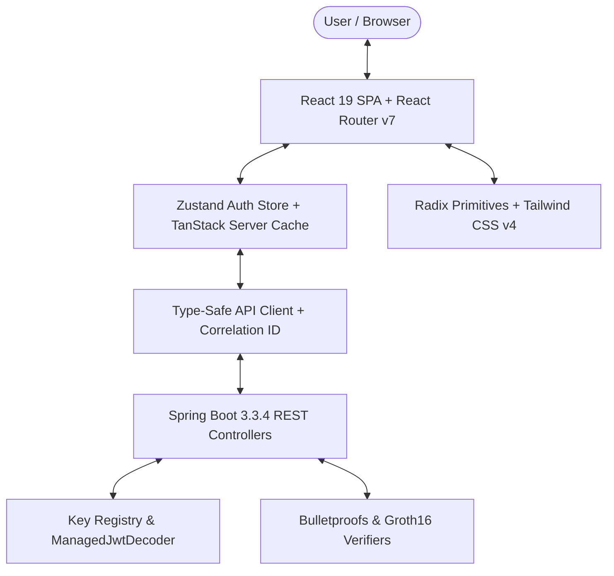

# Phase F1: Technology Stack Recommendation & Architectural Standards

**Project:** Zero-Knowledge Document Verification Platform  
**Document ID:** ZKDOC-FE-F1-004  
**Status:** Approved Architectural Standard  
**Target Execution:** Frontend Phase F2 & Subsequent Implementation Phases  

---

## 1. Executive Summary

This document defines the selected technology stack, library ecosystem, architectural patterns, and security guardrails for rebuilding the Zero-Knowledge Document Verification Platform frontend.

The platform requires a high-assurance, cryptographically sound, and accessible user interface. The frontend must seamlessly integrate with a Spring Boot 3.3.4 backend running OpenJDK 21, adhering to strict OAuth2 Resource Server constraints, Zero-Knowledge Proof (ZKP) predicate verification protocols, and Content Security Policy (CSP) headers.

The selected stack has been evaluated against current enterprise alternatives to optimize for developer productivity, bundle size, security, WCAG 2.2 Level AA accessibility compliance, and build compatibility with `frontend-maven-plugin`.

---

## 2. Technology Stack Evaluation & Selection

### 2.1 Framework Selection: React 19 + TypeScript vs Alternatives

| Framework | Evaluation & Fit Analysis | Decision |
| :--- | :--- | :--- |
| **React 19 + TypeScript (Selected)** | **Best Fit.** Seamless SPA architecture that compiles to static assets served by Spring Boot's `SpaForwardController`. Native support for React Server Components is not needed; pure client SPA mode with Vite maximizes compatibility, static bundle performance, and developer velocity. TypeScript 5.7+ provides end-to-end compile-time contract safety matching Java DTOs. | **SELECTED** |
| **Next.js (App Router / SSR)** | **Poor Fit.** Requires a persistent Node.js runtime server or standalone export mode that breaks Next.js dynamic routing conventions. Conflicts with the backend architecture where Spring Boot serves the API and static SPA assets as a single deployable JAR. | Rejected |
| **Remix / React Router 7 SSR** | **Partial Fit.** While React Router v7 library mode is excellent, full-stack SSR requires a Node runtime container separate from Spring Boot. React Router v7 *in SPA library mode* is selected for client-side routing. | Rejected (SSR) |
| **Svelte 5 / SvelteKit** | **Viable Alternative.** Lightweight, fast, and reactive. However, enterprise cryptographic libraries (Wasm/ZKP), QR scanner ecosystems (`html5-qrcode`), and accessible headless primitive libraries (`@radix-ui`) are significantly more mature and battle-tested in the React ecosystem. | Rejected |
| **Angular 18+** | **Viable Alternative.** Excellent enterprise structure and built-in RxJS. However, Angular brings significant bundle overhead, complex dependency injection boilerplate, and steeper onboarding friction for a focused zero-knowledge verification toolchain. | Rejected |

---

### 2.2 Build Tool: Vite 6+ vs Webpack / Turbopack

| Build Tool | Evaluation & Fit Analysis | Decision |
| :--- | :--- | :--- |
| **Vite 6+ (Selected)** | **Best Fit.** Instant HMR via native ES modules, fast Rollup-based production bundling, native TypeScript support, and zero configuration for outDir output to `../zkdoc-api/src/main/resources/static`. Out-of-the-box compatibility with `frontend-maven-plugin`. | **SELECTED** |
| **Webpack 5** | **Legacy.** Slow cold start, verbose configuration files, high memory consumption during `mvnw package`, and outdated dev server ergonomics. | Rejected |
| **Turbopack** | **Incompatible.** Primarily designed for Next.js ecosystem; lacks standalone static SPA build tooling flexibility required for Spring Boot embedded static resources. | Rejected |

---

### 2.3 Styling & Accessible Component Primitives

| Component / Style System | Evaluation & Fit Analysis | Decision |
| :--- | :--- | :--- |
| **Tailwind CSS v4 + Radix UI Primitives (Selected)** | **Best Fit.** Tailwind CSS v4 delivers extreme compile performance using the new `@tailwindcss/vite` engine with zero runtime CSS-in-JS overhead. Radix UI provides unstyled, accessible primitives (Dialog, Tabs, Popover, Dropdown, Tooltip, Toast) with built-in ARIA attributes, keyboard navigation, and focus-trap management required for WCAG 2.2 AA compliance. | **SELECTED** |
| **Material UI (MUI)** | **Poor Fit.** Heavy runtime CSS-in-JS overhead via Emotion/MUI-system, sluggish load times, opinionated Google Material aesthetics that clash with high-density cryptographic verification consoles, and complex theming customization. | Rejected |
| **Ant Design (antd)** | **Poor Fit.** Bulky bundle size (>1.2MB gzipped), rigid styling paradigms, and frequent accessibility warnings on screen readers and keyboard navigation. | Rejected |
| **Shadcn UI (Component Pattern)** | **Selected Pattern.** Utilizing Radix primitives styled with Tailwind CSS v4 utility classes provides full ownership of accessible components without external black-box library bloat. | **SELECTED (Pattern)** |

---

### 2.4 State Management & Data Fetching

| Tool | Evaluation & Fit Analysis | Decision |
| :--- | :--- | :--- |
| **TanStack Query v5 (React Query)** | **Best Fit for Server State.** Built-in caching, deduplication, automatic refetching, mutation states, optimistic UI updates, and declarative loading/error states for all REST endpoints (`/api/*`). | **SELECTED** |
| **Zustand + React Context** | **Best Fit for Client State.** Extremely lightweight (<1KB) store for auth token management, theme toggle, and active session states. Eliminates Redux boilerplate while maintaining pure immutable updates. | **SELECTED** |
| **Redux Toolkit** | **Over-engineered.** Unnecessary complexity and boilerplate for an application primarily driven by server-side document verification queries and transactional mutations. | Rejected |

---

### 2.5 Form Handling & Schema Validation

| Tool | Evaluation & Fit Analysis | Decision |
| :--- | :--- | :--- |
| **React Hook Form + Zod (Selected)** | **Best Fit.** Performant uncontrolled form inputs with minimal re-renders. Zod enables schema-first validation directly mirroring backend validation rules (`@NotBlank`, `@Size`, `@Pattern`, `@Min`, `@Max`). Produces instant client-side validation feedback before hitting network boundaries. | **SELECTED** |
| **Formik + Yup** | **Legacy.** Excessive re-renders on large multi-attribute credential issuance forms; Yup lacks the TypeScript inference precision of Zod. | Rejected |

---

### 2.6 Testing Ecosystem

| Testing Tool | Evaluation & Fit Analysis | Decision |
| :--- | :--- | :--- |
| **Vitest + React Testing Library (Selected)** | **Best Fit for Unit/Component.** Shares Vite's native configuration, fast execution, full Jest compatibility, happy-dom for lightweight DOM emulation, and Testing Library for user-centric component testing. | **SELECTED** |
| **Playwright (Selected for E2E)** | **Best Fit for E2E.** Fast, reliable multi-browser automation (Chromium, Firefox, WebKit), network mocking, visual regression testing, and accessibility auditing via `@axe-core/playwright`. | **SELECTED** |
| **Jest + Enzyme / Cypress** | **Outdated.** Jest requires separate Babel/TS transform pipelines. Cypress is resource-heavy and slower than Playwright for CI execution. | Rejected |

---

## 3. Recommended Core Dependencies & Target Versions

```json
{
  "name": "zkdoc-verification-frontend",
  "version": "1.0.0",
  "private": true,
  "type": "module",
  "scripts": {
    "dev": "vite",
    "build": "tsc -b && vite build",
    "preview": "vite preview",
    "typecheck": "tsc --noEmit",
    "lint": "eslint . --max-warnings 0",
    "lint:fix": "eslint . --fix",
    "format:check": "prettier --check .",
    "format:write": "prettier --write .",
    "test": "vitest",
    "test:run": "vitest run",
    "test:coverage": "vitest run --coverage",
    "test:e2e": "playwright test",
    "test:a11y": "playwright test --project=a11y"
  },
  "dependencies": {
    "@radix-ui/react-alert-dialog": "^1.1.2",
    "@radix-ui/react-dialog": "^1.1.2",
    "@radix-ui/react-dropdown-menu": "^2.1.2",
    "@radix-ui/react-label": "^2.1.0",
    "@radix-ui/react-popover": "^1.1.2",
    "@radix-ui/react-select": "^2.1.2",
    "@radix-ui/react-slot": "^1.1.0",
    "@radix-ui/react-tabs": "^1.1.1",
    "@radix-ui/react-tooltip": "^1.1.4",
    "@tanstack/react-query": "^5.62.0",
    "clsx": "^2.1.1",
    "html5-qrcode": "^2.3.8",
    "lucide-react": "^0.468.0",
    "qrcode.react": "^4.1.0",
    "react": "^19.0.0",
    "react-dom": "^19.0.0",
    "react-hook-form": "^7.54.0",
    "react-router-dom": "^7.0.2",
    "tailwind-merge": "^2.5.5",
    "zod": "^3.24.1",
    "zustand": "^5.0.2"
  },
  "devDependencies": {
    "@axe-core/playwright": "^4.10.0",
    "@eslint/js": "^9.16.0",
    "@playwright/test": "^1.49.1",
    "@tailwindcss/vite": "^4.0.0",
    "@testing-library/jest-dom": "^6.6.3",
    "@testing-library/react": "^16.1.0",
    "@testing-library/user-event": "^14.5.2",
    "@types/node": "^22.10.1",
    "@types/react": "^19.0.1",
    "@types/react-dom": "^19.0.1",
    "@vitejs/plugin-react": "^4.3.4",
    "eslint": "^9.16.0",
    "eslint-plugin-jsx-a11y": "^6.10.2",
    "eslint-plugin-react-hooks": "^5.1.0",
    "eslint-plugin-react-refresh": "^0.4.16",
    "happy-dom": "^15.11.7",
    "prettier": "^3.4.2",
    "tailwindcss": "^4.0.0",
    "typescript": "^5.7.2",
    "typescript-eslint": "^8.18.0",
    "vitest": "^2.1.8"
  }
}
```

---

## 4. Architectural Standards & Design Patterns

### 4.1 Type-Safe API Client Architecture

All backend communication must pass through a strongly-typed API client module that enforces:
1. **Correlation ID Header Injection:** Every outgoing HTTP request generates or propagates an `X-Correlation-Id` header (UUID v4) for distributed tracing across Spring Boot logs.
2. **Standardized Error Normalization:** Catches HTTP errors and normalizes them into a strongly-typed `ApiError` class matching the backend's `ApiErrorResponse`:
   ```typescript
   export interface ApiErrorResponse {
     timestamp: string;
     status: number;
     error: string;
     message: string;
     path: string;
     correlationId?: string;
     validationErrors?: Record<string, string>;
   }
   ```
3. **Session Interception:** A 401 Unauthorized response triggers automated session clearing and navigates the user to the session-renewal dialog with a descriptive message.
4. **Content-Type & Header Hygiene:** Automatically attaches `Accept: application/json` and `Content-Type: application/json` for mutation requests.

```typescript
// Architectural Pattern: Typed Request Wrapper
export async function apiRequest<T>(endpoint: string, options: RequestInit = {}): Promise<T> {
  const correlationId = crypto.randomUUID();
  const token = authStore.getState().token;

  const headers = new Headers(options.headers);
  headers.set('X-Correlation-Id', correlationId);
  headers.set('Accept', 'application/json');
  if (token) {
    headers.set('Authorization', `Bearer ${token}`);
  }
  if (options.body && !(options.body instanceof FormData)) {
    headers.set('Content-Type', 'application/json');
  }

  const response = await fetch(endpoint, { ...options, headers });

  if (!response.ok) {
    let errorData: ApiErrorResponse;
    try {
      errorData = await response.json();
    } catch {
      errorData = {
        timestamp: new Date().toISOString(),
        status: response.status,
        error: response.statusText,
        message: 'An unexpected network error occurred.',
        path: endpoint,
        correlationId,
      };
    }
    throw new ApiError(errorData);
  }

  // Handle 204 No Content
  if (response.status === 204) {
    return {} as T;
  }

  return response.json() as Promise<T>;
}
```

---

### 4.2 Security Standards & Zero-Knowledge Cryptographic Safeguards

#### 1. Content Security Policy (CSP) Alignment
The backend Spring Boot security configuration (`SecurityConfig.java`) enforces strict CSP headers:
- `script-src 'self'`: No inline `<script>` tags, no `eval()`, and no external CDN scripts (e.g. Unpkg, cdnjs).
- `style-src 'self' 'unsafe-inline'`: Styles are compiled into Vite's bundled CSS; inline dynamic style tags are minimized.
- `connect-src 'self'`: Outgoing fetch calls can only target the application origin or configured API endpoints.
- `object-src 'none'`: Plugins and Flash objects are prohibited.

#### 2. Authentication & JWT Handling
- **No Insecure Mock Tokens:** The legacy practice of injecting `demo-signature-for-development-eval` is abolished.
- **Developer Token Connect Modal:** For local development and testing, an explicit "Connect Developer JWT" modal will allow operators to input a valid signed JWT issued by `https://auth.zkdoc.internal` or provide an integration helper that signs a test token using a local development keypair when running in mock-auth mode.
- **Storage:** Sensitive session tokens are held in `sessionStorage` or in-memory Zustand state, never written to persistent `localStorage` to reduce XSS blast radius.

#### 3. Cryptographic Data Hygiene & Zeroization
- **No Raw Blinding Factors:** Frontend forms and views must NEVER expose or log raw blinding factors, uncommitted salt strings, or private key seed values.
- **Strict Verification Verification Rules:**
  - Badges such as "Mathematically Valid", "Valid Signature", and "Bound to Credential" must ONLY render `true` if and only if the backend returns `verified: true`.
  - Under no circumstances may an `undefined` property evaluate to `true` (preventing the legacy `proofValid !== false` false-positive vulnerability).
- **Sensitive Memory Clearing:** On logout or proof submission completion, sensitive proof generation inputs are actively overwritten in memory (`proofBytes.fill(0)`).

---

### 4.3 Accessibility Standards (WCAG 2.2 Level AA Compliance)

1. **Keyboard Operability:** Every interactive element (buttons, tabs, modal triggers, QR scanner toggles, copy buttons) must be reachable and actionable via `Tab`, `Enter`, and `Space`.
2. **Focus Visible:** Distinct focus visible indicators (`ring-2 ring-indigo-500 ring-offset-2`) on all interactive components.
3. **ARIA Live Regions:**
   - Proof verification results, QR scanning status, and toast notifications must utilize `role="status"` or `role="alert"` with `aria-live="polite"` or `aria-live="assertive"`.
4. **Form Accessibility:**
   - Every input element must have an explicitly associated `<label>` via `htmlFor`/`id`.
   - Field errors must be referenced via `aria-describedby="field-error-id"` and have `aria-invalid="true"`.
5. **Color Contrast:**
   - All text must meet or exceed contrast ratios of **4.5:1** for standard text and **3:1** for large headings and badge containers against background colors.
   - Status indicators must not rely solely on color; they must include text labels and distinct semantic icons (e.g., checkmark for success, exclamation circle for failure).

---

### 4.4 Mobile-First & Responsive Layout Strategy

1. **Breakpoints:** Standard Tailwind CSS responsive breakpoints (`sm: 640px`, `md: 768px`, `lg: 1024px`, `xl: 1280px`).
2. **Mobile-Responsive Dashboards:** Tables with high column density (e.g., Credential Lists, Audit Logs) automatically transform into accessible card-based stacked lists on screens narrower than `768px`.
3. **Camera UX:** QR scanner viewport adapts dynamically to mobile aspect ratios, providing camera selection dropdowns and manual file upload fallbacks for devices without camera access.

---

## 5. Summary of Recommended Architecture



This stack guarantees strict alignment with backend security invariants, modern maintainability, and enterprise-grade reliability.
