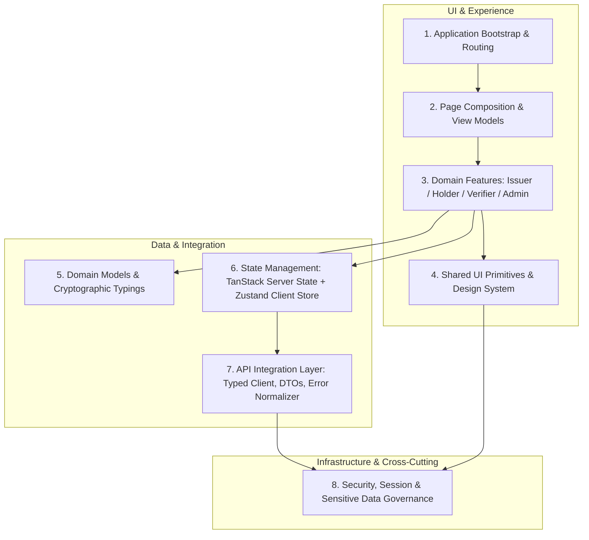
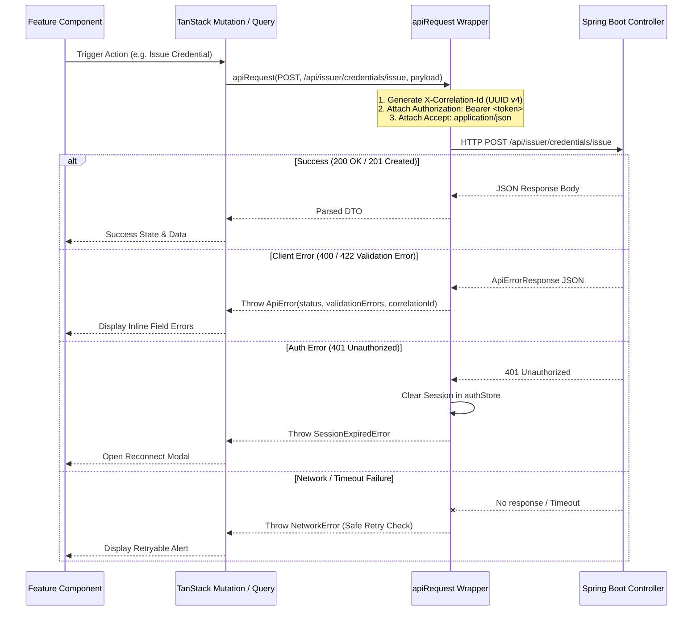

# Phase F2: Frontend Architecture Specification

**Project:** Zero-Knowledge Document Verification Platform  
**Document ID:** ZKDOC-FE-F2-001  
**Status:** Approved Architecture Specification  
**Target Implementation Phases:** F3 through F12  

---

## 1. Executive Summary & Architecture Baseline

This specification defines the complete, production-grade frontend architecture for the Zero-Knowledge Document Verification Platform. 

Following the audit in Phase F1, this document formalizes the architectural baseline, module boundaries, routing strategy, state hierarchy, API integration layer, and deployment model. The architecture is strictly grounded in the verified capabilities of the Spring Boot 3.3.4 backend running OpenJDK 21, enforcing strict separation of concerns, enterprise security, and WCAG 2.2 Level AA accessibility compliance.

### Confirmed Architectural Decisions:
1. **Core Toolchain:** React 19 SPA running TypeScript 5.7+ with Vite 6+ as the build engine.
2. **Styling & Accessible Primitives:** Tailwind CSS v4 (`@tailwindcss/vite`) combined with Radix UI headless accessible primitives (`@radix-ui/react-*`) and `lucide-react` iconography.
3. **Client-Side Routing:** React Router v7 in SPA library mode, structured around deep routes registered in Spring Boot's [`SpaForwardController.java`](file:///c:/Sabareesh/Easwari%20College/Semester%203/OOPs%20with%20Java/Project/Start%20over/Zero%20Knowledge%20Document%20Verification/zkdoc-api/src/main/java/com/zkdoc/api/controller/SpaForwardController.java).
4. **State Layer:** Strict two-tier state management:
   - **Server Cache & Query Lifecycle:** TanStack Query v5 (React Query) for deduplication, optimistic updates, and loading/error states.
   - **Client Session Store:** Zustand with in-memory / `sessionStorage` persistence for OAuth2 JWTs, active user identity, and theme tokens.
5. **Form & Contract Validation:** React Hook Form coupled with Zod schemas strictly synchronized with Spring Boot Java DTOs.
6. **Backend Packaging Target:** Vite builds directly into `../zkdoc-api/src/main/resources/static`, packaged via `frontend-maven-plugin` into the standalone Spring Boot JAR.

---

## 2. Logical Layer Architecture & Separation of Concerns

The frontend is organized into 8 strict logical layers to guarantee maintainability, zero circular dependencies, and high testability:



### Layer Responsibilities & Isolation Rules:

| Layer | Responsibility | Allowed Inclusions | Prohibited Inclusions |
| :--- | :--- | :--- | :--- |
| **1. Application Layer** | App bootstrapping, React Router provider, TanStack Query provider, global error boundaries, and HTML head metadata. | Providers, Root layout, global CSS import, router configuration. | Feature-specific business logic, direct fetch calls, raw form handlers. |
| **2. Page Layer** | Route-level components. Maps URL parameters to queries, orchestrates feature components, and manages page-level title/meta. | Layout wrappers, feature composition, breadcrumbs. | Low-level DOM primitives, raw API requests without feature hooks. |
| **3. Feature Layer** | Autonomous business modules: `issuer`, `holder`, `verifier`, `admin`, `audit`. | Forms, feature tables, workflow modals, domain-specific hooks (`useIssuerCredentials`). | Cross-feature direct imports without shared domain interfaces. |
| **4. Shared UI Layer** | Reusable, accessible UI design system components. | Buttons, Badges, Modals (Radix), Inputs, Toasts, Skeletons, Dropdowns. | Direct API dependencies, global authentication state, domain business logic. |
| **5. Domain Layer** | Clean domain entities, proof artifact structures, and verification enum types. | Pure TypeScript interfaces, type guards, formatting helpers (`formatHash`). | React hooks, JSX, browser DOM manipulation. |
| **6. State Layer** | Query cache keys, mutation definitions, active auth token store, theme toggles. | TanStack Query options, Zustand stores, cache invalidation logic. | Direct DOM mutations, long-lived persistence of cryptographic secrets. |
| **7. API Layer** | Type-safe HTTP client, correlation ID generator, backend DTOs, and error normalization. | Fetch client wrapper, DTO types, status code handlers, request timeouts. | React component state, UI alert rendering. |
| **8. Security Layer** | Token extraction, role-based route guards, memory zeroization utilities. | JWT claim decoding, permission checks, cryptographic buffer wiping. | Hardcoded mock tokens, persistent secret storage in localStorage. |

---

## 3. Target Directory Structure (`frontend/src/`)

```
frontend/
├── legacy-reference/             # Quarantined legacy code (temporary, purged in F12)
├── public/                       # Static public assets (favicon.svg, robots.txt)
├── src/
│   ├── api/                      # Layer 7: API Integration
│   │   ├── client.ts             # Typed fetch wrapper with correlation ID & auth header
│   │   ├── endpoints.ts          # Centralized endpoint URI constants
│   │   ├── errors.ts             # ApiError class & ApiErrorResponse normalizer
│   │   ├── types.ts              # Backend DTO schemas matching Java models
│   │   └── services/             # Endpoint service wrappers
│   │       ├── verifierService.ts
│   │       ├── zkpService.ts
│   │       ├── issuerService.ts
│   │       ├── holderService.ts
│   │       ├── adminService.ts
│   │       ├── auditService.ts
│   │       └── keyService.ts
│   ├── assets/                   # Static SVG icons, illustrations, badges
│   ├── components/               # Layer 4: Shared UI Design System
│   │   ├── common/               # General UI atoms & molecules
│   │   │   ├── Alert.tsx         # Accessible status callout
│   │   │   ├── Badge.tsx         # Status & capability tags
│   │   │   ├── Button.tsx        # Accessible button with loading & focus states
│   │   │   ├── Card.tsx          # Content container with semantic sections
│   │   │   ├── Dialog.tsx        # Radix-powered focus-trapped modal
│   │   │   ├── Dropdown.tsx      # Radix-powered accessible action menu
│   │   │   ├── Input.tsx         # Accessible input with label & error binding
│   │   │   ├── Select.tsx        # Radix accessible select
│   │   │   ├── Skeleton.tsx      # Loading state placeholders
│   │   │   ├── Table.tsx         # Responsive table with card fallback
│   │   │   └── Tooltip.tsx       # Radix accessible tooltip
│   │   ├── feedback/             # Toasts, error boundaries, live regions
│   │   │   ├── ErrorBoundary.tsx # React error boundary catching render crashes
│   │   │   ├── LiveRegion.tsx    # Screen reader announcement manager
│   │   │   └── Toast.tsx         # Ephemeral status messages
│   │   └── layout/               # Global navigation & shells
│   │       ├── AppLayout.tsx     # Shell with skip-link, header, sidebar, footer
│   │       ├── Header.tsx        # Top navbar with user profile & connect modal
│   │       ├── Sidebar.tsx       # Role-aware responsive navigation drawer
│   │       ├── Footer.tsx        # Platform status, build info, legal links
│   │       └── SkipLink.tsx      # WCAG 2.2 bypass block mechanism
│   ├── domain/                   # Layer 5: Domain Models & Proof Concepts
│   │   ├── credential.ts         # Credential entity & status enums
│   │   ├── verification.ts       # Verification result semantics & status types
│   │   ├── proof.ts              # ZKP predicate proof models & nonce contracts
│   │   └── audit.ts              # Audit record model & hash chain contracts
│   ├── features/                 # Layer 3: Autonomous Business Modules
│   │   ├── admin/                # Key rotation & recovery administration
│   │   │   ├── components/
│   │   │   ├── hooks/
│   │   │   └── AdminDashboard.tsx
│   │   ├── audit/                # Immutable audit log explorer
│   │   │   ├── components/
│   │   │   ├── hooks/
│   │   │   └── AuditLogViewer.tsx
│   │   ├── auth/                 # OAuth2 JWT connect dialog & session status
│   │   │   ├── components/
│   │   │   │   └── JwtConnectModal.tsx
│   │   │   └── hooks/
│   │   │       └── useAuth.ts
│   │   ├── holder/               # Credential wallet & ZKP proof generation
│   │   │   ├── components/
│   │   │   │   ├── CredentialCard.tsx
│   │   │   │   └── ProofGenerationModal.tsx
│   │   │   ├── hooks/
│   │   │   └── HolderWallet.tsx
│   │   ├── issuer/               # Credential issuance & revocation lifecycle
│   │   │   ├── components/
│   │   │   │   ├── DocumentUploader.tsx
│   │   │   │   └── IssuanceForm.tsx
│   │   │   ├── hooks/
│   │   │   └── IssuerWorkspace.tsx
│   │   └── verifier/             # Public verification & predicate evaluation
│   │       ├── components/
│   │       │   ├── QrReader.tsx
│   │       │   ├── VerificationResultCard.tsx
│   │       │   └── PredicateVerifierForm.tsx
│   │       ├── hooks/
│   │       └── VerificationConsole.tsx
│   ├── hooks/                    # Reusable utility hooks
│   │   ├── useDebounce.ts
│   │   ├── useMediaQuery.ts
│   │   └── useClipboard.ts
│   ├── pages/                    # Layer 2: Page Composition
│   │   ├── HomePage.tsx          # Public platform overview & role router
│   │   ├── VerifyPage.tsx        # Public verification console
│   │   ├── PredicateVerifyPage.tsx # Anonymous ZKP predicate evaluation
│   │   ├── IssuerPage.tsx        # Authenticated issuer dashboard
│   │   ├── HolderPage.tsx        # Authenticated holder wallet
│   │   ├── AuditLogsPage.tsx     # Authenticated audit explorer
│   │   ├── AdministrationPage.tsx# Authenticated key & node management
│   │   ├── ForbiddenPage.tsx     # 403 Access denied view
│   │   └── NotFoundPage.tsx      # 404 Route fallback
│   ├── routes/                   # Layer 1: Route Declarations & Guards
│   │   ├── index.tsx             # React Router configuration
│   │   ├── ProtectedRoute.tsx    # Role-aware authentication guard
│   │   └── routes.ts             # Route constant paths matching Spring Boot
│   ├── state/                    # Layer 6: State Stores & Query Client
│   │   ├── authStore.ts          # Zustand store for JWT & session state
│   │   └── queryClient.ts        # TanStack Query client configuration
│   ├── styles/                   # Design Tokens & Styles
│   │   ├── tokens.css            # CSS custom properties for color, spacing, rings
│   │   └── index.css             # Tailwind CSS v4 entry
│   ├── utils/                    # Pure Utility Functions
│   │   ├── crypto.ts             # Hex nonce generator & memory zeroization
│   │   ├── formatters.ts         # Date, hash, and attribute formatters
│   │   └── qr.ts                 # Canonical JSON QR parser & serializer
│   ├── App.tsx                   # Top-level application component
│   ├── main.tsx                  # Application bootstrap entry point
│   └── vite-env.d.ts             # Vite environment typings
├── index.html                    # HTML5 entry template
├── package.json                  # Dependencies & scripts
├── tsconfig.json                 # TypeScript project configuration
├── vite.config.ts                # Vite build configuration (outDir to static/)
└── vitest.config.ts              # Vitest test configuration
```

---

## 4. Routing Architecture & Spring Boot SPA Forwarding

### 4.1 Route Synchronization
The frontend routes are strictly aligned with Spring Boot's [`SpaForwardController.java`](file:///c:/Sabareesh/Easwari%20College/Semester%203/OOPs%20with%20Java/Project/Start%20over/Zero%20Knowledge%20Document%20Verification/zkdoc-api/src/main/java/com/zkdoc/api/controller/SpaForwardController.java):

```java
@GetMapping(value = {
    "/",
    "/verify",
    "/credentials",
    "/verification",
    "/predicate-verification",
    "/audit-logs",
    "/administration"
})
public String forward() {
    return "forward:/index.html";
}
```

### 4.2 Route Definitions & Access Control Matrix:

| Route Path | Page Component | Access Level | Required Role | Fallback / Guard |
| :--- | :--- | :--- | :--- | :--- |
| `/` | `HomePage` | Public | None | N/A |
| `/verify` | `VerifyPage` | Public | None | N/A |
| `/verification` | `VerifyPage` (Alias) | Public | None | N/A |
| `/predicate-verification` | `PredicateVerifyPage` | Public | None | N/A |
| `/credentials` | `HolderPage` | Protected | `ROLE_HOLDER` | Redirect to Connect Modal |
| `/issuer` | `IssuerPage` | Protected | `ROLE_ISSUER` | Redirect to Connect Modal |
| `/audit-logs` | `AuditLogsPage` | Protected | `ROLE_ADMIN` or `ROLE_ISSUER` | Redirect to Forbidden / 403 |
| `/administration` | `AdministrationPage` | Protected | `ROLE_ADMIN` | Redirect to Forbidden / 403 |
| `*` | `NotFoundPage` | Public | None | 404 View with Home link |

---

## 5. API Integration Layer Architecture

### 5.1 Typed Fetch Client Architecture
The API layer enforces strict HTTP standards, correlation tracing, and error normalization:



### 5.2 Error Normalization Model
Every non-2xx HTTP response is normalized into an `ApiError` class matching the backend's `ApiErrorResponse`:
```typescript
export class ApiError extends Error {
  public readonly status: number;
  public readonly error: string;
  public readonly path: string;
  public readonly correlationId?: string;
  public readonly validationErrors?: Record<string, string>;
  public readonly timestamp: string;

  constructor(payload: ApiErrorResponse) {
    super(payload.message || 'An unexpected API error occurred');
    this.name = 'ApiError';
    this.status = payload.status;
    this.error = payload.error;
    this.path = payload.path;
    this.correlationId = payload.correlationId;
    this.validationErrors = payload.validationErrors;
    this.timestamp = payload.timestamp;
  }
}
```

### 5.3 Retry Policy & Safe Boundaries
- **Idempotent GET Requests:** Retried up to 2 times with exponential backoff (`useQuery({ retry: 2 })`).
- **Cryptographic & State-Changing Mutations:** **ZERO RETRIES.** Operations such as `POST /api/issuer/credentials/issue`, `POST /api/issuer/credentials/{id}/revoke`, and `POST /api/admin/keys/rotate` will NEVER automatically retry upon network uncertainty to prevent duplicate cryptographic commits or double-revocations.

---

## 6. Authentication, Session & Token Architecture

### 6.1 OAuth2 Resource Server Reality
The backend Spring Boot security filter chain (`JwtAuthenticationFilter`) verifies incoming bearer tokens using `ManagedJwtDecoderProvider` against keys registered in `KeyRegistryService` for purpose `JWT_SIGNING`.

Because the backend **does not provide an in-band username/password login endpoint**, the frontend provides:
1. **Interactive Developer JWT Connect Dialog:** Allows operators to input a valid signed JWT issued by `https://auth.zkdoc.internal` or test environments.
2. **Token Validation & Claim Decoding:** Inspects token structure without trusting unverified signatures, extracting:
   - `sub`: Subject identifier / username.
   - `roles`: String array (e.g. `["ROLE_ADMIN", "ROLE_ISSUER"]`).
   - `exp`: Expiration timestamp in epoch seconds.
3. **Session Expiry Watcher:** Automatically monitors token `exp`. When expired, clears active state, terminates in-flight queries, and prompts user re-authentication.

### 6.2 Token Storage Strategy
- **Primary Storage:** In-memory Zustand state.
- **Persistence Across Tab Reload:** Optional `sessionStorage` fallback (cleared when browser tab closes).
- **Hard Restriction:** Tokens are **NEVER stored in `localStorage`**, cookies with script access, or URL query parameters to minimize XSS exposure.

---

## 7. Performance, Code Splitting & Build Output

### 7.1 Chunking & Code Splitting Strategy
To minimize initial bundle load time, routes and heavy libraries are code-split using `React.lazy()` and dynamic imports:
- **Core Chunk (`vendor-react`):** `react`, `react-dom`, `react-router-dom`, `zustand`, `@tanstack/react-query`.
- **UI Primitives (`vendor-ui`):** `@radix-ui/*`, `lucide-react`.
- **QR & Crypto Chunk (`vendor-qr`):** `html5-qrcode`, `qrcode.react` (loaded only on verification and issuance routes).
- **Route Chunks:** Each page in `src/pages/` is loaded lazily with a `<Suspense>` fallback rendering an accessible `<Skeleton>`.

### 7.2 Spring Boot Static Resource Integration
Vite is configured with:
```typescript
build: {
  outDir: '../zkdoc-api/src/main/resources/static',
  emptyOutDir: true,
  sourcemap: false, // Prevent source code leakage in production builds
  rollupOptions: {
    output: {
      manualChunks: {
        'vendor-react': ['react', 'react-dom', 'react-router-dom'],
        'vendor-ui': ['@radix-ui/react-dialog', '@radix-ui/react-tabs', 'lucide-react'],
      }
    }
  }
}
```

---

## 8. Summary of Architectural Guarantees

1. **Contract Faithfulness:** 100% of API endpoints, parameters, and payloads match Java DTO declarations.
2. **Cryptographic Truth:** Zero-knowledge predicate and integrity results are derived solely from verified backend booleans.
3. **Security Invariants:** Strict CSP compliance (`script-src 'self'`), correlation ID injection, and zeroization of sensitive memory buffers.
4. **Accessibility Baseline:** WCAG 2.2 Level AA conformance built into all primitive components via Radix UI.
5. **Preservation:** No backend code or static assets will be altered during planning; full compatibility with `mvnw clean verify`.
