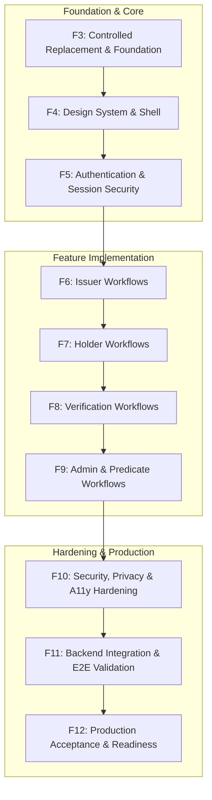

# Phase F2: Implementation Blueprint (Phases F3–F12)

**Project:** Zero-Knowledge Document Verification Platform  
**Document ID:** ZKDOC-FE-F2-005  
**Status:** Approved Master Implementation Blueprint  
**Target Execution:** Phases F3 through F12  

---

## 1. Roadmap Architecture & Phase Sequencing

This blueprint establishes the precise technical contracts, deliverables, prerequisites, verification commands, and exit gates for executing the frontend rebuild across Phases F3 through F12.

Each phase is strictly isolated and builds directly upon verified artifacts from previous phases, ensuring zero regression of the Spring Boot backend or its embedded static delivery pipeline.



---

## 2. Phase-by-Phase Technical Specifications

---

### Phase F3: Controlled Replacement and Project Foundation

- **Objective:** Safely decommission legacy frontend source files, scaffold the modern React 19 + TypeScript 5.7+ + Vite 6+ toolchain, configure Tailwind CSS v4, and verify backend static asset invariants.
- **Scope:** Build manifests, configuration files, quarantine setup, and minimal compilable application.
- **Prerequisites:** Phase F2 approval. Clean working tree on `feat/readiness`.
- **Files Introduced / Replaced:**
  - Quarantine: Move `frontend/src/` -> `frontend/legacy-reference/src/`.
  - Replaced: `frontend/package.json`, `package-lock.json`, `vite.config.ts`, `tsconfig.json`, `tsconfig.app.json`, `tsconfig.node.json`, `eslint.config.js`, `.prettierrc`, `index.html`.
  - Introduced: Minimal `src/main.tsx`, `src/App.tsx`, `src/index.css`, `src/vite-env.d.ts`.
- **Backend API Dependencies:** None (pure toolchain & static build verification).
- **Security & Preservation Rules:**
  - Preserved: Do NOT delete `zkdoc-api/src/main/resources/static/index.html` during initial cleanup.
  - No network dependencies during build: lockfile committed cleanly.
- **Verification Commands:**
  ```powershell
  npm --prefix frontend run typecheck
  npm --prefix frontend run lint
  npm --prefix frontend run format:check
  npm --prefix frontend run build
  .\mvnw.cmd test -pl zkdoc-api -Dtest=FrontendIntegrationTest
  ```
- **Exit Criteria:** Clean build produces bundle in `zkdoc-api/src/main/resources/static/`; `FrontendIntegrationTest` passes with code 0; 0 lint errors, 0 type errors.
- **Out of Scope:** Feature components, API client implementation, routing setup.

---

### Phase F4: Design System and Application Shell

- **Objective:** Implement the design token system, accessible component primitives (Radix UI + Tailwind CSS v4), global navigation shell, responsive drawer, skip-links, and error boundaries.
- **Scope:** Layout shell, core component library (`components/common/*`), theme tokens, error boundaries, and 404/403 pages.
- **Prerequisites:** Phase F3 completed with passing build.
- **Files Introduced:**
  - Tokens: `src/styles/tokens.css`, `src/styles/index.css`.
  - Primitives: `Button.tsx`, `Badge.tsx`, `Card.tsx`, `Dialog.tsx`, `Dropdown.tsx`, `Input.tsx`, `Select.tsx`, `Table.tsx`, `Alert.tsx`, `Skeleton.tsx`.
  - Layout: `AppLayout.tsx`, `Header.tsx`, `Sidebar.tsx`, `Footer.tsx`, `SkipLink.tsx`.
  - Fallback Views: `NotFoundPage.tsx`, `ForbiddenPage.tsx`, `ErrorBoundary.tsx`.
- **Backend API Dependencies:** `GET /actuator/health` (for system health indicator in header).
- **Security & Accessibility Rules:**
  - All interactive controls have `min-h-[44px] min-w-[44px]` touch targets.
  - Visible focus rings: `focus-visible:ring-2 focus-visible:ring-indigo-600 focus-visible:ring-offset-2`.
  - Skip-to-content bypass link targets `#main-content`.
- **Verification Commands:**
  ```powershell
  npm --prefix frontend run test:run -- components
  npm --prefix frontend run lint
  ```
- **Exit Criteria:** All component unit tests pass with 100% assertions; layout renders responsively across desktop (1280px) and mobile (375px); zero a11y contrast violations.
- **Out of Scope:** Business domain workflows, JWT authentication integration.

---

### Phase F5: Authentication and Session Security

- **Objective:** Implement the type-safe fetch API client with correlation ID tracing, `ApiErrorResponse` normalization, OAuth2 JWT session store, and the Developer JWT Connect modal.
- **Scope:** API client, Zustand `authStore`, JWT decoder, route guards, and session lifecycle monitoring.
- **Prerequisites:** Phase F4 completed.
- **Files Introduced:**
  - API Client: `src/api/client.ts`, `src/api/endpoints.ts`, `src/api/errors.ts`, `src/api/types.ts`.
  - Auth Feature: `src/features/auth/components/JwtConnectModal.tsx`, `src/features/auth/hooks/useAuth.ts`.
  - State & Routing: `src/state/authStore.ts`, `src/routes/ProtectedRoute.tsx`.
- **Backend API Dependencies:** Compatible with backend Spring Security `JwtAuthenticationFilter` (`https://auth.zkdoc.internal`, `aud: zkdoc-api`).
- **Security Requirements:**
  - Eliminates legacy `demo-signature-for-development-eval` mock tokens.
  - Tokens stored in memory (or optional `sessionStorage`), NEVER in `localStorage`.
  - Automatic session teardown on 401 Unauthorized response or `exp` expiration.
- **Verification Commands:**
  ```powershell
  npm --prefix frontend run test:run -- api auth
  npm --prefix frontend run typecheck
  ```
- **Exit Criteria:** Unit tests prove correct `X-Correlation-Id` propagation, `ApiError` mapping, and route redirection for unauthenticated attempts.
- **Out of Scope:** Domain dashboards, document uploads, proof generation.

---

### Phase F6: Issuer Workflows

- **Objective:** Implement the credential issuer dashboard, document upload with client-side SHA-256 calculation, multi-attribute credential issuance, and credential revocation modal.
- **Scope:** `IssuerPage`, `DocumentUploader`, `IssuanceForm`, and revocation action workflows.
- **Prerequisites:** Phase F5 completed.
- **Files Introduced:**
  - Services: `src/api/services/issuerService.ts`.
  - Components: `src/features/issuer/components/DocumentUploader.tsx`, `src/features/issuer/components/IssuanceForm.tsx`, `src/features/issuer/components/RevocationModal.tsx`.
  - Page: `src/pages/IssuerPage.tsx`.
- **Backend API Endpoints:**
  - `POST /api/issuer/documents/upload`
  - `POST /api/issuer/credentials/issue`
  - `POST /api/issuer/credentials/{id}/revoke`
- **Security Requirements:**
  - Client-side SHA-256 digest validation matching server-side digest.
  - Zero retries on issuance or revocation mutations to avoid duplicate transactions.
- **Verification Commands:**
  ```powershell
  npm --prefix frontend run test:run -- features/issuer
  npm --prefix frontend run lint
  ```
- **Exit Criteria:** Issuer unit & integration tests pass; issuance form validates attribute schemas; revocation prompts confirmation dialog.
- **Out of Scope:** Holder wallet views, public verification consoles.

---

### Phase F7: Holder Workflows

- **Objective:** Implement the holder credential wallet, attribute inspection, lifecycle status display, and Zero-Knowledge Proof generation modal with valid hex nonce generation.
- **Scope:** `HolderPage`, `CredentialCard`, and `ProofGenerationModal`.
- **Prerequisites:** Phase F6 completed.
- **Files Introduced:**
  - Services: `src/api/services/holderService.ts`.
  - Components: `src/features/holder/components/CredentialCard.tsx`, `src/features/holder/components/ProofGenerationModal.tsx`.
  - Page: `src/pages/HolderPage.tsx`.
- **Backend API Endpoints:**
  - `GET /api/holder/credentials`
  - `POST /api/holder/credentials/proofs/generate`
- **Security Requirements:**
  - Enforce valid `nonceHex` matching `^[0-9a-fA-F]{2,128}$` (fixing the legacy F1 defect).
  - In-memory zeroization of sensitive proof buffers (`Uint8Array.fill(0)`) upon modal close.
- **Verification Commands:**
  ```powershell
  npm --prefix frontend run test:run -- features/holder
  npm --prefix frontend run typecheck
  ```
- **Exit Criteria:** Tests prove proof generation payload includes valid `nonceHex`; sensitive fields zeroed on unmount.
- **Out of Scope:** Public verifier QR scanning, system administration.

---

### Phase F8: Verification Workflows

- **Objective:** Implement the public credential verification console, QR code camera scanning and parsing, canonical JSON QR validation, and privacy-preserving result presentation.
- **Scope:** `VerifyPage`, `QrReader`, `VerificationResultCard`, and verification reference utilities.
- **Prerequisites:** Phase F7 completed.
- **Files Introduced:**
  - Services: `src/api/services/verifierService.ts`.
  - Components: `src/features/verifier/components/QrReader.tsx`, `src/features/verifier/components/VerificationResultCard.tsx`.
  - Page: `src/pages/VerifyPage.tsx`.
  - Utils: `src/utils/qr.ts`.
- **Backend API Endpoints:**
  - `POST /api/verifier/credentials/verify`
  - `GET /api/verifier/credentials/{id}`
- **Security & Truthfulness Rules:**
  - Validates untrusted QR input against `CanonicalQrSchema` (`{"v":"QR_V1","m":...}`).
  - Verification badges render `VERIFIED & ACTIVE` strictly when `valid === true && status === 'ACTIVE'`.
- **Verification Commands:**
  ```powershell
  npm --prefix frontend run test:run -- features/verifier
  npm --prefix frontend run lint
  ```
- **Exit Criteria:** Tests prove successful parsing of canonical QR JSON; tests verify accurate result rendering for active, revoked, and expired credentials.
- **Out of Scope:** Administrative key rotation, ZKP predicate evaluation.

---

### Phase F9: Administrator and Predicate-Proof Workflows

- **Objective:** Implement the anonymous Zero-Knowledge Predicate proof verification interface, key registry management, recovery reconciliation, and the immutable audit log explorer.
- **Scope:** `PredicateVerifyPage`, `AdministrationPage`, and `AuditLogsPage`.
- **Prerequisites:** Phase F8 completed.
- **Files Introduced:**
  - Services: `src/api/services/zkpService.ts`, `src/api/services/adminService.ts`, `src/api/services/auditService.ts`, `src/api/services/keyService.ts`.
  - Pages: `src/pages/PredicateVerifyPage.tsx`, `src/pages/AdministrationPage.tsx`, `src/pages/AuditLogsPage.tsx`.
- **Backend API Endpoints:**
  - `POST /api/v2/zkp/credential-predicates/verify` (Strict 6 fields)
  - `GET /api/keys/status`
  - `POST /api/admin/keys/rotate`
  - `POST /api/admin/recovery/reconcile`
  - `GET /api/admin/recovery/status`
  - `GET /api/audit/logs`
- **Critical Quality Rule:**
  - **Zero Falsification Fix:** Predicate verification UI displays "PREDICATE SATISFIED" if and only if `verified === true`. Renders "PROOF REJECTED" when `verified === false`. Disallows truthy evaluations on `undefined`.
- **Verification Commands:**
  ```powershell
  npm --prefix frontend run test:run -- pages/PredicateVerifyPage pages/AdministrationPage pages/AuditLogsPage
  npm --prefix frontend run typecheck
  ```
- **Exit Criteria:** Tests prove strict 6-field payload generation for predicate evaluation; zero false-positive badges on failed proofs; recovery reconcile triggered and displayed cleanly.
- **Out of Scope:** Final E2E browser tests, legacy code deletion.

---

### Phase F10: Frontend Security, Privacy and Accessibility Hardening

- **Objective:** Execute comprehensive accessibility audits via Axe, verify WCAG 2.2 AA compliance across all routes, enforce responsive card collapse on mobile viewports, audit storage hygiene, and verify Content Security Policy adherence.
- **Scope:** Cross-application auditing, automated Axe tests, keyboard focus verification, and responsive refactoring.
- **Prerequisites:** Phase F9 completed.
- **Verification & Testing Commands:**
  ```powershell
  npm --prefix frontend run test:a11y
  npm --prefix frontend run test:run
  npm --prefix frontend run lint
  ```
- **Exit Criteria:** 0 Axe accessibility violations; 0 lint errors; verified keyboard navigation across all interactive workflows; confirmed empty `localStorage`.
- **Out of Scope:** Production JAR packaging.

---

### Phase F11: Backend Integration and End-to-End Validation

- **Objective:** Implement full Playwright E2E test suites against live or mocked backend services, validate deep link routing via `FrontendIntegrationTest`, and perform full Maven reactor build.
- **Scope:** Playwright E2E suite, backend integration tests, and Maven build pipeline verification.
- **Prerequisites:** Phase F10 completed.
- **Verification Commands:**
  ```powershell
  npm --prefix frontend run test:e2e
  .\mvnw.cmd test -pl zkdoc-api -Dtest=FrontendIntegrationTest
  .\mvnw.cmd clean verify
  ```
- **Exit Criteria:** Full `mvnw clean verify` completes with code 0; all backend unit and integration tests pass; Playwright test suite passes 100%.
- **Out of Scope:** Final documentation sign-off and legacy file deletion.

---

### Phase F12: Production Acceptance and Deployment Readiness

- **Objective:** Permanently delete the quarantined legacy code (`frontend/legacy-reference/`), perform final dependency and security audit, generate production operational guide, and certify frontend production acceptance.
- **Scope:** Legacy file deletion, final repository cleanup, operational documentation, and production certification.
- **Prerequisites:** Phase F11 completed.
- **Actions & Deliverables:**
  - Permanently remove `frontend/legacy-reference/`.
  - Author `docs/frontend-rebuild/frontend-operations-guide.md`.
  - Author `docs/frontend-rebuild/f12-production-acceptance-report.md`.
- **Verification Commands:**
  ```powershell
  npm --prefix frontend run typecheck
  npm --prefix frontend run lint
  npm --prefix frontend run test:run
  .\mvnw.cmd test -pl zkdoc-api -Dtest=FrontendIntegrationTest
  git status --short
  ```
- **Exit Criteria:** Legacy reference directory completely purged; working directory clean; full suite passes; production acceptance signed off.

---

## 3. Master Acceptance Criteria for Complete Rebuild

The complete frontend rebuild will be certified production-ready upon meeting all 8 non-negotiable criteria:

1. **Standalone JAR Packaging:** `.\mvnw.cmd clean verify` executes with code `0`, embedding the compiled React 19 SPA into the Spring Boot JAR without manual intervention.
2. **Zero Backend Regressions:** 100% of existing backend tests across `zkdoc-crypto`, `zkdoc-zkp`, `zkdoc-keys`, `zkdoc-core`, and `zkdoc-api` pass.
3. **Deep Link Delivery:** `FrontendIntegrationTest` passes across `/`, `/verify`, `/credentials`, `/verification`, `/predicate-verification`, `/audit-logs`, `/administration`.
4. **Code Quality & Static Analysis:** `npm run typecheck`, `npm run lint`, and `npm run format:check` execute with zero errors and zero warnings.
5. **Cryptographic Integrity:** Predicate proof verification renders positive status *only* upon mathematical proof verification (`verified: true`); proof generation includes valid `nonceHex`.
6. **Authentication Compliance:** Strictly integrates with OAuth2 Resource Server Bearer standards without mock token generation.
7. **Accessibility Compliance:** WCAG 2.2 Level AA compliance verified via automated Axe tests and manual keyboard review.
8. **Total Technical Debt Elimination:** All legacy files in `frontend/legacy-reference/` completely removed.
