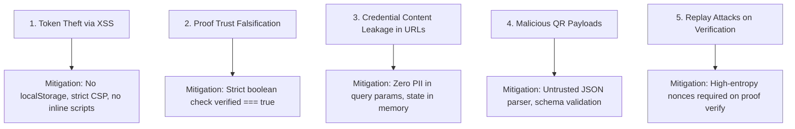

# Phase F2: Security, Privacy & Sensitive Data Flow Specification

**Project:** Zero-Knowledge Document Verification Platform  
**Document ID:** ZKDOC-FE-F2-004  
**Status:** Approved Security Specification  
**Target Implementation Phases:** F3 through F12  

---

## 1. Executive Summary

This specification establishes the security boundaries, authentication lifecycles, sensitive data classifications, memory hygiene rules, and threat mitigations for the Zero-Knowledge Document Verification Platform frontend.

The frontend operates in an adversarial environment where client-side state is vulnerable to inspection and cross-site scripting (XSS). This document enforces strict policies ensuring:
1. Zero storage of cryptographic private keys or raw blinding factors in persistent browser storage.
2. In-memory zeroization of sensitive Zero-Knowledge proof buffers upon completion of proving actions.
3. Strict Content Security Policy (CSP) alignment with Spring Boot's security configuration.
4. Total elimination of the legacy frontend's insecure mock token generation vulnerability.

---

## 2. Authentication, Session & Token Architecture

### 2.1 Backend OAuth2 Resource Server Constraints
The backend operates strictly as an OAuth2 Resource Server configured via `SecurityConfig.java` and `JwtAuthenticationFilter.java`:
- **Token Type:** RS256 or PS256 JSON Web Tokens (JWT).
- **Key Verification:** Tokens must contain a `kid` header present in `KeyRegistryService` with key purpose `JWT_SIGNING`.
- **Issuer (`iss`):** Must match `https://auth.zkdoc.internal`.
- **Audience (`aud`):** Must match `zkdoc-api`.
- **Authority Claims:** Extracted from the `roles` (or `scope`) claim array: `ROLE_ADMIN`, `ROLE_ISSUER`, `ROLE_HOLDER`.
- **No In-Band Login Endpoint:** The Spring Boot backend does not host a username/password or token-issuance endpoint. Authentication tokens are issued out-of-band by the internal identity provider or generated via administrative tools.

### 2.2 Token Storage Evaluation & Security Decision

| Storage Mechanism | XSS Vulnerability | CSRF Vulnerability | Multi-Tab Sync | Session Persistence | Final Decision |
| :--- | :---: | :---: | :---: | :---: | :--- |
| **`localStorage`** | **CRITICAL RISK** (Permanent exposure) | Immune | Yes | Survives browser restart | **PROHIBITED** |
| **`sessionStorage`** | **LOW/MEDIUM** (Scoped to single tab) | Immune | No | Survives tab reload only | **PERMITTED (Optional Session Restore)** |
| **In-Memory Store (Zustand)** | **LOWEST** (Lost on tab close / crash) | Immune | No | Lost on page refresh | **PRIMARY (Default Token Store)** |
| **HttpOnly Secure Cookie** | Immune to JavaScript XSS | Vulnerable without CSRF token | Yes | Configurable | Unusable (Backend does not support cookie auth) |

**Architectural Decision:** 
- The JWT is held in **in-memory Zustand state** during active usage.
- An optional opt-in allows storing the token in `sessionStorage` strictly to survive deliberate page reloads during active developer sessions.
- Tokens are **never written to `localStorage`**, IndexedDB, or URL query parameters.

### 2.3 Interactive Developer Connect Workflow
To replace the legacy security vulnerability (`demo-signature-for-development-eval` mock tokens), the new frontend provides a dedicated **"Connect Developer JWT" Modal**:
1. Allows operators, verifiers, and administrators to paste a valid signed JWT.
2. Client-side parser decodes claims (`sub`, `roles`, `exp`) and displays token status and remaining validity without trusting unverified signatures.
3. Automatically attaches `Authorization: Bearer <token>` to all subsequent API requests.
4. An automated session countdown timer tracks token expiration (`exp`) and prompts the user before the session becomes invalid.

---

## 3. Sensitive Data Classification & Flow Matrix

Every data asset handled by the frontend is classified and governed by strict lifetime and disposal rules:

| Data Asset | Classification | Source | In Browser Memory? | In Browser Storage? | In URLs / Params? | In Console Logs? | Lifetime in Browser | Disposal / Zeroization Policy |
| :--- | :---: | :--- | :---: | :---: | :---: | :---: | :--- | :--- |
| **JWT Bearer Token** | Confidential | Developer modal or IdP | Yes | `sessionStorage` (Opt-in) | **NO** | **NO** | Active session / Until `exp` | Cleared on disconnect or 401 response |
| **Raw Source Document** | Confidential | File input | Yes (Blob) | **NO** | **NO** | **NO** | Duration of upload request | Object URL revoked, buffer garbage collected |
| **Document SHA-256 Hash** | Public / Verified | Client calculation or API | Yes | No | **NO** | Yes (Debug) | Page lifecycle | Standard GC |
| **Credential Plaintext Attributes** | Sensitive PII | Holder / Issuer API | Yes | No | **NO** | **NO** | Modal lifecycle | Wiped on modal close |
| **Cryptographic Blinding Factors** | Secret | Holder proof engine | Yes | **NO** | **NO** | **NO** | Transient (< 1 second) | **Active zeroization (`Uint8Array.fill(0)`)** |
| **Proof Nonce (`nonceHex`)** | Restricted | Crypto random generator | Yes | No | **NO** | Yes (Trace) | Single proof request | Discarded after API response |
| **Proof Bytes (`proofBytes`)** | Public / Verifiable | Backend ZKP engine | Yes (Base64) | No | **NO** | **NO** | Verification lifecycle | Discarded after verification completes |
| **QR Code Payload** | Untrusted Input | Camera scanner / File | Yes | No | **NO** | **NO** | Scanning session | Validated against JSON schema, cleared |
| **Audit Logs** | Restricted | Audit API | Yes | No | Query filters only | No | View lifecycle | Replaced on pagination |

---

## 4. Cryptographic Memory Hygiene & Zeroization

Zero-knowledge proofs rely on secret commitments and blinding factors that must never linger in browser heap memory:
1. **Memory Zeroization Helper:**
   ```typescript
   export function zeroizeBuffer(buffer: Uint8Array | null | undefined): void {
     if (buffer && buffer instanceof Uint8Array) {
       buffer.fill(0);
     }
   }
   ```
2. **Modal Teardown Hooks:** All components handling proving material or sensitive credential attributes execute cleanup routines upon unmounting:
   ```typescript
   useEffect(() => {
     return () => {
       zeroizeBuffer(proofBufferRef.current);
       sensitiveDataRef.current = null;
     };
   }, []);
   ```
3. **No Redux / Global State for Proof Secrets:** Proving parameters are confined strictly to component-local closures and discarded immediately after dispatch.

---

## 5. Frontend Threat Modeling & Mitigation Strategies



### 5.1 Threat 1: Cross-Site Scripting (XSS) & Token Exfiltration
- **Risk:** Malicious scripts injected into the DOM reading authentication tokens or secret credentials.
- **Mitigation:**
  - Strict Content Security Policy configured by Spring Boot:
    `default-src 'self'; script-src 'self'; style-src 'self' 'unsafe-inline'; connect-src 'self'; object-src 'none'; frame-ancestors 'none'`.
  - Zero usage of `eval()`, `dangerouslySetInnerHTML`, or remote CDN scripts.
  - React's native JSX escaping prevents HTML injection.

### 5.2 Threat 2: Cryptographic Trust Falsification (Legacy Bug)
- **Risk:** The frontend displays green "Verified" badges when a proof was actually rejected by the backend (as discovered in the F1 audit).
- **Mitigation:**
  - Status logic enforces strict identity:
    `const isVerified = response.verified === true;`
  - Explicit tests assert that `undefined`, `null`, `false`, or `{}` input NEVER produces a positive verification state.

### 5.3 Threat 3: Sensitive Data Leakage in URLs or Referrers
- **Risk:** Credential IDs, document hashes, or attributes leaking into server logs or browser histories via URL query parameters.
- **Mitigation:**
  - URL routes carry only opaque IDs for public references (e.g. `/verify?id=...`).
  - Sensitive proving inputs, attributes, and nonces are transmitted strictly via HTTP request bodies.

### 5.4 Threat 4: Malicious QR Payloads & Injection
- **Risk:** An attacker presents a malicious QR code containing executable JavaScript, SQL injection strings, or buffer overflow patterns.
- **Mitigation:**
  - The QR reader treats all input as completely untrusted.
  - Payloads are passed through strict Zod schema validation:
    ```typescript
    export const CanonicalQrSchema = z.object({
      v: z.literal('QR_V1'),
      m: z.string().min(1).max(512),
      c: z.string().uuid().optional(),
    });
    ```
  - Unrecognized or malformed QR payloads are rejected immediately with a friendly warning.

---

## 6. Security Testing & Acceptance Gates (Phase F10 Quality Gate)

Before the frontend rebuild can be certified for production, the following security verifications must pass:
1. **CSP Compliance Check:** Verify that zero inline scripts or blocked resources trigger browser console CSP violations during E2E testing.
2. **Storage Audit:** Inspect `localStorage` after executing complete issuer, holder, and admin workflows; verify that `localStorage` is 100% empty.
3. **Falsification Regression Test:** Execute Vitest assertion verifying that `PredicateVerificationPage` renders red "PROOF REJECTED" when backend returns `{ verified: false }`.
4. **Memory Cleanup Test:** Unit test proves `zeroizeBuffer()` successfully wipes target byte arrays.
5. **No Token in Headers on Public Routes:** Verify that anonymous verification requests (`/api/verifier/*`, `/api/v2/zkp/*`) do not leak user bearer tokens.
