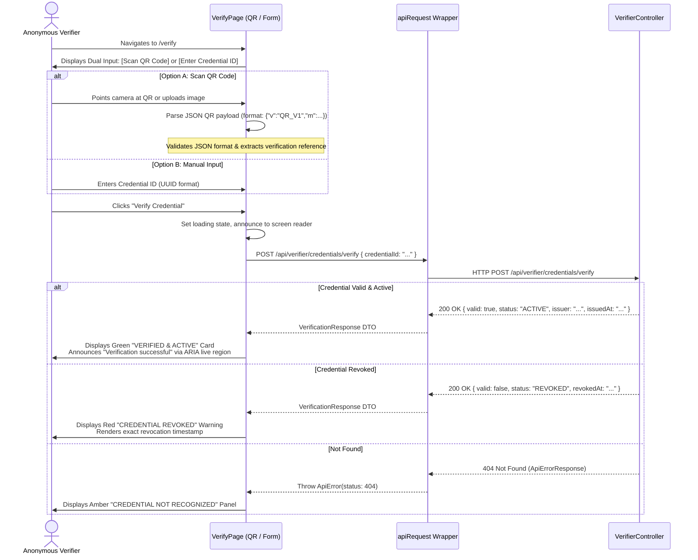
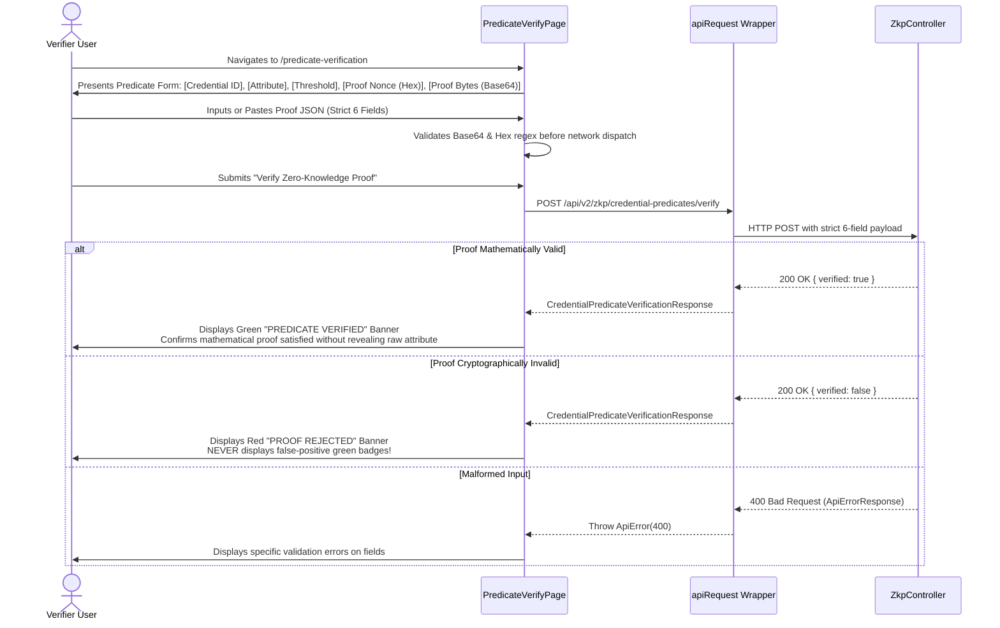
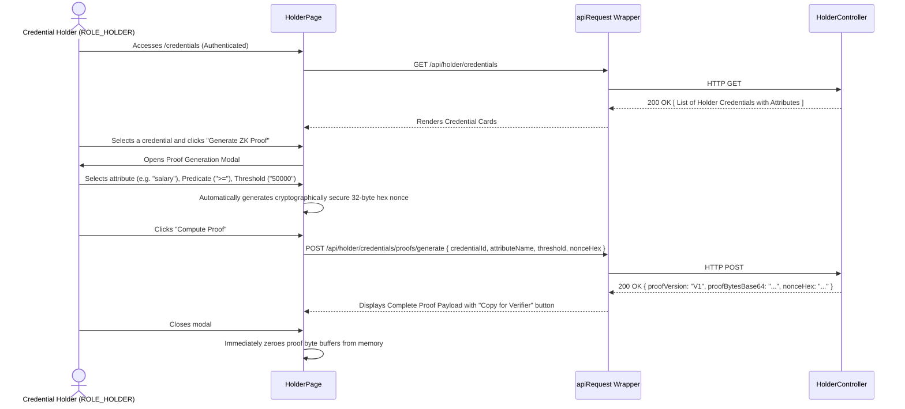

# Phase F2: UX and Route Specification

**Project:** Zero-Knowledge Document Verification Platform  
**Document ID:** ZKDOC-FE-F2-002  
**Status:** Approved UX Specification  
**Target Implementation Phases:** F3 through F12  

---

## 1. Executive Summary

This document specifies the complete user experience (UX), routing structure, role permissions, interaction states, and user journeys for the Zero-Knowledge Document Verification Platform.

The UX design adheres to Nielsen’s 10 Usability Heuristics, mobile-first design patterns, and WCAG 2.2 Level AA accessibility standards. The user interface prioritizes cryptographic precision, transparent system status, minimal data disclosure, and zero false-positive visual feedback.

---

## 2. Roles, Permissions & Authorization Model

The application aligns strictly with the backend Spring Security authorization model configured in `SecurityConfig.java`:

| Role Name | Access Scope | Supported Capabilities in UI |
| :--- | :--- | :--- |
| **Anonymous Public Verifier** | Unauthenticated | • Verify credentials by ID or QR code reference<br>• Evaluate Zero-Knowledge Predicate proofs anonymously<br>• Inspect public key registry status (`GET /api/keys/status`) |
| **Credential Holder** (`ROLE_HOLDER`) | Authenticated | • View owned credentials and cryptographic commitments<br>• Inspect credential lifecycle status (ACTIVE, REVOKED, EXPIRED)<br>• Generate Zero-Knowledge Predicate proofs with custom nonces<br>• Export proving artifacts for selective disclosure |
| **Credential Issuer** (`ROLE_ISSUER`) | Authenticated | • Upload source documents with SHA-256 integrity calculation<br>• Issue multi-attribute cryptographic credentials<br>• Revoke issued credentials with cryptographic audit trail<br>• Generate downloadable QR codes for issued credentials<br>• Inspect platform audit logs |
| **Platform Administrator** (`ROLE_ADMIN`) | Authenticated | • Inspect cryptographic key registry and active signing keys<br>• Trigger manual key rotation (`POST /api/admin/keys/rotate`)<br>• Reconcile system recovery status (`POST /api/admin/recovery/reconcile`)<br>• Filter and inspect immutable platform audit log chains |

*Security Rule:* Frontend role checks are UX enhancements for conditional rendering and navigation convenience. True authorization is enforced authoritatively on the backend by Spring Security on every API call.

---

## 3. Comprehensive Route & Page Matrix

| Route Path | Page Component | Access | Required Role | Backend API Dependency | Handled Sensitive Data | Navigation Access | Error / Denied States | Target Phase |
| :--- | :--- | :---: | :---: | :--- | :--- | :--- | :--- | :---: |
| `/` | `HomePage` | Public | None | None | None | Main Navbar, Logo | None | F5 |
| `/verify` | `VerifyPage` | Public | None | `POST /api/verifier/credentials/verify`<br>`GET /api/verifier/credentials/{id}` | Credential ID, QR payload (Untrusted) | Navbar "Verify", Home CTA | `404 Not Found`<br>`400 Invalid ID Format` | F8 |
| `/verification` | `VerifyPage` | Public | None | (Same as `/verify`) | (Same as `/verify`) | Legacy route alias | (Same as `/verify`) | F8 |
| `/predicate-verification` | `PredicateVerifyPage` | Public | None | `POST /api/v2/zkp/credential-predicates/verify` | Proof bytes, nonce, threshold | Navbar "ZK Predicates" | `400 Bad Request`<br>`422 Invalid Proof` | F9 |
| `/credentials` | `HolderPage` | Protected | `ROLE_HOLDER` | `GET /api/holder/credentials`<br>`POST /api/holder/credentials/proofs/generate` | Credential attributes, raw values, blinding factors in memory | Navbar "My Credentials" | `401 Unauthorized`<br>`403 Forbidden` | F7 |
| `/issuer` | `IssuerPage` | Protected | `ROLE_ISSUER` | `POST /api/issuer/documents/upload`<br>`POST /api/issuer/credentials/issue`<br>`POST /api/issuer/credentials/{id}/revoke` | Raw document bytes, plaintext attributes, recipient public key | Navbar "Issuer Console" | `401 Unauthorized`<br>`403 Forbidden` | F6 |
| `/audit-logs` | `AuditLogsPage` | Protected | `ROLE_ADMIN`, `ROLE_ISSUER` | `GET /api/audit/logs` | User identifiers, IP hashes, correlation IDs | Navbar / Sidebar "Audit Logs" | `401 Unauthorized`<br>`403 Forbidden` | F9 |
| `/administration` | `AdministrationPage` | Protected | `ROLE_ADMIN` | `GET /api/keys/status`<br>`POST /api/admin/keys/rotate`<br>`POST /api/admin/recovery/reconcile`<br>`GET /api/admin/recovery/status` | Key identifiers, algorithm names, node health metrics | Navbar / Sidebar "Admin" | `401 Unauthorized`<br>`403 Forbidden` | F9 |
| `/forbidden` | `ForbiddenPage` | Public | None | None | None | Automatic redirect on 403 | None | F4 |
| `*` | `NotFoundPage` | Public | None | None | None | Automatic fallback | None | F4 |

---

## 4. Navigation Architecture & Responsive Shell

### 4.1 Navigation Hierarchy
```
Global App Shell
├── Skip-to-Content Link (Keyboard focus target: #main-content)
├── Top Header Navigation
│   ├── Brand Identity: Logo + "Zero-Knowledge Verifier"
│   ├── Desktop Nav Links:
│   │   ├── Public: [Home], [Verify Credential], [ZK Predicates]
│   │   ├── Role-Gated (Holder): [My Credentials]
│   │   ├── Role-Gated (Issuer): [Issuer Workspace]
│   │   └── Role-Gated (Admin): [Administration], [Audit Logs]
│   ├── Actions Section:
│   │   ├── Platform Health Badge (Live Actuator status)
│   │   └── Authentication Control:
│   │       ├── Unauthenticated: "Connect Developer JWT" Button
│   │       └── Authenticated: User Badge (`sub`), Role Pills, "Disconnect" Button
│   └── Mobile Hamburger Toggle (Viewport < 768px)
├── Mobile Navigation Drawer (Radix Dialog with Slide-over)
│   └── Vertical stack of all accessible routes matching active role
├── Main Content Container (`<main id="main-content" role="main">`)
│   ├── Page Title & Breadcrumbs
│   └── Route View (Wrapped in React.Suspense with accessible Skeleton)
└── Accessible Footer
    ├── System Status: Active Key Registry Version & Actuator State
    ├── Cryptographic Notice: Zero-Knowledge proofs verified client/server side
    └── Source & Contract Links
```

### 4.2 Active Route Indication & Breadcrumbs
- **Active Navigation Style:** Active links display `text-indigo-600 dark:text-indigo-400 font-semibold border-b-2 border-indigo-600` and include `aria-current="page"`.
- **Breadcrumbs:** Provided on all deep child workflows (e.g., `Home > Verifier > Predicate Proof #8f92a`). All ancestor links are actionable; the current page is marked with `aria-current="location"`.

---

## 5. End-to-End User Journey Specifications

### 5.1 Journey 1: Public Credential Verification (Anonymous)



---

### 5.2 Journey 2: Zero-Knowledge Predicate Proof Evaluation (Anonymous)

This journey enables evaluating an attribute claim (e.g., `Age >= 21` or `Income >= 50000`) without revealing the underlying sensitive attribute value:



---

### 5.3 Journey 3: Credential Issuance Lifecycle (Issuer)

```mermaid
sequenceDiagram
    actor Issuer as Credential Issuer (ROLE_ISSUER)
    participant UI as IssuerPage
    participant Client as apiRequest Wrapper
    participant Backend as IssuerController

    Issuer->>UI: Accesses /issuer (Authenticated)
    UI->>Issuer: Displays Issuer Workspace: [Upload Document] & [Issue Credential]
    
    rect rgb(240, 245, 255)
        Note over Issuer, Backend: Step 1: Document Upload & Digest Calculation
        Issuer->>UI: Selects file (PDF/JSON/PNG)
        UI->>UI: Calculates client-side SHA-256 for instant feedback
        Issuer->>UI: Clicks "Upload Document"
        UI->>Client: POST /api/issuer/documents/upload (multipart/form-data)
        Client->>Backend: HTTP POST
        Backend-->>Client: 200 OK { documentId: "doc-123", hash: "..." }
        Client-->>UI: Auto-populates document ID in Issuance Form
    end

    rect rgb(245, 255, 240)
        Note over Issuer, Backend: Step 2: Multi-Attribute Issuance
        Issuer->>UI: Enters Holder ID, Credential Schema, and Attributes (Name/Value pairs)
        Issuer->>UI: Clicks "Issue Signed Credential"
        UI->>Client: POST /api/issuer/credentials/issue { documentId, holderId, attributes }
        Client->>Backend: HTTP POST
        Backend-->>Client: 201 Created { credentialId: "cred-456", qrPayload: "...", issuedAt: "..." }
        Client-->>UI: Displays Success Dialog with Rendered QR Code
        Issuer->>UI: Can download QR PNG or copy Canonical Reference
    end

    rect rgb(255, 245, 245)
        Note over Issuer, Backend: Step 3: Revocation (When Needed)
        Issuer->>UI: Clicks "Revoke" on an issued credential row
        UI->>Issuer: Displays Destructive Confirmation Modal
        Issuer->>UI: Confirms revocation reason
        UI->>Client: POST /api/issuer/credentials/{id}/revoke { reason: "..." }
        Client->>Backend: HTTP POST
        Backend-->>Client: 200 OK { status: "REVOKED", revokedAt: "..." }
        UI->>UI: Invalidate TanStack query cache; table row updates to REVOKED
    end
```

---

### 5.4 Journey 4: Holder Wallet & ZKP Proof Generation (Holder)



---

### 5.5 Journey 5: Administrator Operations & Audit Trail (Admin)

```mermaid
sequenceDiagram
    actor Admin as Platform Admin (ROLE_ADMIN)
    participant UI as Admin & Audit Pages
    participant Client as apiRequest Wrapper
    participant Backend as Admin / Audit Controllers

    Admin->>UI: Accesses /administration
    UI->>Client: GET /api/keys/status & GET /api/admin/recovery/status
    Client->>Backend: Parallel HTTP GETs
    Backend-->>Client: Returns Key Registry & Node Status
    Client-->>UI: Displays Key Table & Node Status Indicators
    
    Admin->>UI: Clicks "Rotate Signing Key"
    UI->>Admin: Displays High-Impact Confirmation Prompt
    Admin->>UI: Confirms Key Rotation
    UI->>Client: POST /api/admin/keys/rotate
    Client->>Backend: HTTP POST
    Backend-->>Client: 200 OK { newKeyId: "key-2026-v2", rotatedAt: "..." }
    Client-->>UI: Updates Key status table; emits success toast

    Admin->>UI: Navigates to /audit-logs
    UI->>Client: GET /api/audit/logs?page=0&size=20
    Client->>Backend: HTTP GET
    Backend-->>Client: 200 OK { content: [...], totalPages: 5 }
    Client-->>UI: Renders Paginated Audit Log Table with SHA-256 chain verification
```

---

## 6. Verification Result State Language & Semantics

To prevent misinterpretation of cryptographic guarantees, the UI enforces precise, unambiguous semantic states:

| UI Badge / Banner | Semantic Meaning | Required Backend Condition | Visual Style |
| :--- | :--- | :--- | :--- |
| **`VERIFIED & ACTIVE`** | The credential was signed by a registered issuer key, the cryptographic signature is valid, and the status is active. | `valid === true && status === 'ACTIVE'` | Green badge with check-circle icon |
| **`CREDENTIAL REVOKED`** | The credential signature is authentic, but the credential has been revoked by the issuer. | `status === 'REVOKED'` | Red badge with alert-octagon icon |
| **`CREDENTIAL EXPIRED`** | The credential signature was authentic, but the validity window has elapsed. | `status === 'EXPIRED'` | Amber badge with clock icon |
| **`PREDICATE SATISFIED`** | The Zero-Knowledge proof proves mathematically that the hidden attribute satisfies the threshold claim. | `verified === true` (from `/v2/zkp/*`) | Green badge with shield-check icon |
| **`PROOF REJECTED`** | The submitted Zero-Knowledge proof failed cryptographic verification. | `verified === false` (from `/v2/zkp/*`) | Red badge with x-circle icon |
| **`NOT RECOGNIZED`** | No credential with this identifier exists in the platform registry. | HTTP 404 response | Neutral gray badge with help-circle icon |
| **`VERIFICATION UNAVAILABLE`** | Network error, timeout, or backend node in recovery mode. | Network failure or 503 response | Amber badge with refresh-cw icon |

*Rule:* The frontend will NEVER display a badge indicating mathematical validity or signature integrity unless the backend explicitly asserts `true`. If a property is missing or `undefined`, it defaults to an unverified state.

---

## 7. Responsive & Accessible UX Standards

### 7.1 Breakpoints & Layout Adaptations
- **Mobile (< 768px):**
  - Navigation converts into a slide-over drawer triggered by an accessible hamburger button (`aria-expanded`, `aria-controls`).
  - High-density data tables (Credential Lists, Audit Logs) automatically transform into stacked, accessible `<article>` cards.
  - Form actions stick to bottom viewport with `pb-safe` for mobile touch accessibility.
- **Tablet (768px – 1024px):**
  - Grid layouts collapse to 2 columns.
  - Action buttons maintain full 44x44px touch targets.
- **Desktop (> 1024px):**
  - Full tabular layouts with sortable column headers.
  - Side-by-side verification consoles (QR Scanner + Manual Input).

### 7.2 Accessibility (WCAG 2.2 Level AA Mandates)
1. **Focus Rings:** Distinct, non-overlapping focus indicator on all interactive components: `focus-visible:ring-2 focus-visible:ring-indigo-600 focus-visible:ring-offset-2`.
2. **Keyboard Bypass:** Top-level skip link: `<a href="#main-content" className="sr-only focus:not-sr-only">Skip to main content</a>`.
3. **Screen Reader Announcements:** Dynamic verification results, QR scanning status, and toast notifications announced via `<div role="status" aria-live="polite">`.
4. **Form Association:** Every input has a hard-linked `<label htmlFor="id">` and error message `<span id="error-id" role="alert">` connected via `aria-describedby`.
