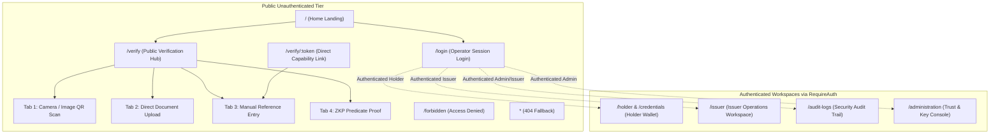

# Phase 2 — Frontend UX Strategy & Information Architecture
## Zero-Knowledge Document Verification Platform

---

## 1. Executive Summary & Mission

### 1.1 Engagement Purpose
This document establishes the strategic user experience (UX) blueprint and information architecture (IA) for the **Zero-Knowledge Document Verification Platform**, completing **Phase 2: UX Research & User Journey Planning**.

Building directly upon the verified baseline established in Phase 1 ([`FRONTEND_PHASE_1_AUDIT_REPORT.md`](file:///c:/Sabareesh/Easwari%20College/Semester%203/OOPs%20with%20Java/Project/Start%20over/Zero%20Knowledge%20Document%20Verification/docs/frontend-audit/FRONTEND_PHASE_1_AUDIT_REPORT.md)), this strategy bridges backend cryptographic capabilities (SHA-256 integrity hashing, RSA-2048/4096 digital signatures, W3C Verifiable Credentials, and Weavechain Bulletproofs zero-knowledge range proofs) with accessible, intuitive, and privacy-preserving user interfaces.

### 1.2 Core Strategic Mandates
1. **Strict Decoupling of Verification Modalities:** The platform must treat **QR-code verification** and **Direct document file verification** as completely independent, parallel verification paths. A verifier possessing an original document must never be forced to scan a QR code, and a verifier scanning a QR code must never be forced to provide the original document file.
2. **Progressive Disclosure of Cryptography:** Complex mathematical constructs (hexadecimal digests, RSA public key fingerprints, Merkle hash chains, Bulletproofs commitments) must never be presented as barriers to task completion. Interfaces will present high-level, human-readable authenticity statuses by default, while offering expandable technical inspection drawers for auditors and security professionals.
3. **Honest Terminology & Zero-Knowledge Boundaries:** The UX copy will accurately distinguish between standard digital signatures (authenticity/integrity with full disclosure) and genuine zero-knowledge predicate proofs (mathematical proof of an attribute condition without disclosing underlying values). Unsupported claims of "zero-knowledge encryption" for simple document uploads are strictly prohibited.
4. **Universal Accessibility (WCAG 2.1 AA):** All workflows, including high-stakes document upload and camera-based QR scanning, must support keyboard-only navigation, screen-reader accessibility, non-color-dependent outcome signaling, and clear error recovery.

---

## 2. Incorporation of Phase 1 Technical Findings

The UX strategy directly integrates the empirical findings and constraints identified in Phase 1:

| Phase 1 Finding | Severity | UX Strategy Remediation & Constraint |
| :--- | :---: | :--- |
| **Monolithic Bundle Size (1.04 MB)** (`FE-AUDIT-001`) | Medium | The IA defines clean route boundaries allowing heavy dependencies (`@zxing/browser`, Lucide icon sets, Admin/Audit tables) to be lazily loaded via `React.lazy()` without impacting the initial public verification landing speed. |
| **Modal Focus Trapping Gaps** (`FE-AUDIT-002`) | Medium | All planned modal flows (Credential Detail, Key Rotation, PEM Inspection, Suspension Confirmation) specify strict keyboard focus containment, `Esc` dismissibility, and focus restoration to the trigger button. |
| **Form Error ARIA Associations** (`FE-AUDIT-003`) | Low | Form interaction designs mandate explicit `aria-describedby` links between inputs and error spans, and require form fields to announce errors immediately upon field blur or form submission. |
| **Missing Upload Progress Indication** (`FE-AUDIT-004`) | Low | Drag-and-drop file upload specifications define staged feedback: File Selected -> Client Validation -> Uploading (with determinate percentage bar up to 25 MB) -> Backend Cryptographic Processing -> Completed. |
| **Camera Permission Fallback** (`FE-AUDIT-006`) | Low | Camera scanning UX incorporates explicit step-by-step browser permission recovery instructions, immediate fallback to manual verification token entry, and file upload of QR images. |
| **Session Persistence in `sessionStorage`** | Architectural | The authentication UX reflects tab-scoped session boundaries: closing the browser tab terminates the authenticated session, protecting shared workstations in enterprise environments. |

---

## 3. Evidence-Based Provisional User Profiles

In accordance with empirical UX research discipline, fictional demographic personas have been avoided. Instead, provisional behavioral profiles are defined based on verified backend roles and endpoint permissions:

### Profile 1: The Public Document Verifier (Unauthenticated / Anonymous)
- **Primary Objective:** Quickly determine whether a credential, certificate, or document is genuine, untampered, and issued by an authorized authority.
- **Context & Environment:** Mobile smartphone scanning a printed certificate at a checkpoint, or desktop browser verifying a received PDF attachment. Low tolerance for latency; zero desire to create an account or learn cryptographic terminology.
- **Key Pain Points:** Confusion when asked for a QR code if they only have a PDF; fear of uploading private personal documents to an untrusted web service; cryptic error messages like "Hash mismatch" instead of plain explanations.
- **Permitted Workflows:** Public QR verification, Public Direct Document verification, Public Capability verification, Public ZKP Predicate verification.

### Profile 2: The Credential Holder (Role: `HOLDER` / `ADMIN`)
- **Primary Objective:** Manage their issued credentials, review selective disclosure capabilities, generate zero-knowledge range proofs (e.g. proof of age/income), and manage credential lifecycle (self-suspension/reactivation).
- **Context & Environment:** Desktop or mobile personal dashboard. Needs reassurance that their private attributes are not leaked to verifiers.
- **Key Pain Points:** Uncertainty over what data is revealed when sharing a verification QR code; complex JSON payloads in proof generation.
- **Permitted Workflows:** Wallet inspection, provision credential, generate Bulletproofs predicate proof, view lifecycle audit history, request credential suspension.

### Profile 3: The Authorized Institutional Issuer (Role: `ISSUER` / `ADMIN`)
- **Primary Objective:** Register official organization documents (producing SHA-256 hashes and RSA digital signatures), issue W3C-compliant Verifiable Credentials, manage status lifecycles, and generate verifiable QR capabilities.
- **Context & Environment:** Enterprise desktop workstation. Frequent, batch-oriented document registration. High focus on regulatory compliance and non-repudiation.
- **Key Pain Points:** Slow upload feedback on large files (up to 25 MB); accidental duplicate registrations; lack of audit trail visibility over issued credentials.
- **Permitted Workflows:** Document registration dropzone, credential issuance wizard, credential lifecycle transitions (Suspend, Resume, Revoke), capability generation, issuer activity logs.

### Profile 4: The Platform Trust Administrator (Role: `ADMIN`)
- **Primary Objective:** Maintain cryptographic trust anchors, register and rotate authorized RSA public keys, monitor Merkle audit event integrity, and oversee system recovery status.
- **Context & Environment:** Secure desktop terminal with dual-factor security expectations. Highly technical, precision-driven operator.
- **Key Pain Points:** Inadvertent submission of private keys to public registries; lack of cryptographic verification tooling for tamper-evident audit logs.
- **Permitted Workflows:** Key registry management, key status rotation, zero-private-key submission guardrails, Merkle audit chain verification, system recovery reconciliation.

---

## 4. User-Role & Permissions Matrix

| User Type | Confirmed by Backend? | Primary Goal | Allowed Actions | Sensitive Information Exposed | Open Questions |
| :--- | :---: | :--- | :--- | :--- | :--- |
| **Public Verifier** | Yes (Public Endpoints) | Fast, reliable document verification | Scan QR, upload file for direct hash check, submit capability token, verify ZKP predicate | Verification outcome, issuer name, issuance date (Document content **hidden**) | Should verification history be stored in browser `sessionStorage`? |
| **Credential Holder** | Yes (`ROLE_HOLDER`) | Manage identity credentials & proofs | View wallet, provision credential, generate range proofs, suspend/activate own credential | Full credential claims, personal identifiers, cryptographic secrets | Should holders be allowed to permanently revoke or only suspend? |
| **Institutional Issuer** | Yes (`ROLE_ISSUER`) | Issue documents & credentials | Register documents (upload), issue credentials, suspend/resume/revoke, download QR codes | Uploaded document contents, recipient claim data, activity logs | Is bulk CSV/JSON credential issuance required in Phase 6? |
| **Platform Administrator** | Yes (`ROLE_ADMIN`) | Manage trust root & system health | Register/rotate public keys, inspect audit events, verify Merkle chain, trigger recovery | Public key PEMs, audit events, actor IP addresses, system telemetry | Can administrators view raw document contents? (Recommendation: **No**) |

---

## 5. Foundational UX Design Principles

1. **Clarity Before Cryptography:** Always show the plain-language operational outcome first. Never force users to understand SHA-256, RSA-PSS, or Bulletproofs to know whether a diploma or ID is valid.
2. **Autonomous Verification Channels:** Keep QR verification and Direct File verification completely independent. Never cross-contaminate flows by demanding a QR code during a file upload or demanding a raw file during a QR scan.
3. **Privacy by Default & Minimal Disclosure:** Verification views reveal only what is strictly necessary to establish trust: Verification Status, Issuer Organization, Issuance Date, and Document Reference. Plaintext document contents and sensitive personal claims remain strictly concealed unless authorized.
4. **Forgiving Interactions & Preserved Work:** Never clear user inputs or uploaded files when a validation error occurs. When a network error interrupts processing, allow instantaneous retry without re-selecting files.
5. **Consequence-Revealing Language:** Action buttons must clearly articulate their real-world impact. Use "Register & Sign Document" instead of "Submit"; use "Verify Document Hash" instead of "Upload"; use "Revoke Credential Permanently" instead of "OK".
6. **Accessible Under Duress:** Design for high-stress, mobile verification environments (poor lighting, degraded cellular data, bright sunlight, noisy backgrounds). Ensure high-contrast status badges (exceeding 4.5:1), large touch targets (minimum 44x44 px), and non-color sensory cues.

---

## 6. Information Architecture (IA) Model

The application architecture is structured into four distinct functional tiers:
1. **Public Verification Tier:** Fast, frictionless, unauthenticated entry points for high-volume verification.
2. **Holder Identity Tier:** Privacy-preserving credential wallet and cryptographic proof generation workspace.
3. **Issuer Operations Tier:** Multi-step document registration, digital signature creation, and credential lifecycle administration.
4. **Governance & Audit Tier:** Cryptographic key registry management, Merkle audit trail verification, and system telemetry.



---

## 7. Application Navigation Model

### 7.1 Public Navigation Bar
- **Logo / Brand Mark:** Link to `/` (Home).
- **Public Action Links:**
  - `Verify Document`: Primary CTA button navigating to `/verify` (defaults to active verification tab).
  - `About Platform`: In-page anchor or modal explaining privacy-preserving integrity architecture.
- **Session Controls:**
  - `Operator Login`: Links to `/login`. Displays active role badge (e.g., `ISSUER`, `ADMIN`) and `Disconnect` button when a session is active.

### 7.2 Authenticated Navigation (Dynamic by Role)
When a valid JWT session is established via `authStore`, the header dynamically displays authorized workspace links:
- **Holder Session (`ROLE_HOLDER`):** Shows `My Credentials` (`/holder`).
- **Issuer Session (`ROLE_ISSUER`):** Shows `Issuer Workspace` (`/issuer`), `Audit Logs` (`/audit-logs`).
- **Admin Session (`ROLE_ADMIN`):** Shows `Issuer Workspace` (`/issuer`), `Holder Workspace` (`/holder`), `Audit Logs` (`/audit-logs`), and `Administration` (`/administration`).

### 7.3 Mobile Drawer Navigation
On viewport widths `< 768px`, navigation collapses into an accessible slide-over drawer triggered by a high-contrast menu icon. The drawer includes:
- Prominent `Verify Now` button.
- Workspace navigation links (role-gated).
- Current session identity display (`sub` and `role`).
- Explicit `Disconnect Session` button.

---

## 8. Proposed Page & Screen Inventory

| Page or Screen | Target User | Strategic Purpose | Primary Actions | Backend Dependencies | Priority |
| :--- | :--- | :--- | :--- | :--- | :---: |
| **Home Landing** (`/`) | Public / All | Introduce platform capabilities, offer immediate verification entry points, explain trust model. | Navigate to `/verify`, Navigate to `/login`, read capability briefings. | None (Static) | **P1** |
| **Public Verification Hub** (`/verify`) | Public Verifier | Centralized verification console with independent tabs for all 4 verification modalities. | Scan camera QR, drop document file, enter capability token, submit ZKP range proof. | `/api/public/verify/*`, `/api/v2/zkp/*` | **P0** (Core) |
| **Deep-Linked Verification** (`/verify/:token`) | Public Verifier | Immediate verification of pre-encoded QR capabilities or external links. | Auto-load token verification, display authenticity certificate, copy reference. | `/api/public/verify/capability/{token}` | **P0** (Core) |
| **Operator Login** (`/login`) | Operators / Admin | Secure bearer JWT session establishment with live decoded claims preview and returnUrl redirect. | Paste token, toggle masking, preview claims, connect session. | RFC 8725 client parser (Zero backend auth endpoint) | **P0** (Core) |
| **Holder Wallet** (`/holder`, `/credentials`) | Credential Holder | Inspect held credentials, generate zero-knowledge range proofs, manage credential suspension. | Filter credentials, generate Bulletproofs, suspend/resume credential, copy capability QR. | `/api/holder/credentials/*` | **P1** |
| **Issuer Workspace** (`/issuer`) | Institutional Issuer | Register and sign documents (25 MB bound), issue credentials via wizard, manage statuses. | Drag-and-drop document upload, issue credential, toggle status (suspend/resume/revoke), inspect activity. | `/api/documents`, `/api/credentials/*` | **P1** |
| **Security Audit Logs** (`/audit-logs`) | Admin & Issuer | Review append-only security audit trail, verify cryptographic Merkle hash chain integrity. | Filter audit events by category, inspect event payload, trigger Merkle chain integrity proof. | `/api/admin/audit/events`, `/api/admin/audit/verify-integrity` | **P2** |
| **Admin Console** (`/administration`) | Platform Admin | Oversee cryptographic key registry, execute key rotation, monitor disaster recovery. | Register public key (zero private key guard), rotate key, check system health & recovery. | `/api/admin/keys/*`, `/api/admin/recovery/*` | **P2** |
| **Access Forbidden** (`/forbidden`) | Authenticated Users | Clear explanation when an operator attempts to access a route disallowed for their active role. | Switch active role, return to authorized workspace, disconnect session. | None (Static) | **P1** |
| **404 Not Found** (`*`) | Public / All | Friendly, helpful recovery screen for broken links or mistyped verification tokens. | Return to home, navigate to verification hub, search reference. | None (Static) | **P2** |

---

## 9. Privacy-by-Design & Information Disclosure Rules

To prevent accidental data exposure and maintain compliance with data privacy regulations (GDPR, CCPA), the frontend implements strict disclosure boundaries:

```
[Document / Credential Stored on Backend]
                 │
                 ▼
┌──────────────────────────────────────────────┐
│  Public Verification Result Screen           │
│                                              │
│  ✅ Status: Authentic & Verified             │
│  🏛️ Issuer: State University Registrar      │
│  📅 Issued At: Oct 24, 2026                 │
│  🔒 Verification Method: RSA-2048 Digital Sig│
│  🆔 Verification ID: cap-8f92-e41c           │
│                                              │
│  ❌ Plaintext Document Text: [HIDDEN]        │
│  ❌ Student Name / PII:     [HIDDEN]        │
│  ❌ GPA / Grade Details:     [HIDDEN]        │
│  ❌ Raw Private Keys:        [NEVER STORED]  │
└──────────────────────────────────────────────┘
```

### 9.1 Verification Result Disclosure Standards
1. **Never Display Plaintext Document Contents:** The public verification response will show metadata confirming authenticity without displaying the underlying document text or image.
2. **Masked Technical Identifiers:** Long hexadecimal strings (e.g., SHA-256 digests `e3b0c44298fc1c14...`) are rendered via [`FormattedHash`](file:///c:/Sabareesh/Easwari%20College/Semester%203/OOPs%20with%20Java/Project/Start%20over/Zero%20Knowledge%20Document%20Verification/frontend/src/components/data/FormattedHash.tsx) displaying the first 6 and last 4 characters (`0xe3b0...1c14`), with a one-click copy button and full string available only in an explicit modal drawer.
3. **Zero-Knowledge Proof Guarantees:** When displaying ZKP range proof verifications (Workflow D), the UI explicitly clarifies: *"The holder has mathematically proven that their attribute satisfies the criteria without revealing the underlying value."*

---

## 10. Accessibility (a11y) Architecture (WCAG 2.1 AA)

Accessibility is treated as a core product requirement across all features:

### 10.1 Multi-Sensory Outcome Signaling
Color alone is never used to convey verification states:
- **Verified / Authentic:** Green border + Checkmark icon (`CheckCircle2`) + Text label `"Authentic & Verified"` + Screen reader text `"Verification Successful: Document is authentic and integrity is verified."`
- **Tampered / Invalid:** Red border + Alert triangle icon (`AlertTriangle`) + Text label `"Integrity Compromised"` + Screen reader text `"Verification Failed: Document content has been altered or signature is invalid."`
- **Revoked / Inactive:** Amber border + Ban icon (`ShieldAlert`) + Text label `"Credential Revoked"` + Screen reader text `"Warning: This credential was revoked by the issuing authority."`

### 10.2 Keyboard Navigation & Focus Management
- **Skip Navigation:** A visible `<SkipLink />` at the top of every page bypasses header navigation directly to `<main id="main-content">`.
- **Focus Trapping in Modals:** When any modal or drawer opens, focus is programmatically shifted to the modal container, constrained within interactive elements using `Tab`/`Shift+Tab`, and returned to the trigger element when closed via `Esc` or button.
- **Form Error Association:** All inputs use `aria-invalid="true"` when invalid, linked via `aria-describedby="{fieldId}-error"` to the associated error message.

---

## 11. Responsive Layout & Device Strategy

The interface adapts across three primary device classes:

### 11.1 Mobile Viewports (320px – 767px)
- **Camera Viewfinder:** Full-width responsive container (1:1 aspect ratio) optimized for mobile back cameras (`facingMode: "environment"`).
- **Sticky Actions:** Critical actions (`Scan Again`, `Verify Another Document`) dock at the bottom of the viewport with a minimum touch target of 48x48 px.
- **Tab Swiping:** Verification mode tabs format as a horizontally scrollable chip bar with clear active indicators.

### 11.2 Tablet Viewports (768px – 1023px)
- **Split Layouts:** Verification forms display side-by-side with preview panels (e.g., QR scanner on left, live decoded verification summary on right).
- **Navigation:** Expanded header with condensed icon/text buttons.

### 11.3 Desktop Viewports (1024px+)
- **Two-Column Dashboard Grids:** Feature cards arrange into logical pairs (e.g., Document Upload Dropzone alongside Recent Issuer Activity Table).
- **Dense Data Displays:** Tabular audit logs display full columns (Timestamp, Event Type, Actor, Hash Chain Status) with pagination and search filters.

---

## 12. Terminology Dictionary & Content Style Guide

To maintain engineering honesty and eliminate user confusion, all interface copy must follow this terminology dictionary:

| Preferred Term | Intended Meaning | Terms to Strictly Avoid | Technical Qualification |
| :--- | :--- | :--- | :--- |
| **Verify Document** | Check authenticity and integrity against registered records. | "Authenticate Document", "Decrypt Document" | Does not reveal or alter document contents. |
| **Register & Sign** | Upload document, calculate SHA-256 hash, and sign digest with RSA private key. | "Encrypt Document", "ZKP Upload", "Save to Blockchain" | Standard public key cryptography and hashing. |
| **Authentic & Untampered** | SHA-256 digest matches registered record; digital signature is mathematically valid. | "100% Genuine Forever", "ZKP Verified" | Valid at time of verification check. |
| **Integrity Compromised** | Current file hash does not match original registered digest. | "Fake Document", "Virus Detected" | May indicate compression, conversion, or malicious modification. |
| **QR Verification Code** | QR matrix containing capability reference token. | "ZKP QR Code", "Secret QR Code" | Encodes a public verification capability reference. |
| **Zero-Knowledge Range Proof** | Bulletproofs cryptographic proof verifying a numerical claim (e.g., age >= 21) without revealing exact value. | "ZKP Hash", "Zero Knowledge Upload" | Restricted strictly to Workflow D predicate verifications. |
| **Credential Revoked** | Issuer has permanently terminated the validity of an issued credential. | "Deleted Credential", "Corrupt Credential" | Record exists in audit trail but is no longer valid. |
| **Capability Token** | Ephemeral or scoped token permitting verification without revealing document. | "Master Key", "Secret Token" | Opaque reference string managed by backend. |

---

## 13. Product Decisions & Boundary Register

| Decision ID | Topic | Current Verified Status | Recommended Default | Decision Impact |
| :--- | :--- | :--- | :--- | :--- |
| **DEC-UX-001** | Anonymous Public Verification | Backend supports unauthenticated `GET /api/public/verify/*` | **Permit fully anonymous verification without login.** | Reduces friction for third-party verifiers. |
| **DEC-UX-002** | Document Storage & Retention | Backend stores encrypted artifacts up to 25 MB in `JdbcArtifactStore` | **Disclose 25 MB limit; clarify that file is stored for signature validation.** | Prevents user confusion on file limits. |
| **DEC-UX-003** | Verification History Storage | Backend currently does not track anonymous public verification queries | **Store last 5 verifications in browser `sessionStorage` only.** | Provides user convenience without server-side tracking. |
| **DEC-UX-004** | Private Key Submission Defense | Admin key registration modal has client-side regex blocking `PRIVATE KEY` | **Enforce client-side check + backend HTTP 400 rejection.** | Protects against operator catastrophic error. |
| **DEC-UX-005** | Direct Document Verification Support | Backend supports `POST /api/public/verify/upload` (Multipart) | **Prominently feature direct upload as Tab 2 in verification hub.** | Guarantees non-QR documents can be verified easily. |

---

## 14. Scope Boundaries & Explicit Non-Goals for Phase 2

### In-Scope for Phase 2:
- Complete information architecture and navigation model.
- High-fidelity journey flowcharts and step-by-step specifications for Workflows A through F.
- Measurable, testable acceptance criteria for all user workflows.
- Accessible interaction specifications (focus management, ARIA linking, contrast guidelines).
- Resolution of open product decisions and definition of handover contracts for Phase 3.

### Explicitly Excluded (Out-of-Scope for Phase 2):
- Writing or modifying React component code (`.tsx` files).
- Modifying Tailwind CSS styles or creating production CSS tokens.
- Modifying Spring Boot backend controllers or database schemas.
- Installing new third-party dependencies.

---

## 15. Strategic Handover to Phase 3

Upon formal acceptance of this strategy, **Phase 3: Frontend Architecture & Design System** will translate these IA models and UX principles into:
1. Normalized design tokens in `frontend/src/styles/tokens.css` (semantic color mapping, spacing scales, typography).
2. Atomic component specifications (Buttons, Badges, Dropzones, Verification Status Banners, Dialogs).
3. Code-splitting architecture in `App.tsx` utilizing `React.lazy()` and Suspense fallbacks.
